

### [An Education Explorer for Public NCES Data](posts/education-explorer/index.llms.md)

[Schools, colleges and district boundaries on one map, with 25+ years of history](posts/education-explorer/index.llms.md)

A static, map-first dashboard for publicly available NCES data (CCD, PSS, IPEDS) for one U.S. state at a time, powered by DuckDB-WASM.

Oct 19, 2026

Pukar Bhandari

### [A Zero-Cost Freight Flow Explorer for Utah](posts/freight-explorer/index.llms.md)

[FAF origin-destination flows, DuckDB-WASM, and deck.gl — no backend required](posts/freight-explorer/index.llms.md)

A map-first explorer for the public Freight Analysis Framework (FAF) data, built as a static site that queries Parquet files directly in the browser.

Oct 19, 2026

Pukar Bhandari

[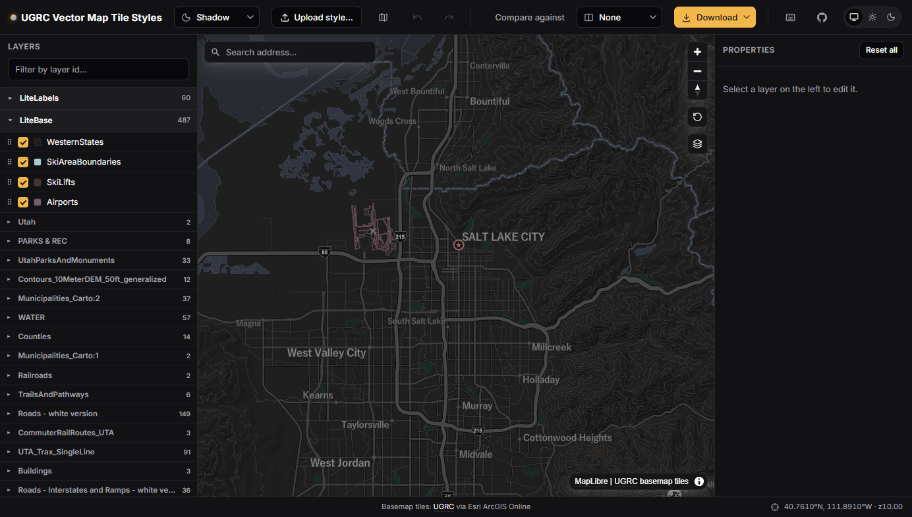](posts/ugrc-styles/index.llms.md)

### [Restyling Utah’s Vector Basemap for MapLibre](posts/ugrc-styles/index.llms.md)

[Dark and warm-light themes for UGRC’s Lite basemap, plus a browser-based style editor](posts/ugrc-styles/index.llms.md)

Alternate MapLibre styles for UGRC’s Lite vector basemap, generated from live upstream sources, and a visual editor to tweak, compare and download them.

Sep 29, 2026

Pukar Bhandari

[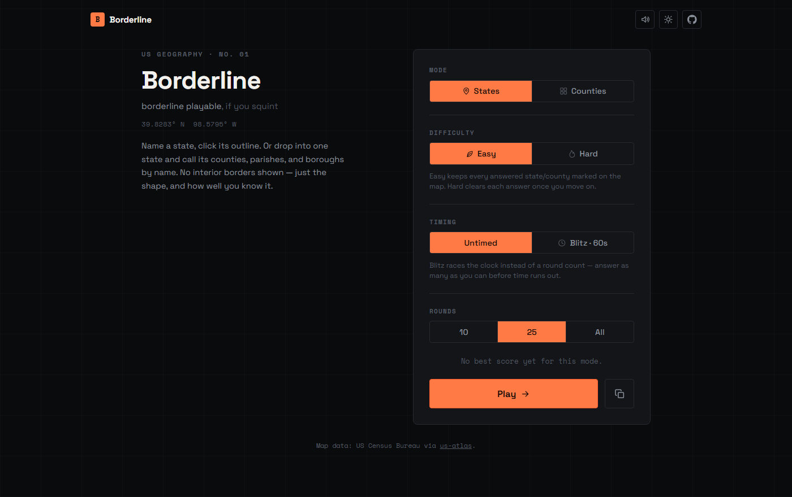](posts/borderline/index.llms.md)

### [Borderline: A U.S. Geography Guessing Game](posts/borderline/index.llms.md)

[Name a state, click its outline — no interior borders to give it away](posts/borderline/index.llms.md)

A browser geography game for U.S. states and counties, built as plain static HTML, CSS and JavaScript with no build step.

Sep 21, 2026

Pukar Bhandari

[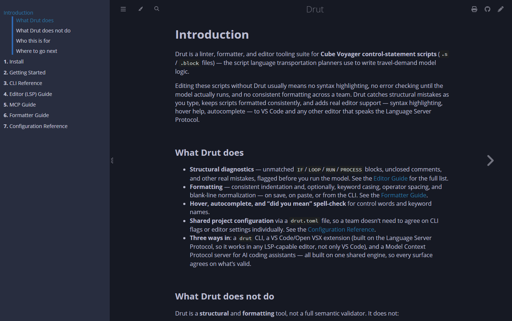](posts/drut/index.llms.md)

### [Drut: Linting and Formatting for Cube Voyager Scripts](posts/drut/index.llms.md)

[A Rust-based toolchain and VS Code extension for travel-demand model control-statement files](posts/drut/index.llms.md)

Drut is a linter, formatter and editor tooling suite for Cube Voyager scripts (.s / .block), with a CLI, a language server for VS Code, and an MCP server.

Aug 20, 2026

Pukar Bhandari

[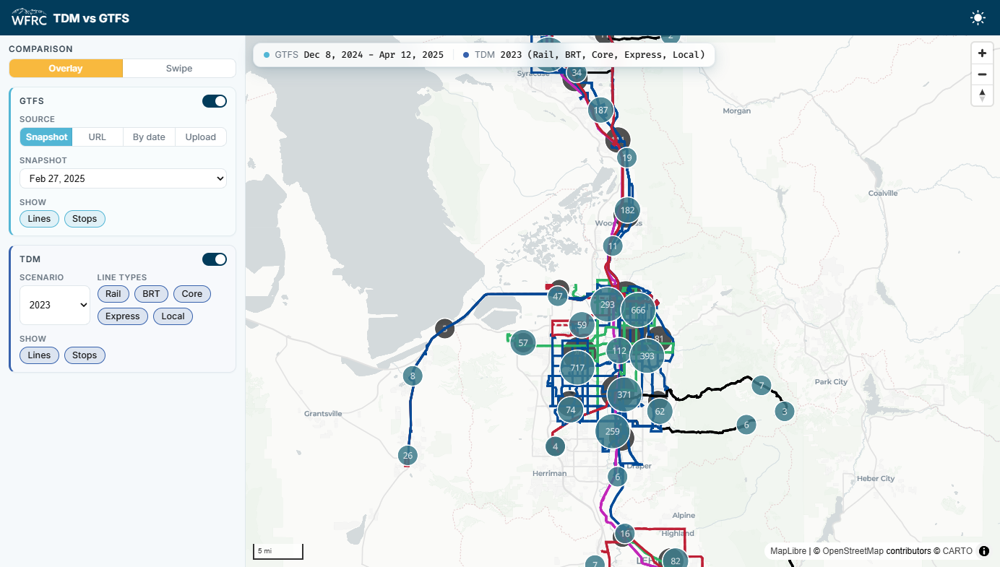](work/gtfs-vs-tdm/index.llms.md)

### [GTFS vs. TDM Transit Network Comparison](work/gtfs-vs-tdm/index.llms.md)

[Visually checking the travel demand model’s transit network against published GTFS](work/gtfs-vs-tdm/index.llms.md)

A web map for comparing the base-year transit network in the Wasatch Front travel demand model with GTFS transit data. Developed at the Wasatch Front Regional Council.

Jul 2, 2026

Pukar Bhandari

### [Commute Flow Explorer](work/commute-explorer/index.llms.md)

[Place your own analysis points and compare commuter flows between them](work/commute-explorer/index.llms.md)

A client-side web app for exploring origin-destination commuter flows across the Wasatch Front using H3 cells and DuckDB-WASM. Developed at the Wasatch Front Regional Council.

Jun 26, 2026

Pukar Bhandari

### [Opportunity Zones 2.0 Tract Info Sheets](work/opportunity-zones-info-sheets/index.llms.md)

[Auto-generated PDF info sheets for every eligible census tract in the WFRC and MAG region](work/opportunity-zones-info-sheets/index.llms.md)

A Quarto and R pipeline that builds county summary and per-tract detail PDFs for Utah’s Opportunity Zones 2.0 eligible list. Developed at the Wasatch Front Regional Council.

May 28, 2026

Pukar Bhandari

### [Utah Commuter Flow Patterns](work/commute-patterns/index.llms.md)

[An open-source rebuild of WFRC’s Regional Commuter Flows map](work/commute-patterns/index.llms.md)

An interactive, client-side map of commute flows across Utah, built on LEHD LODES data and open-source tools. Developed at the Wasatch Front Regional Council.

May 17, 2026

Pukar Bhandari

### [SE 2025 Urban Form D Variables (H3)](work/se2025-h3/index.llms.md)

[Six urban-form measures on H3 hexagons for the WFRC and MAG region](work/se2025-h3/index.llms.md)

Calculates the D variables of urban form (density, diversity, design, destinations, demographics, distance to transit) for the Wasatch Front region at H3 resolution. Developed at the Wasatch Front Regional Council.

May 14, 2026

Pukar Bhandari

### [Building a Client-Side Geo/Parquet File Viewer](posts/parquet-explorer/index.llms.md)

[Built on webassembly, works in browser, and data never leaves your computer](posts/parquet-explorer/index.llms.md)

Apr 12, 2026

Pukar Bhandari

### [Building a Client-Side Open Matrix (OMX) File Viewer](posts/omx-viewer/index.llms.md)

[Built on webassembly, works in browser, and data never leaves your computer](posts/omx-viewer/index.llms.md)

Apr 11, 2026

Pukar Bhandari

### [Spatial Explorer: Spatial SQL for Maps, in the Browser and in VS Code](posts/spatial-sql-exporer/index.llms.md)

[DuckDB-WASM, MapLibre GL and Svelte — one codebase, a web app and a VS Code extension, and your files never leave your machine](posts/spatial-sql-exporer/index.llms.md)

Open a geospatial file, query it with spatial SQL, style it and export it without a desktop GIS. How the project grew from a single-page experiment into a web app and a VS Code extension.

Feb 25, 2026

Pukar Bhandari

### [WgetGUI Ultimate: A Fluent Command Generator](posts/wget-gui/index.llms.md)

A modern, Windows 11-inspired web interface for building complex GNU Wget commands

Jan 25, 2026

Pukar Bhandari

### [Housing Site Evaluator](work/housing-site-evaluator/index.llms.md)

[A rebuilt scoring pipeline for WFRC’s Housing Access-to-Opportunity (ATO) Calculator](work/housing-site-evaluator/index.llms.md)

Scores every parcel and H3 hexagon in the Wasatch Front region on access to jobs, transit and everyday necessities. Developed at the Wasatch Front Regional Council.

Dec 2, 2025

Pukar Bhandari

[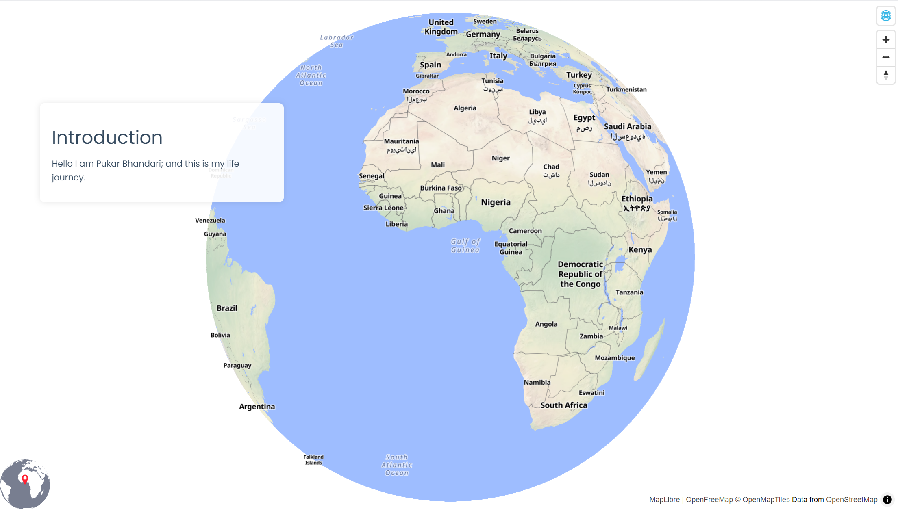](posts/storymap_my_journey/index.llms.md)

### [Building an Interactive Storymap using {mapgl}](posts/storymap_my_journey/index.llms.md)

[A Visual Journey Through My Life.](posts/storymap_my_journey/index.llms.md)

Creating an open-source, interactive storymap with the {mapgl} R package to visualize my journey across the world.

Sep 3, 2025

Pukar Bhandari

[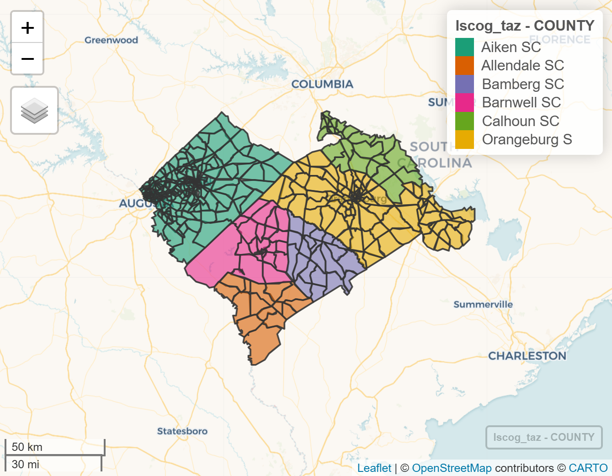](posts/socioeconomic-demo/index.llms.md)

### [Base Year SE Data Development](posts/socioeconomic-demo/index.llms.md)

[Lower Savannah Council of Governments (LSCOG) 2050 Long Range Transportation Plan](posts/socioeconomic-demo/index.llms.md)

Jul 5, 2025

Pukar Bhandari

[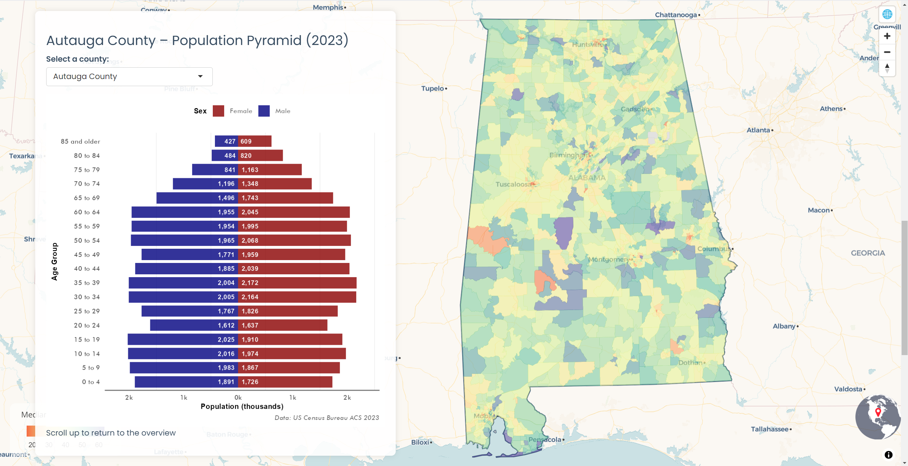](posts/population-pyramid-explorer/index.llms.md)

### [Building an Interactive Population Pyramid Explorer](posts/population-pyramid-explorer/index.llms.md)

[Exploring demographic patterns across US counties through interactive visualization using {R-Shiny} and {mapgl}](posts/population-pyramid-explorer/index.llms.md)

A deep dive into creating a story-driven Shiny application that combines interactive mapping with demographic visualizations using Census data.

Jun 25, 2025

Pukar Bhandari

[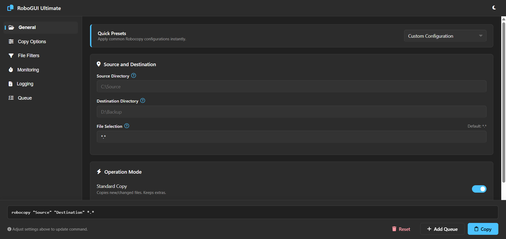](posts/robocopy-gui/index.llms.md)

### [Interactive Robocopy GUI Tool](posts/robocopy-gui/index.llms.md)

A web-based interface for generating Windows robocopy commands with ease

Jun 15, 2025

Pukar Bhandari

### [pukRhelpers: A Personal Toolbox of R Helpers](posts/pukrhelpers/index.llms.md)

[Small utilities for ArcGIS services, UGRC data, KML and sf that I reused across projects](posts/pukrhelpers/index.llms.md)

An R package collecting helper functions from my day-to-day data and GIS work. Maintained lightly.

May 23, 2025

Pukar Bhandari

[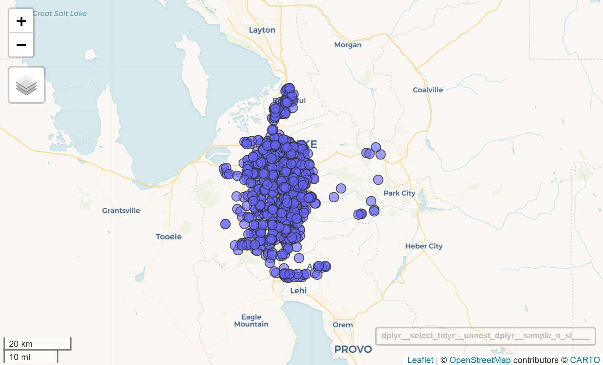](posts/overture-data-download/index.llms.md)

### [Overture Maps Data Download](posts/overture-data-download/index.llms.md)

[Applying DuckDB in R and Python](posts/overture-data-download/index.llms.md)

May 22, 2024

Pukar Bhandari

[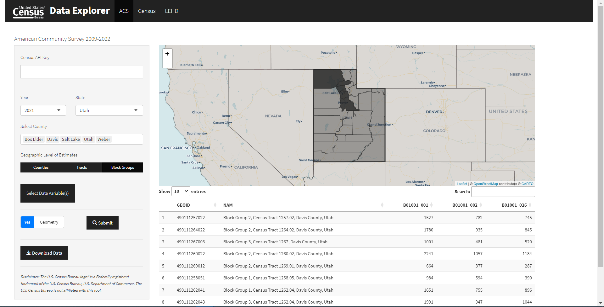](posts/uscensus-dashboard/index.llms.md)

### [Building a U.S. Census Data Explorer](posts/uscensus-dashboard/index.llms.md)

[A Shiny Dashboard for ACS, Decennial Census, and LEHD Data](posts/uscensus-dashboard/index.llms.md)

Learn how to build an interactive Shiny dashboard for exploring U.S. Census data including ACS, Decennial Census, and LEHD datasets with integrated mapping capabilities.

May 11, 2024

Pukar Bhandari

[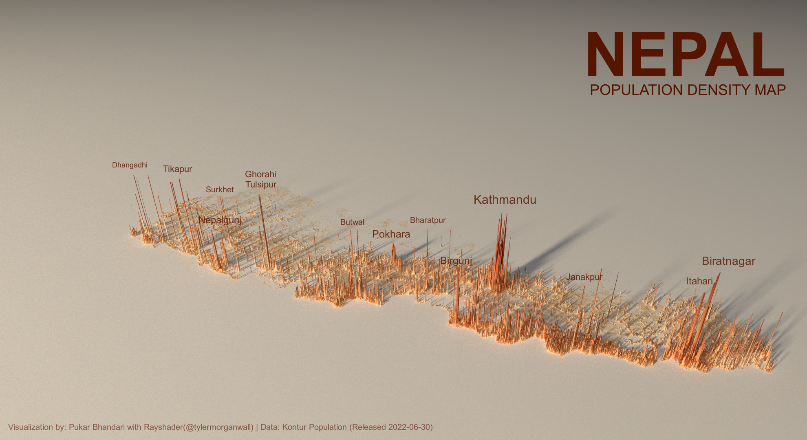](posts/nepal-population-density/index.llms.md)

### [3D Population Density Mapping of Nepal](posts/nepal-population-density/index.llms.md)

[Using Rayshader for Advanced Geospatial Visualization](posts/nepal-population-density/index.llms.md)

Jan 3, 2023

Pukar Bhandari
