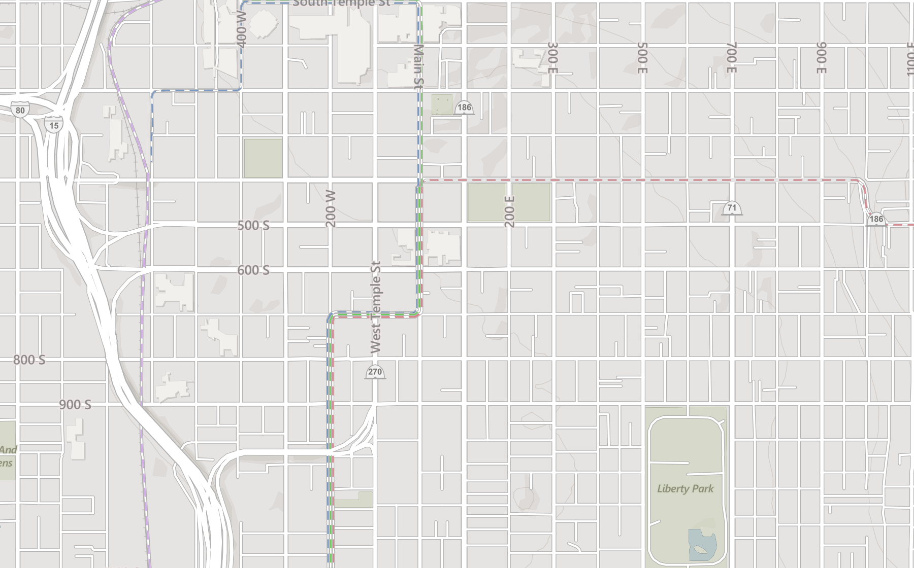
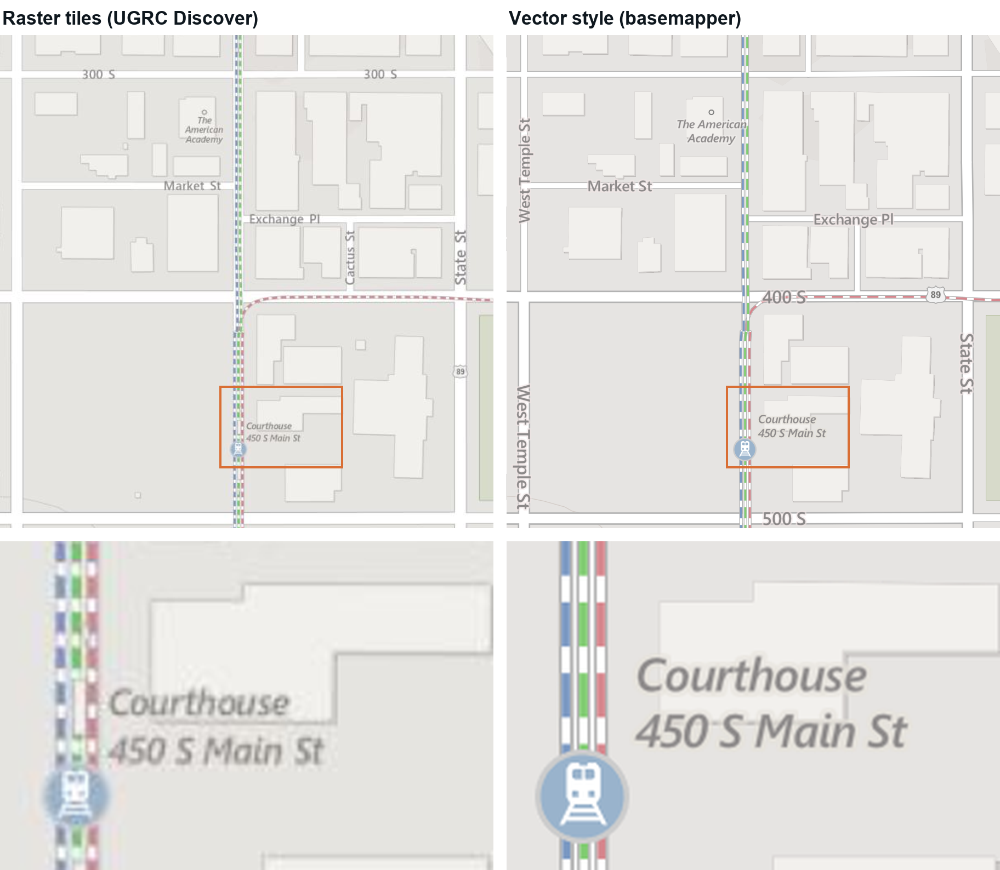
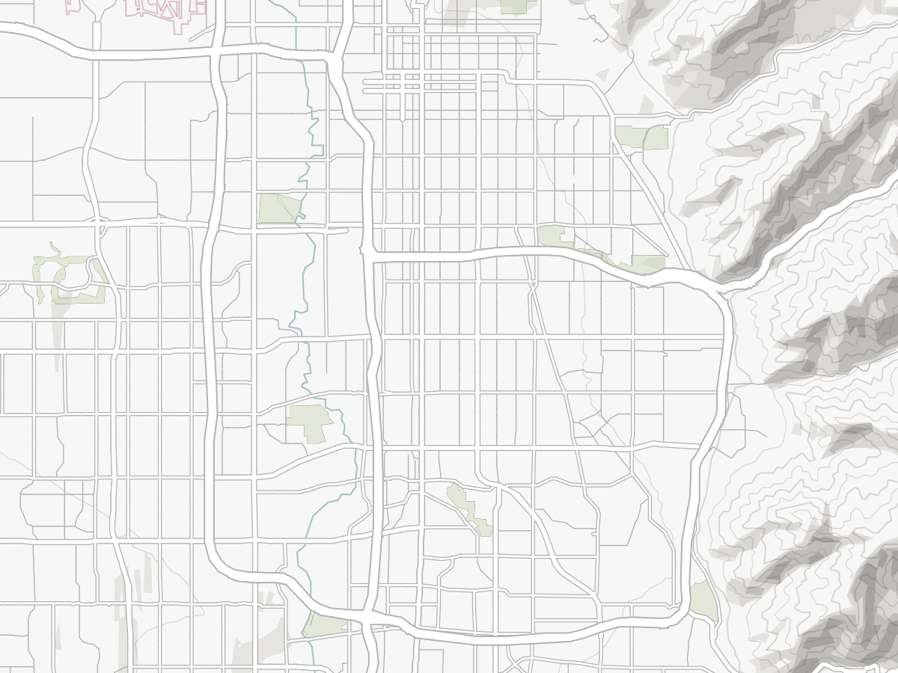
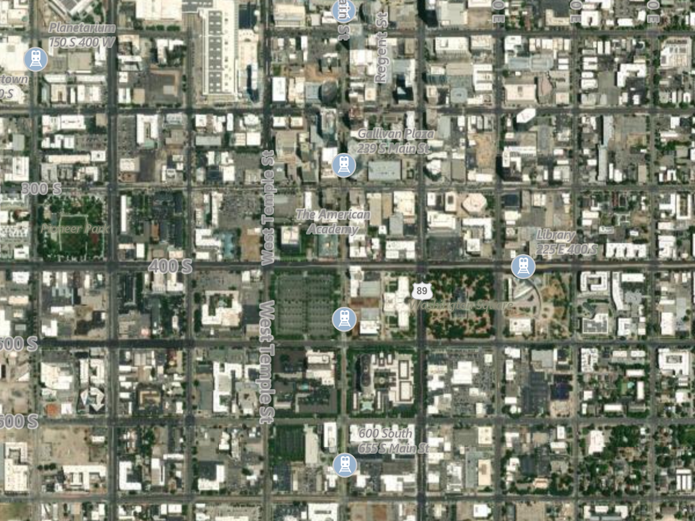
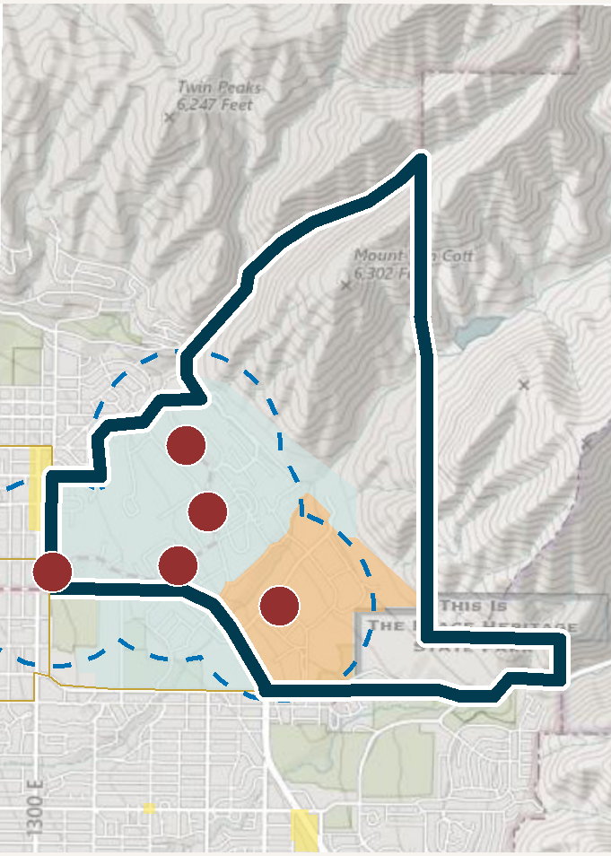
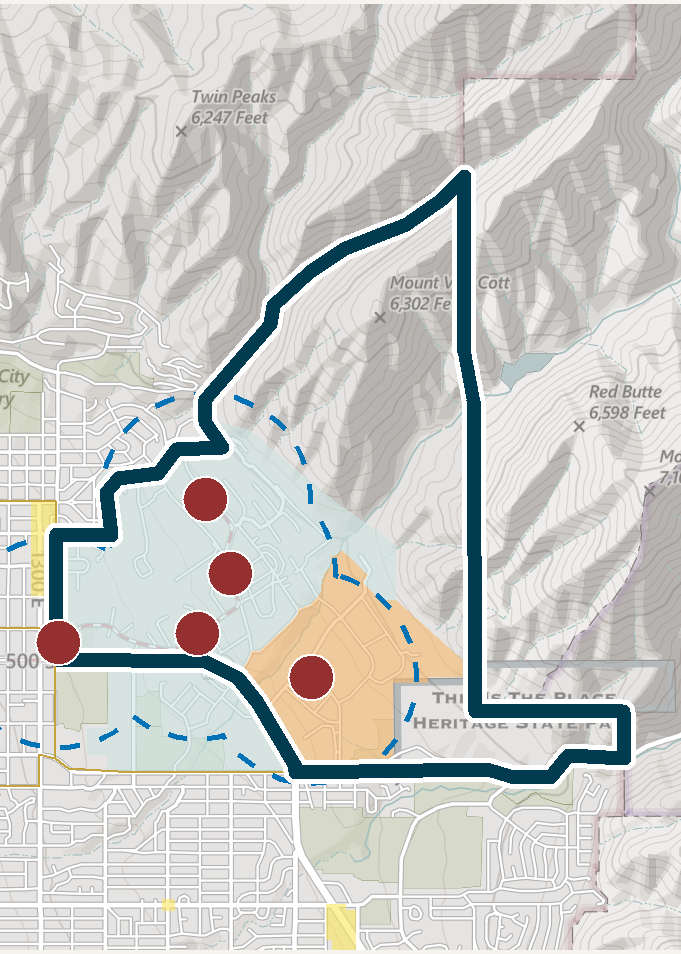

Every static map I make has two halves: the data I care about, and the basemap underneath that tells the reader where they are. In R and Python I have great tools for the first half. For the second half, I had been putting up with blurry tiles for years.

This post introduces **basemapper**, an R and Python package (with a Rust core) that renders vector basemaps straight into ggplot2, tmap, matplotlib and plotnine figures. It is also the story of how a small annoyance on a work project turned into a software port of MapLibre GL JS's rendering pipeline, checked pixel by pixel against the real thing.

::: {.app-links}
[ Docs](https://ar-puuk.github.io/basemapper/){.btn .btn-primary target="_blank" rel="noopener"}
[ GitHub](https://github.com/ar-puuk/basemapper){.btn .btn-outline-secondary target="_blank" rel="noopener"}
[ DOI](https://doi.org/10.5281/zenodo.24457061){.btn .btn-outline-secondary target="_blank" rel="noopener"}
:::

{fig-alt="UGRC Lite vector basemap of downtown Salt Lake City and Liberty Park, rendered by basemapper, with street names, TRAX lines and highway shields."}

## The map that started it

In mid-2026 I was building the [Opportunity Zones 2.0 info sheets](../../work/opportunity-zones-info-sheets/index.qmd) at the Wasatch Front Regional Council: a Quarto pipeline that produces a PDF page for every eligible census tract in the region, each with a large map of the tract and its surroundings. These pages go to investors and local governments, so the maps had to read well in print.

The Utah Geospatial Resource Center (UGRC) publishes a lovely basemap called Lite, and it publishes it two ways: as pre-drawn raster tiles, and as a vector tile style meant for MapLibre in a web browser. The R and Python basemap tools I knew only speak raster tiles. So the maps got the raster version, and the result looked like this: soft contours, labels that were hard to read, and a place name half hidden under a label box.

The vector version of the same basemap exists, looks far better, and is free. I just had no way to put it under a ggplot.

## The trouble with tiles in a static figure

Raster tiles were designed for slippy web maps. Each tile is a 256 or 512 pixel image drawn for one whole zoom level, and a web map shows them at exactly that size. A static figure breaks both assumptions:

- **Your figure's extent picks a fractional zoom.** A tract that fits the panel at zoom 15.6 gets tiles drawn for zoom 15 or 16, resampled to fit. Labels end up too small or too large, and always a little soft.
- **Your figure has its own resolution.** A 300 dpi PDF wants three times as many pixels as a screen. Raster tiles for screens get upscaled, and print shows it.
- **The design is baked in.** You cannot turn off the points of interest, drop the labels, or keep only roads and water. You get the picture the tile server drew.

A vector style fixes all three, because the map is drawn on demand from geometry and a style sheet. The catch is that vector styles are drawn by MapLibre GL JS, which runs in a browser on a GPU. You can screenshot a browser canvas, but that gives you a screen-resolution image of a web page, not a print-quality figure, and it drags a headless browser into your R session.

Here is the difference on one view of downtown Salt Lake City, both panels at zoom 15.6 and 2× pixel ratio. The left panel is UGRC Lite as raster tiles from UGRC Discover; the right panel is the same basemap from its vector style, rendered by basemapper. The bottom row enlarges the outlined area around the Courthouse TRAX station.

{fig-alt="Side-by-side maps of downtown Salt Lake City around the Courthouse TRAX station. The raster-tile version on the left has small, blurry labels and soft edges when enlarged; the basemapper vector version on the right has larger, sharp labels and crisp lines and station icon."}

What I wanted was MapLibre's output, at any zoom and any resolution, without a browser, callable from R and Python.

## A quick tour

basemapper's central object is a map view: a style, a size, and either a centre and zoom or a bounding box. From there you can render it to a PNG, an array, a georeferenced raster or a true vector SVG.

::: {.panel-tabset group="language"}
## R

```r
library(basemapper)

m <- basemap("UGRC.Lite", 800, 600, center = c(-111.8887, 40.7556), zoom = 12.4,
             pixel_ratio = 2)

render_png(m, path = "slc.png")   # 1600 x 1200, drawn natively at zoom 12.4
render_svg(m, path = "slc.svg")   # true vector; labels stay editable text
r <- render_raster(m)             # a terra SpatRaster in EPSG:3857
```

## Python

```python
import basemapper

m = basemapper.basemap("UGRC.Lite", 800, 600, center=(-111.8887, 40.7556),
                       zoom=12.4, pixel_ratio=2)

m.render_png(path="slc.png")
m.render_svg(path="slc.svg")
a = m.render_array()              # (1200, 1600, 4) uint8 array
```
:::

`"UGRC.Lite"` is a name from basemapper's catalogue, which uses the same provider names as leaflet (`"OpenFreeMap.Positron"`, `"CartoDB.Voyager"`, `"Esri.WorldImagery"` and so on). Some names stand for several services stacked together: UGRC Lite is really three styles, a hillshade, a base map and a labels layer, and basemapper draws them as one map. Anything that is not in the catalogue can be passed directly: a style URL, a tile URL template, a TileJSON, a PMTiles archive, an ArcGIS service, or a WMS or WMTS endpoint.

### In a plot

Most of the time I don't want a picture of a basemap, I want a basemap under my data. Each plotting library gets a layer that works out the extent, projection and pixel size from the plot itself:

::: {.panel-tabset group="language"}
## R

```r
library(ggplot2)
library(sf)
library(basemapper)

capitol <- st_sfc(st_point(c(-111.888, 40.777)), crs = 4326) |>
  st_transform(26912) |>
  st_buffer(800)

p <- ggplot(capitol) +
  geom_basemap("UGRC.Lite") +
  geom_sf(fill = NA, colour = "navy", linewidth = 1)

ggsave("capitol.png", p, width = 6, height = 4, dpi = 300)
```

## Python

```python
import geopandas as gpd
import matplotlib.pyplot as plt
from shapely.geometry import Point
from basemapper import add_basemap

capitol = gpd.GeoSeries([Point(-111.888, 40.777)], crs=4326).to_crs(26912).buffer(800)

fig, ax = plt.subplots(figsize=(6, 4))
capitol.plot(ax=ax, facecolor="none", edgecolor="navy", linewidth=2)
add_basemap(ax, "UGRC.Lite", crs=capitol.crs)

fig.savefig("capitol.png", dpi=300)
```
:::

{fig-alt="A ggplot2 map with latitude and longitude axes: a navy circle around the Utah State Capitol over a UGRC Lite vector basemap with streets, Memory Grove and hillshade, and a UGRC attribution line in the corner." width="75%"}

The important detail is *when* the basemap is drawn. `geom_basemap()` renders when the plot is drawn on a device, at that device's size and resolution, so `ggsave(dpi = 300)` gets a basemap drawn at 300 dpi rather than a screen image stretched to fit. The matplotlib layer does the same at `savefig()` time. tmap gets `tm_basemap()`, and plotnine gets its own `geom_basemap()`. The providers' attribution goes in the corner by default, and `get_attribution()` returns it as text for a caption.

### Only the parts you want

Because the map is drawn from a style, basemapper can leave things out. `labels = FALSE` drops the labels, `labels = "only"` keeps just the labels on a transparent background, and `features` keeps or drops whole parts of the map (water, parks, roads, buildings, terrain, points of interest and a few more). Those names work across the common vector tile schemas (OpenMapTiles, Protomaps, Shortbread) and Esri's layer names, so you don't need to learn each style's layer ids. When you do want that control, `layers` takes layer ids with `*` wildcards, and `list_layers()` previews what a render will draw.

```r
# Terrain, water, parks and roads only, no labels
basemap("UGRC.Lite", labels = FALSE,
        features = c("terrain", "water", "parks", "roads"), ...)

# Satellite imagery under UGRC Lite's labels
basemap(c("Esri.WorldImagery", basemap_provider("UGRC.Lite", labels = "only")), ...)
```

::: {layout-ncol="2"}
{fig-alt="A quiet basemap of the Salt Lake Valley with grey hillshade on the Wasatch Front, the Jordan River, green parks and a grey road network, and no labels."}

{fig-alt="Satellite imagery of downtown Salt Lake City with street names, TRAX station icons and a US-89 shield from UGRC Lite drawn on top."}
:::

The left panel is the kind of quiet background I want under a choropleth. The right one builds a hybrid map out of two providers that were never designed to go together.

## Under the hood

basemapper is three packages around one Rust crate. The crate, `basemapper-core`, does all the work: it reads the style, chooses tiles, fetches them (with a disk cache, so re-running a report doesn't download everything again), and renders. The R package binds it with [extendr](https://extendr.github.io/), the Python package with [PyO3](https://pyo3.rs/) and maturin. Both are thin: they turn a plot or a bounding box into a request and hand the pixels back. That is also why the R, Python and Rust APIs have the same functions, argument names and defaults; there is only one implementation to describe.

Raster sources are the easy half: fetch the tiles that cover the view, then composite them. Vector styles are where all the time went.

## The hard parts

### First attempt: borrow a GPU renderer

The first working version, in June, rendered vector tiles with [maplibre-rs](https://github.com/maplibre/maplibre-rs), an experimental Rust port of MapLibre that draws with wgpu. It produced maps, but it was the wrong tool for this job:

- It needed a GPU, or a software stand-in for one, and the platform graphics libraries to go with it. That is a lot to ask of an R package installed on a locked-down office laptop or a CI runner.
- It rendered tile by tile, so roads and labels broke at tile edges. I worked around the seams by drawing the whole tile grid in one pass, but that was a fix on top of a fix.
- It built from my own fork, and needed `protoc` (the Protocol Buffers compiler) installed just to compile.
- Its output was *similar* to MapLibre's. It was not MapLibre's.

That last point mattered most. A basemap style is designed by someone looking at it in MapLibre. If my renderer interprets a line width, a halo or a label collision a little differently, the map stops looking like what its designer intended.

### Second attempt: port MapLibre to the CPU

So in November I replaced it with a renderer of basemapper's own: a software port of MapLibre GL JS's rendering pipeline. Not a renderer *inspired by* MapLibre, but its behaviour ported from the TypeScript source and its shaders, one module at a time: vector tile decoding, the style expression language, line tessellation, fills, circles, and, the biggest piece, the symbol pipeline that shapes, places and collides labels.

The rule was to reproduce what MapLibre does on the GPU, including the parts that look like accidents:

- Colours are blended premultiplied, in float32, and stored to 8 bits with round-half-to-even, as the GPU does. (`0.3 × 255` is exactly 76.5 in float32, and it stores as 76, not 77.)
- Each tile's geometry is clipped to the tile square, as MapLibre's stencil test does, so features repeated in neighbouring tiles' buffers are never drawn twice.
- Primitives are sampled at pixel centres with the GPU's top-left rule, and edges get their softness from MapLibre's own shader formulas rather than from a generic antialiasing pass.
- Labels follow MapLibre's line breaking, glyph rounding, anchor choice and collision grid, in MapLibre's order. Right-to-left scripts are shaped as MapLibre's RTL plugin shapes them, and CJK text can run vertically.

My favourite bug from this stretch: point-of-interest icons that were sometimes one pixel off. Their edges sat 0.0175 px from a pixel centre. The reference images come from MapLibre running on SwiftShader, a software GPU that snaps vertex positions to a 1/16 px grid before deciding which pixels a triangle covers. On that grid the edge landed on the other side of the pixel centre. Snapping vertices the same way fixed the icons, and across the whole test suite it cut the number of mismatched pixels by a fifth and the mean colour difference by two thirds.

Dropping the GPU engine also shrank the project: the dependency tree went from 468 crates to 243, and building it now needs nothing but a Rust toolchain. No GPU, no `protoc`, no system libraries, no fork.

### Measuring instead of eyeballing

None of that is possible without a way to tell "the same" from "close". basemapper's test suite has well over a hundred golden-image cases. Each one is a fixture with a style and exactly the tiles, fonts and icons one view needs, plus a reference image of that view rendered by MapLibre GL JS itself in headless Chromium. The test renders the same fixture with basemapper and counts pixels that differ by more than 24/255 in any channel.

The cases cover CARTO's Positron, Dark Matter and Voyager and the full UGRC Lite stack at every MapLibre zoom from 1 to 22 over Salt Lake City, plus fractional zooms, 2× pixel ratio, multi-source styles from OpenFreeMap and Versatiles, raster tiles, layer filtering and SVG output. Every case has a limit on how far it may differ, and the limits only ever go down. Most cases now differ from MapLibre in well under a tenth of a percent of pixels. When something regressed, a small viewer with side-by-side, swipe, blink and diff modes showed exactly where.

This changed how the work felt. Instead of "does this look right?" the question was always "why is this pixel different?", and that question has an answer you can find in MapLibre's source.

### SVG that is actually vector

For print and for editing in Illustrator or Inkscape, a PNG is not enough, so basemapper also writes the same view as SVG: real paths for fills and lines, and labels as editable `<text>`, each glyph placed where MapLibre placed it, with the style's fonts embedded. Matching MapLibre here meant translating its conventions into SVG's: dash lengths in MapLibre's units, round caps that SVG would otherwise extend past the dash, and lines thinner than a pixel stroked at the width that gives the same visual weight. The golden tests rasterise each SVG and score it against the same MapLibre reference; the full UGRC stack at zoom 12.4 comes out 0.23% of pixels off.

### Windows, R and Rust

The least glamorous part was getting `install.packages`-style installs to work on Windows. R on Windows is built with the GNU toolchain, so the Rust code has to be too (the MSVC toolchain cannot import R.dll's exported global variables). RTools45's GCC 14 dropped a library that Rust's GNU target still links against, so the package build now creates an empty stand-in for it. And for a while `library(basemapper)` crashed outright with an access violation, until the import library marked R's handful of exported global variables as data rather than functions. None of this is visible to users now, which is the point.

## Building it with Claude

I built basemapper with Claude as a pair programmer, and it is fair to say the project would not exist otherwise: porting a large part of a mature graphics library is far more code than I could write on evenings and weekends. Claude was very good at the mechanical bulk of that work, reading MapLibre's TypeScript and shaders and porting them faithfully, and at writing the tests and tooling around them.

What made it work was the golden-image suite. An AI assistant will happily tell you a renderer looks right. A test that counts mismatched pixels against MapLibre does not care how confident anyone sounds, and a ratchet that never loosens means progress sticks. My job was mostly deciding what "correct" meant, choosing what to measure next, and reading diffs.

## Back to the Opportunity Zones maps

The info sheets were basemapper's first production use, and the reason it exists. Each tract map in the [pipeline](https://github.com/WFRCAnalytics/GIS_OpportunityZones_InfoSheets) now draws UGRC Lite through `geom_basemap()`, rendered at the report's 200 dpi when `ggsave()` runs, at the same zoom as the old raster maps. Here is the same tract map before and after the switch, as committed to the repository; the overlay layers are identical, and only the basemap changed. Click either map to open it in the repository.

::: {layout-ncol="2"}
:::: {}
[{.img-fluid alt="Census tract map on Salt Lake City's east bench, the tract outlined in dark blue with red point markers, a dashed buffer and land-use shading, over a raster basemap with soft, partly hidden labels and blurry contours."}](https://github.com/WFRCAnalytics/GIS_OpportunityZones_InfoSheets/blob/02ef3387d76be82796106dd97d4a01b8d6e1c444/data/map_cache/49035101402_xl.png)

**Before:** raster basemap tiles
::::

:::: {}
[{.img-fluid alt="The same census tract map over a UGRC Lite vector basemap with crisp hillshade, contours and roads."}](https://github.com/WFRCAnalytics/GIS_OpportunityZones_InfoSheets/blob/f02bfd8008e297a7775d2ac9a59461d2f339eb7e/data/map_cache/49035101402_xl.png)

**After:** UGRC Lite vector, rendered by basemapper
::::
:::

Peak names, contour lines and the Heritage State Park label are now readable, and the hillshade has the detail the raster tiles smeared away. More about that project is on its [project page](../../work/opportunity-zones-info-sheets/index.qmd).

## What it doesn't do (yet)

basemapper renders *basemaps*. Style features meant for data visualisation or interactive 3D, such as heatmap layers, point clustering and 3D terrain, are skipped with a warning (and line gradients draw in a single colour); draw that kind of data with your plotting library on top instead. Output is always Web Mercator, which `geom_basemap()` and friends reproject for you.

It is also new: for now it installs from GitHub and compiles the Rust core, so you need a [Rust toolchain](https://rustup.rs) (and, on Windows, RTools45 and the `x86_64-pc-windows-gnu` target):

```r
pak::pak("ar-puuk/basemapper/r-basemapper")
```

```sh
pip install "basemapper @ git+https://github.com/ar-puuk/basemapper#subdirectory=py-basemapper"
```

CRAN, R-universe, PyPI and conda packages will follow after a longer testing period. Until then, the [documentation](https://ar-puuk.github.io/basemapper/) has guides for [R](https://ar-puuk.github.io/basemapper/r/), [Python](https://ar-puuk.github.io/basemapper/python/) and [Rust](https://ar-puuk.github.io/basemapper/rust/), and every map in them is drawn by the code shown next to it. If you try it and a style renders differently from MapLibre, please [open an issue](https://github.com/ar-puuk/basemapper/issues): with the golden-image setup, a mismatch is a test case waiting to be written.

## Cite it

basemapper is archived on Zenodo with the DOI [10.5281/zenodo.24457061](https://doi.org/10.5281/zenodo.24457061), which always points to the latest release. The code is on [GitHub](https://github.com/ar-puuk/basemapper) under the MIT license.
