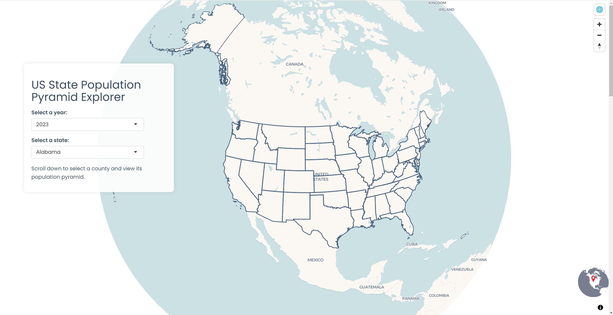
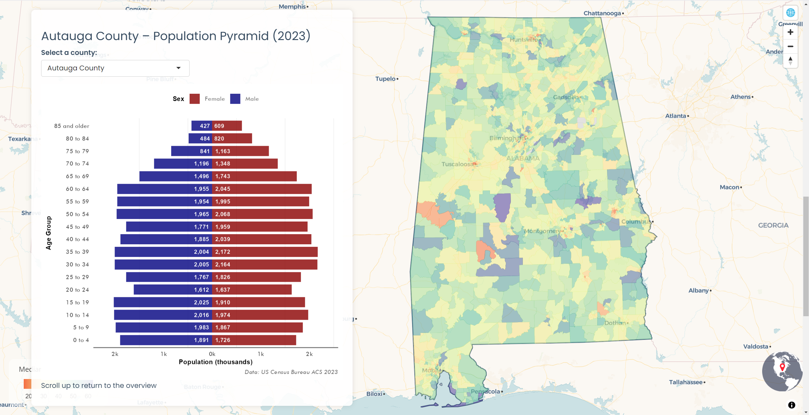

Population demographics are fundamental to transportation planning and urban analysis. Understanding age distributions helps inform infrastructure decisions, transit planning and resource allocation. A population pyramid is the quickest way to see an age distribution, and a map is the quickest way to see where it changes. I wanted both on one screen.

The Population Pyramid Explorer is a Shiny app that does that for every U.S. county. It uses the [{mapgl}](https://walker-data.com/mapgl/) package's story map layout: you scroll from a national overview to a state, where a tract-level map of median age sits behind a population pyramid for the county you pick. This post covers what it does, how the story map and the pyramid are built, and ideas for what comes next.

::: {.app-links}
[ GitHub](https://github.com/ar-puuk/population-pyramid-explorer){.btn .btn-primary target="_blank" rel="noopener"}
:::

## A quick tour

The app has two sections, and scrolling moves between them.

{fig-alt="Story map opening screen: a panel titled US State Population Pyramid Explorer with year and state dropdowns set to 2023 and Alabama, over a globe-projected map of North America with U.S. state outlines, map controls and a small globe minimap."}

The first section is the overview. You choose a year (2015 to 2023) and a state, over a globe-projected map of the country with state outlines, navigation controls and a small globe minimap in the corner.

Scroll down and the map flies to the chosen state, filters the outlines to it, and fills its census tracts by median age. A county picker and the population pyramid appear in the panel on the left. Hovering over a tract highlights it, and clicking it opens a popup with the county name and the tract's median age. Scrolling back up returns to the national view.

{fig-alt="Population pyramid for Autauga County, Alabama, beside a tract-level map of Alabama."}

## Two Census products in one view

The two halves of the screen come from two different Census Bureau products, both requested through [tidycensus](https://walker-data.com/tidycensus/):

1.  **American Community Survey (ACS)** 5-year estimates for the map: median age (`B01002_001`) for every tract in the state, with geometry.
2.  The **Population Estimates Program** for the pyramid: county population by sex and five-year age group, from the `characteristics` product.

The tract layer gives spatial context, and the county estimates give the detail. Both follow the year selector, so the map and the pyramid always describe the same year.

## Key dependencies and setup

The application uses a small set of R packages for data processing, spatial analysis and visualization:

```r
# Custom function to load packages, installing them first if not already installed
load_pkg <- function(pkg) {
  if (!require(pkg, character.only = TRUE)) {
    install.packages(pkg)
  }
  library(pkg, character.only = TRUE)
}

# Data manipulation and visualization
load_pkg("dplyr")
load_pkg("tidyr")
load_pkg("ggplot2")
load_pkg("scales")

# Spatial data and mapping
load_pkg("sf")
load_pkg("mapgl")
load_pkg("tigris")

# Census data integration
load_pkg("tidycensus")

# UI framework
load_pkg("shiny")
```

The `load_pkg()` helper installs any missing package before loading it, so the app runs on a fresh machine with one command. You do need a Census API key, installed once with `tidycensus::census_api_key()`.

## The story map

### User interface design

The UI is a single call to {mapgl}'s `story_maplibre()`, which places a full-screen map behind a column of scrolling sections:

```r
mapgl::story_maplibre(
  map_id = "map",
  font_family = "Poppins",
  sections = list(
    "intro" = mapgl::story_section(...),
    "state_detail" = mapgl::story_section(...)
  )
)
```

Each section holds ordinary Shiny inputs and outputs: the year and state dropdowns in `intro`, and the county picker and pyramid plot in `state_detail`.

### Drawing the map once

The map itself is rendered only once. Every change after that goes through a `maplibre_proxy()`, which updates layers on the existing map instead of rebuilding it:

```r
mapgl::maplibre(
  mapgl::carto_style("voyager"),
  center = c(-98.5, 39.5),
  zoom = 3,
  scrollZoom = FALSE
) |>
mapgl::set_projection(projection = "globe")
```

The base map uses Carto's Voyager style for clean, readable cartography. Turning off scroll zoom matters in a story map: the page scroll is how you move between sections, and the map would otherwise swallow it.

State boundaries are loaded once at startup:

```r
states_sf <- tigris::states(cb = TRUE) |>
  sf::st_transform(crs = 3857) |>
  sf::st_zm(drop = TRUE, what = "ZM")
```

Cartographic boundary files (`cb = TRUE`) are simplified, so they draw quickly at the national scale. The geometries are projected to Web Mercator and any Z or M dimensions are dropped before they are handed to the map.

### Reacting to sections

{mapgl}'s `on_section()` runs code when a section scrolls into view, and that is where the map changes happen. Entering the overview clears the tract layer and the legend, removes the state filter, and flies back to the whole country:

```r
mapgl::fly_to(
  center = c(-98.5, 39.5),
  zoom = 3,
  bearing = 0,
  pitch = 0,
  duration = 1500
)
```

Entering the state section adds the tract fill layer and its legend, filters the state outlines to the chosen state, and fits the map to that state's bounds. The tract colors interpolate between five stops from 20 to 60 years, using ColorBrewer's spectral palette, from young (orange-red) to old (purple). Tracts without an estimate are drawn in light grey.

## Building the pyramid

### Shaping the data

A population pyramid is a horizontal bar chart with males to the left of zero and females to the right. The Population Estimates data needs a few steps to get there. The request returns several kinds of age groups (five-year bands, broader groups, all ages), so the code keeps only the rows whose label starts with "Age" and drops the "Both sexes" totals. Then:

```r
dplyr::mutate(
  value = ifelse(SEX == "Male", -value, value),
  age_min = ifelse(
    stringr::str_detect(AGEGROUP, "under"), 0,
    as.numeric(stringr::str_extract(AGEGROUP, "\\d+"))
  )
)
```

Male counts become negative so their bars point left, and the first number in each age label becomes a sort key. The age groups are then turned into a factor in that order, so "5 to 9" comes after "0 to 4" rather than after "45 to 49" as it would alphabetically.

### Chart design

The pyramid is a ggplot2 chart rendered with `renderPlot()`:

-   **Two colors**: navy for males, dark red for females.
-   **Labels on the bars**: each bar shows its count, using the absolute value so male counts do not print as negative numbers. The same trick formats the x-axis.
-   **Minimal grid lines**, so the shape of the distribution carries the chart.

The age labels from the Census API are wordy ("Age 0 to 4 years"), so the axis strips the repeated words:

```r
scale_y_discrete(labels = ~ stringr::str_remove_all(.x, "Age\\s|\\syears"))
```

## Details that took some fiddling

**Two ways of naming a tract.** The ACS returns each tract's name as one string with the tract, county and state in it. The app splits that string into three columns to get the county name for the popup, and the split uses a regular expression that accepts either a comma or a semicolon as the separator, so it handles both forms the Census API returns.

**State and county names to FIPS codes.** The inputs hold names, but the API calls want FIPS codes. The app converts them with tidycensus's own `validate_state()` and `validate_county()`. Those are internal functions, reached with `tidycensus:::`, which works but could break if the package changes them.

**A fast county picker.** The county list comes from `tidycensus::fips_codes` for the chosen state and is loaded into a `selectizeInput()` on the server side (`server = TRUE`), with type-to-search. The first county is selected by default, so the pyramid appears as soon as you scroll down.

**Caching.** `options(tigris_use_cache = TRUE)` keeps boundary files on disk between sessions, and `shiny::req()` holds back every request until the state and county inputs exist.

## Ideas for later

Possible extensions include:

-   **Multi-county comparison**, with two pyramids side by side
-   **Time series**, showing how a county's pyramid changes over the years
-   **Additional demographic variables** (income, education, housing)
-   **Export functionality** for the chart and the data
-   **Integration with transportation metrics** for planning analysis
-   **Highlighting the selected county** on the state map
-   **Pre-built tract layers**, so the state view opens without waiting for a live Census download

## Try it locally

The app is a single `app.R`. Clone the [repository](https://github.com/ar-puuk/population-pyramid-explorer), install the packages, set your Census API key, and run it:

```r
tidycensus::census_api_key("YOUR_KEY_HERE", install = TRUE)
shiny::runApp("app.R")
```

A free key is available from the [Census Bureau](https://www.census.gov/developers/). The code is under the MIT license, and suggestions and pull requests are welcome.
