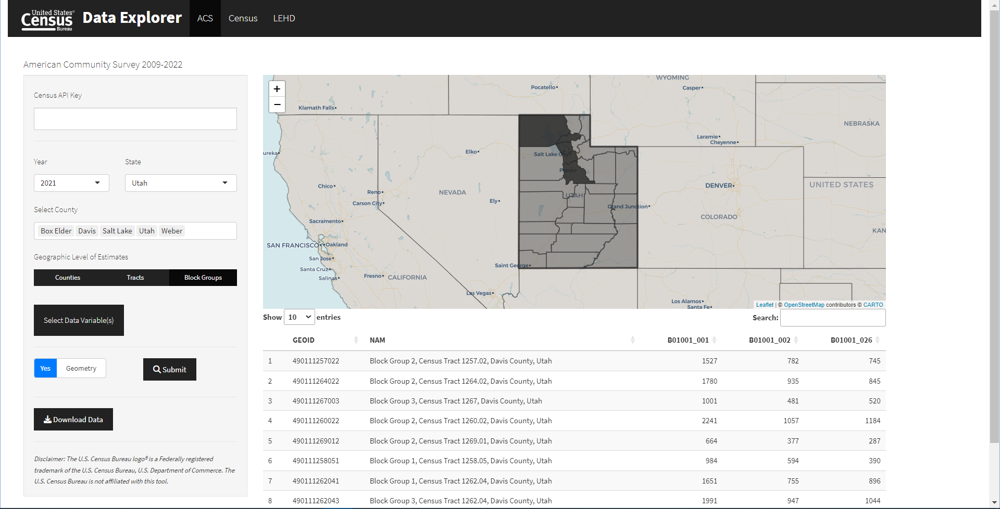

As a transportation planner, accessing and visualizing demographic and employment data is crucial for informed decision-making. The U.S. Census Bureau provides a wealth of information through various datasets, but navigating multiple APIs and data formats can be challenging. To streamline this process, I developed an interactive R Shiny dashboard that provides unified access to three major Census data sources:

- **American Community Survey (ACS)**: detailed demographic and socioeconomic estimates
- **Decennial Census**: complete population counts every 10 years
- **Longitudinal Employer-Household Dynamics (LEHD)**: employment and commuting patterns

This post walks through why I built it, what it does, how the pieces fit together, and where it could go next. The source code is on [GitHub](https://github.com/ar-puuk/uscensus-dashboard/).

[ GitHub](https://github.com/ar-puuk/uscensus-dashboard)

## 1 The problem: three products, three ways in

R already has excellent packages for each of these sources. [tidycensus](https://walker-data.com/tidycensus/) wraps the Census API for the ACS and the Decennial Census, [lehdr](https://github.com/jamgreen/lehdr) downloads LEHD’s LODES files, and [tigris](https://github.com/walkerke/tigris) fetches boundaries. But each one has its own arguments, its own variable codes and its own idea of geography, and every request starts with the same chores: look up the variable codes for the right year, remember which geographies a variable is published for, write the call, then convert the result to whatever format the next tool needs.

I wanted a single window for those chores. Pick a product, a year, a state and its counties, pick variables from a list, and download a CSV or a shapefile. The app is that window: a thin interface over tidycensus, lehdr and tigris, not a replacement for them.

## 2 A quick tour

[](uscensus_dashboard.png "The ACS tab: a 2021 block group request for five Wasatch Front counties in Utah, with the selected counties shaded on the map and the returned table below it.")

The ACS tab: a 2021 block group request for five Wasatch Front counties in Utah, with the selected counties shaded on the map and the returned table below it.

The app has one tab per product, and each tab follows the same pattern:

1.  Paste a Census API key (the LEHD tab does not need one).
2.  Pick a year and a state; the county list fills in for that state.
3.  Choose a geographic level: counties, tracts or block groups for the ACS, plus blocks for the Decennial Census and LEHD.
4.  Open the variable picker and select variables from a searchable table.
5.  Choose whether to include geometry, press **Submit**, and download the result.

The map highlights the chosen state and shades the selected counties, and the returned data appears in a table under it. Downloads are CSV files, or zipped shapefiles when geometry is switched on.

## 3 How it is put together

### Core dependencies

The application leverages several specialized R packages for Census data access and geospatial processing:

``` r
# Census data access
library(tidycensus)   # ACS and Decennial Census API
library(lehdr)        # LEHD Origin-Destination data
library(tigris)       # Geographic boundaries

# Geospatial processing
library(sf)           # Simple features for spatial data
library(leaflet)      # Interactive mapping

# Shiny ecosystem
library(shiny)
library(shinydashboard)
library(shinyWidgets)
library(DT)          # Interactive data tables
```

### Application structure

The whole app is a single `app.R`. Each product has its own UI object and its own block of server logic, and a `navbarPage()` ties the three together as tabs:

``` r
# One UI object per data source
acsUI <- fluidPage(...)      # American Community Survey interface
censusUI <- fluidPage(...)   # Decennial Census interface
lehdUI <- fluidPage(...)     # LEHD interface

# Unified navigation
ui <- navbarPage(...)
```

Keeping the tabs separate meant I could get the ACS tab working first and then adapt it for the other two. The cost of that shortcut shows up later in this post.

## 4 One interface, three data products

### American Community Survey

The ACS tab covers the 5-year estimates from 2009 to 2022. The detail that made the biggest difference here was the variable list. tidycensus’s `load_variables()` returns every ACS variable for a year, along with the smallest geography it is published for. Many tables exist only down to the tract level, so showing them on a block group request just produces an error. The app filters the list by the chosen geographic level before showing it:

``` r
variables_acs <- reactive({
  if (!is.null(input$year_acs)) {
    variables <- load_variables(year = as.numeric(input$year_acs),
                               dataset = "acs5", cache = TRUE)
    # Filter variables based on geographic level
    if (input$level_acs == "tract") {
      variables <- variables |>
        filter(geography %in% c("tract", "block group"))
    }
    return(variables)
  }
})
```

**Geographic hierarchy**: the county options update whenever the state changes, using `tidycensus::list_counties()`, so the request can never name a county outside the chosen state.

The data request itself is a single `get_acs()` call in wide format, with the state, counties, level and geometry taken from the inputs and the API key passed straight through.

### Decennial Census

The Decennial Census tab focuses on the 2000, 2010 and 2020 counts, with variables drawn from the PL 94-171 redistricting dataset. Since the Decennial Census has far fewer variables than the ACS, the interface stays simple while keeping the same interaction pattern. It also adds the census block, the smallest geography the Census Bureau publishes.

### Longitudinal Employer-Household Dynamics

The LEHD tab provides employment statistics and origin-destination flows from LODES, which matter a great deal for transportation planning. It offers all three LODES file types: origin-destination (OD), residence area characteristics (RAC) and workplace area characteristics (WAC). Requests use all workers and all jobs (`segment = "S000"`, `job_type = "JT00"`), and the data can be aggregated from blocks up to block groups, tracts or counties.

**Version management**: different LODES versions cover different years, so the year list follows the chosen version:

``` r
observe({
  version <- if (!is.null(input$version_lehd)) input$version_lehd else "default"

  options <- if (version == "LODES5") {
    2002:2009
  } else if (version == "LODES7") {
    2002:2019
  } else {
    2002:2021
  }

  updateSelectInput(session, "year_lehd", choices = options, selected = max(options))
})
```

LODES files are downloaded from the Census Bureau rather than requested through the API, which is why this tab needs no key.

## 5 The map

### Base map configuration

The application uses Leaflet for interactive mapping, with a carefully chosen base layer that balances aesthetics and functionality:

``` r
default_map <- leaflet(options = leafletOptions(crs = leafletCRS())) |>
  addProviderTiles("CartoDB.Voyager") |>
  addPolygons(data = sf_states, color = "#222222", weight = 1, fillOpacity = 0.15)
```

**CartoDB.Voyager** was chosen for its muted design and good contrast with overlay data, and it needs no API key; CARTO’s Positron and Dark Matter work as drop-in swaps. The default map is built once, outside any reactive code, and each tab adds its own layers on top.

### Following the selection

When a state is chosen, the map draws its outline and counties and zooms to its bounding box; the selected counties get a darker fill so the extent of the request is visible before anything is downloaded:

``` r
output$map_acs <- renderLeaflet({
  if (!is.null(input$state_acs) && input$state_acs != "") {
    selected_state_acs <- sf_states[sf_states$NAME == input$state_acs, ]
    selected_bbox_acs <- sf::st_bbox(selected_state_acs)

    default_map |>
      addPolygons(data = selected_state_acs, color = "#222222", weight = 4) |>
      fitBounds(selected_bbox_acs[[1]], selected_bbox_acs[[2]],
               selected_bbox_acs[[3]], selected_bbox_acs[[4]])
  }
})
```

State and county boundaries come from tigris’s cartographic boundary files, loaded once when the app starts.

## 6 Picking variables from thousands

The ACS publishes thousands of variables each year, which rules out a dropdown. The picker is a modal dialog holding a searchable, paged data table of the variable list. You can search by code, label or concept, select several rows, and confirm:

``` r
var_modal_acs <- modalDialog(
  title = h4("Select Variable(s) from the List"),
  DTOutput("var_table_acs"),
  size = "l",
  easyClose = TRUE,
  footer = actionButton("selectVarButton_acs", "Select Variable(s)")
)
```

The selected codes go into a `reactiveVal()`, which the data request reads when **Submit** is pressed. Keeping the list in a modal keeps the main screen to the controls, the map and the results.

## 7 Getting data out

### CSV or shapefile

Users can export data in two formats depending on their needs:

- **CSV files** for tabular analysis
- **Shapefiles (zipped)** for GIS applications

``` r
output$download_acs <- downloadHandler(
  filename = function() {
    if (input$geometry_acs) {
      paste0("acs_data_", input$state_acs, "_", input$year_acs, ".zip")
    } else {
      paste0("acs_data_", input$state_acs, "_", input$year_acs, ".csv")
    }
  },
  content = function(file) {
    if (input$geometry_acs) {
      write_sf_zip(data_acs(), file, overwrite = TRUE)
    } else {
      readr::write_csv(data_acs() |> st_drop_geometry(), file)
    }
  }
)
```

### Zipping a shapefile

A shapefile is really several files (`.shp`, `.shx`, `.dbf`, `.prj` and so on), and a browser download has to be one file. `sf` writes the parts but does not zip them, so a small helper writes them to a temporary directory and zips the lot:

``` r
write_sf_zip <- function(obj, zipfile, overwrite = FALSE) {
  # Create temporary directory for shapefile components
  tmp <- tempfile()
  dir.create(tmp)
  on.exit(unlink(tmp, recursive = TRUE, force = TRUE))

  # Write shapefile and zip all components
  sf::write_sf(obj, file.path(tmp, shp_name), delete_layer = TRUE)
  withr::with_dir(tmp, zip(tmp_zip, list.files()))

  file.copy(file.path(tmp, tmp_zip), zipfile, overwrite = overwrite)
}
```

`on.exit()` removes the temporary directory even if writing fails partway through.

### Dropping the margins of error

ACS estimates come with margins of error, and in wide format every variable becomes two columns, `...E` and `...M`. For a quick export that doubles the width of the table, so in a follow-up commit I removed the margin columns and stripped the `E` suffix from the estimates:

``` r
result_acs <- result_acs |>
  select(-matches("M$")) |>    # Remove margin columns
  rename_all(~ sub("E$", "", .)) # Clean estimate column names
```

This is also a trade-off, not a free win: margins of error matter for small geographies like block groups, and anyone using the estimates for analysis should go back to tidycensus for them.

## 8 Small decisions that helped

### Caching

``` r
options(tigris_use_cache = TRUE)  # Geographic boundaries
load_variables(..., cache = TRUE) # Variable metadata
```

Boundaries and variable lists rarely change, so both are cached on disk. lehdr’s downloads are cached as well (`use_cache = TRUE`). Repeat requests skip most of the waiting.

### API keys

> **IMPORTANT:**
>
> Request a free key from the [Census Bureau](https://www.census.gov/developers/) and enter it in the app. It is never stored in the source code.

The key is typed into the app and passed straight to tidycensus, rather than hardcoded or installed in a user’s `.Renviron`. That keeps credentials out of the source code, leaves each user in control of their own API usage, and lets the same file run anywhere.

### Waiting for complete input

API calls can take several seconds, so requests run only when **Submit** is pressed (`eventReactive()`), and only once every required input is present:

``` r
req(input$api_key_acs, input$year_acs, input$state_acs, input$county_acs, input$level_acs)
```

The download button appears only after the first request.

## 9 Scope

LEHD requests cover a whole state and download as CSV, while ACS and Decennial requests can also download as shapefiles. The app runs locally: clone the repository, open `app.R` and run it.

## 10 Ideas for later

Several features would make the app more useful:

- **Data visualization**: built-in charts and maps of the returned data, not just the extent of the request
- **Comparison tools**: side-by-side analysis across years or geographies
- **Custom geography**: support for user-uploaded boundary files
- **Batch processing**: several state and year combinations in a single request
- **API integration**: direct connection to external GIS platforms
- **Shiny modules**: one module shared by the three tabs, so a change lands in all of them at once

## 11 Wrapping up

The app does one job: it turns the first hour of a Census data task (finding variable codes, writing the request, converting the output) into a few clicks. For transportation planning work in particular, having demographic characteristics, employment and commuting flows behind the same interface shortens the data-gathering step and leaves more time for analysis.

The code is on [GitHub](https://github.com/ar-puuk/uscensus-dashboard) under the MIT license. Suggestions and contributions are welcome.

## Citation

BibTeX citation:

``` quarto-appendix-bibtex
@online{bhandari2024,
  author = {Bhandari, Pukar},
  title = {Building a {U.S.} {Census} {Data} {Explorer}},
  date = {2024-05-11},
  url = {https://ar-puuk.github.io/posts/uscensus-dashboard/},
  langid = {en-US}
}
```

For attribution, please cite this work as:

Bhandari, Pukar. 2024. “Building a U.S. Census Data Explorer.” May 11. <https://ar-puuk.github.io/posts/uscensus-dashboard/>.
