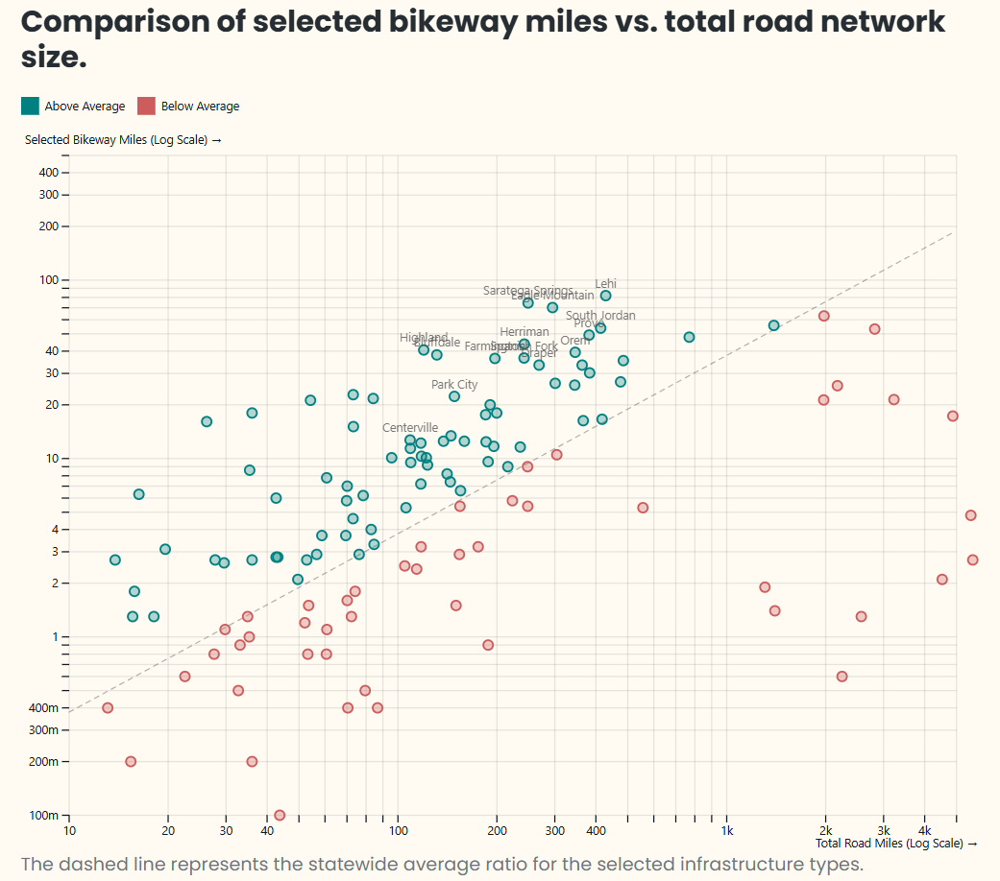
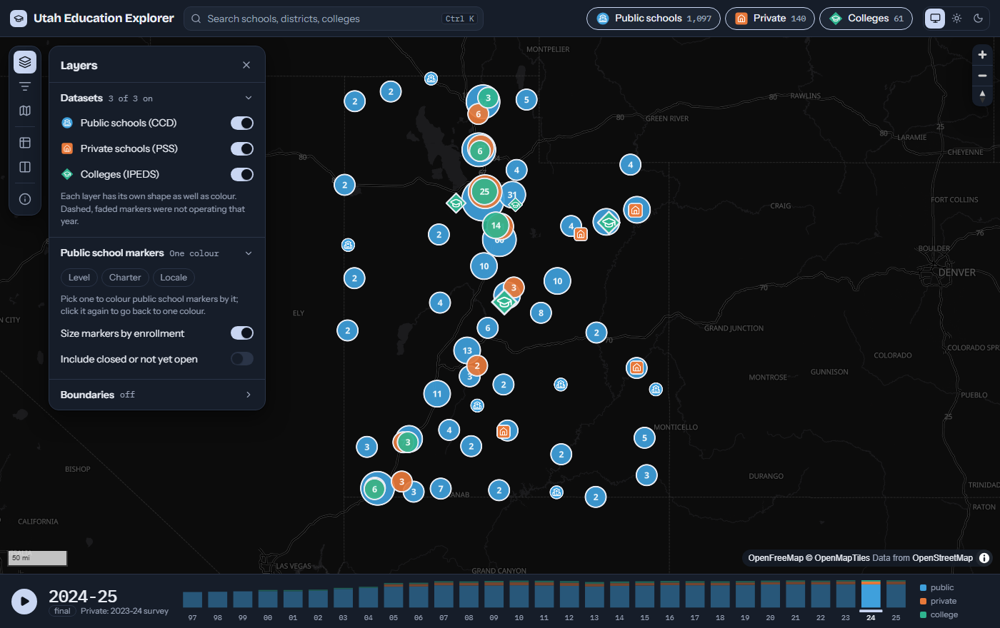
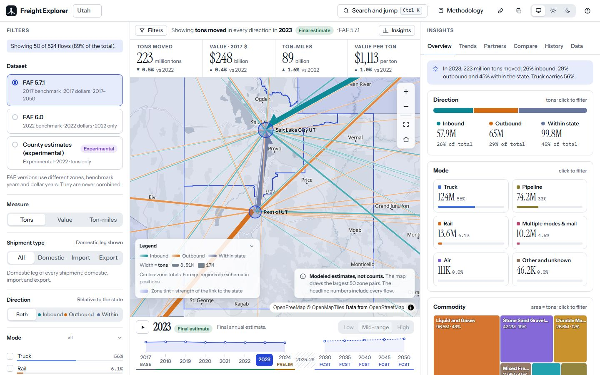
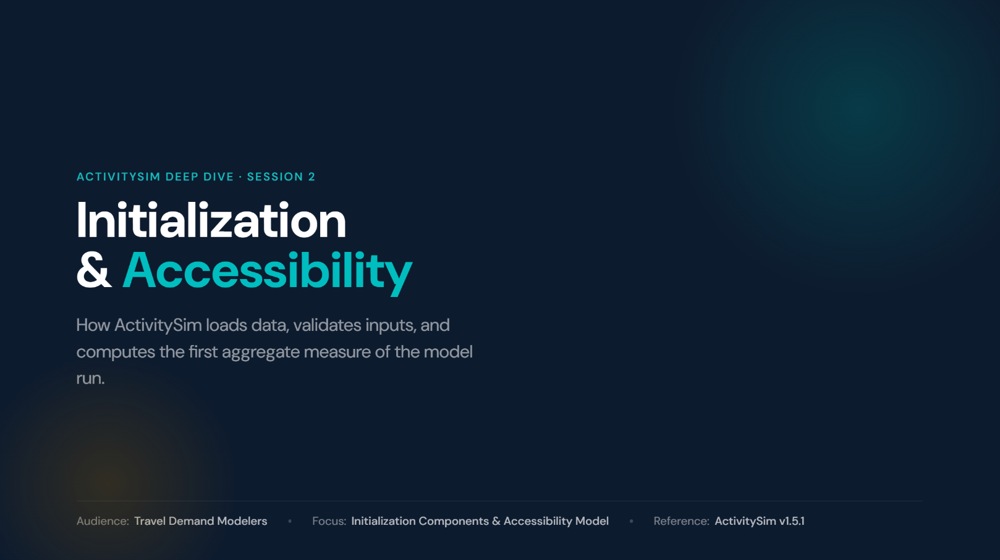
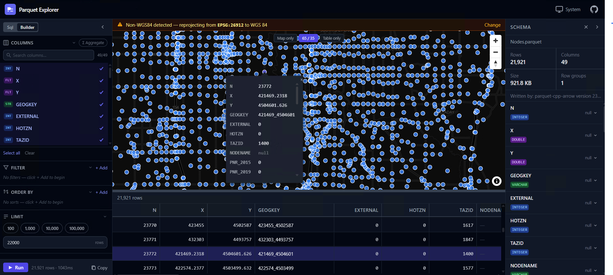
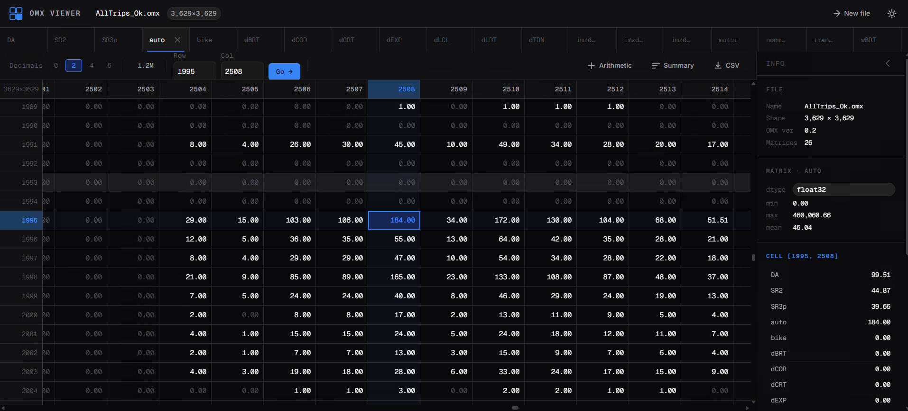
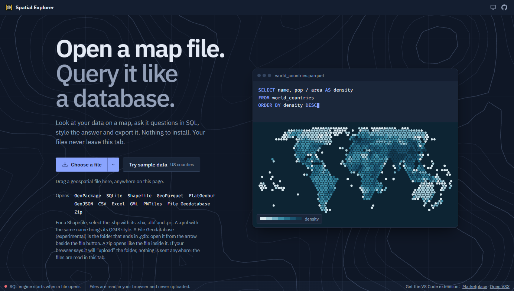
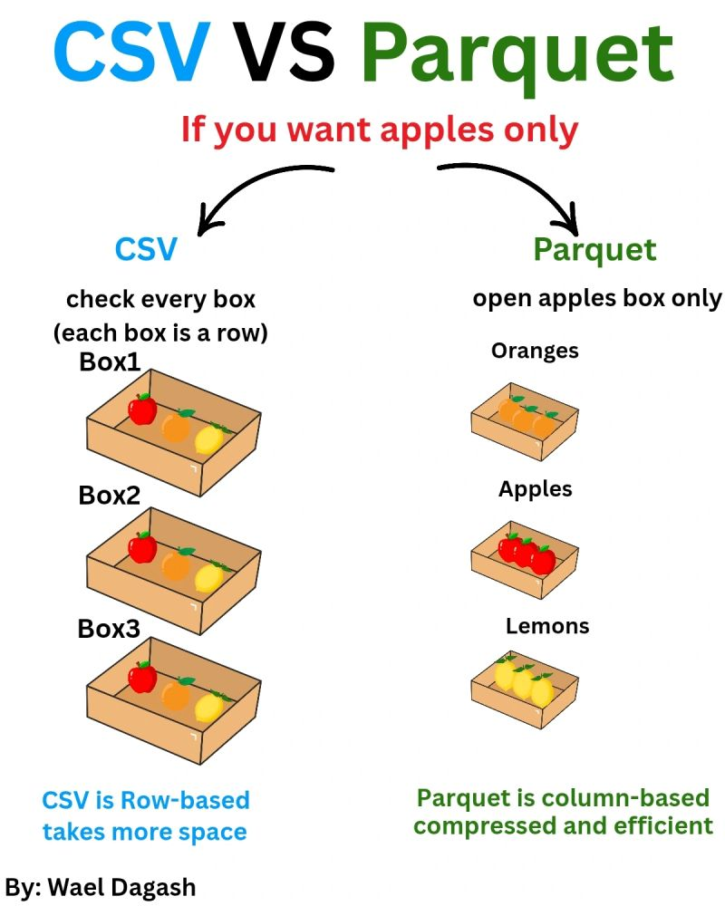
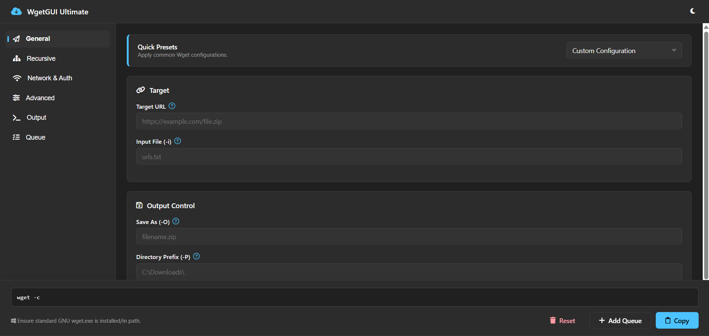
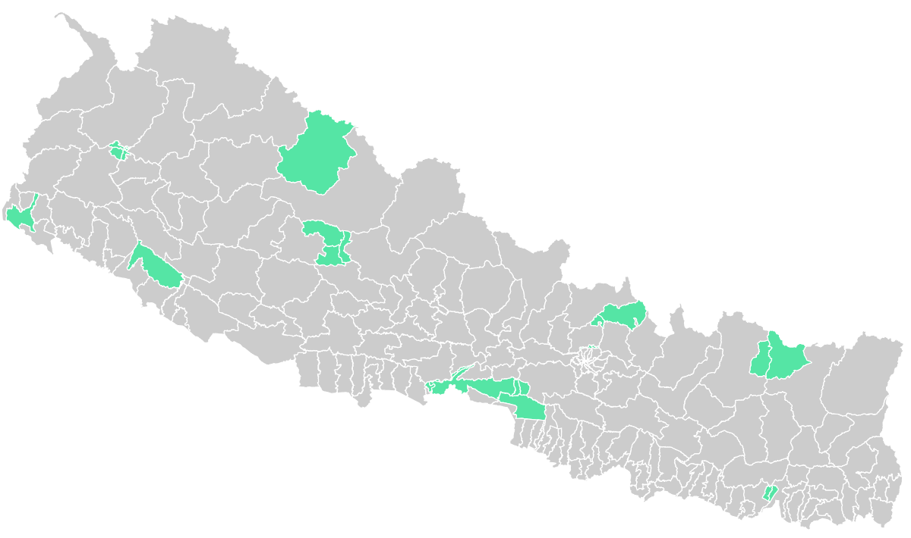

### [Salt Lake County Places Dashboard](dashboards/slco-places.llms.md)

Interactive dashboard of Overture Maps places in Salt Lake County: filter by category and confidence, see where they cluster and which cities have the most.

Oct 2026

4 min

### [Utah Bikeways Dashboard](dashboards/utah-bikeways.llms.md)

Interactive dashboard comparing bikeway miles with road miles for every Utah municipality, filterable by facility type.

Oct 2026

3 min

### [An Education Explorer for Public NCES Data](posts/education-explorer/index.llms.md)

A static, map-first dashboard for publicly available NCES data (CCD, PSS, IPEDS) for one U.S. state at a time, powered by DuckDB-WASM.

Oct 2026

3 min

### [A Zero-Cost Freight Flow Explorer for Utah](posts/freight-explorer/index.llms.md)

A map-first explorer for the public Freight Analysis Framework (FAF) data, built as a static site that queries Parquet files directly in the browser.

Oct 2026

4 min

### [Restyling Utah’s Vector Basemap for MapLibre](posts/ugrc-styles/index.llms.md)

Alternate MapLibre styles for UGRC’s Lite vector basemap, generated from live upstream sources, and a visual editor to tweak, compare and download them.

Sep 2026

4 min

### [Borderline: A U.S. Geography Guessing Game](posts/borderline/index.llms.md)

A browser geography game for U.S. states and counties, built as plain static HTML, CSS and JavaScript with no build step.

Sep 2026

2 min

### [Drut: Linting and Formatting for Cube Voyager Scripts](posts/drut/index.llms.md)

Drut is a linter, formatter and editor tooling suite for Cube Voyager scripts (.s / .block), with a CLI, a language server for VS Code, and an MCP server.

Aug 2026

3 min

### [GTFS vs. TDM Transit Network Comparison](work/gtfs-vs-tdm/index.llms.md)

A web map for comparing the base-year transit network in the Wasatch Front travel demand model with GTFS transit data. Developed at the Wasatch Front Regional Council.

Jul 2026

2 min

### [Commute Flow Explorer](work/commute-explorer/index.llms.md)

A client-side web app for exploring origin-destination commuter flows across the Wasatch Front using H3 cells and DuckDB-WASM. Developed at the Wasatch Front Regional Council.

Jun 2026

2 min

### [Opportunity Zones 2.0 Tract Info Sheets](work/opportunity-zones-info-sheets/index.llms.md)

A Quarto and R pipeline that builds county summary and per-tract detail PDFs for Utah’s Opportunity Zones 2.0 eligible list. Developed at the Wasatch Front Regional Council.

May 2026

2 min

### [Utah Commuter Flow Patterns](work/commute-patterns/index.llms.md)

An interactive, client-side map of commute flows across Utah, built on LEHD LODES data and open-source tools. Developed at the Wasatch Front Regional Council.

May 2026

2 min

### [SE 2025 Urban Form D Variables (H3)](work/se2025-h3/index.llms.md)

Calculates the D variables of urban form (density, diversity, design, destinations, demographics, distance to transit) for the Wasatch Front region at H3 resolution. Developed at the Wasatch Front Regional Council.

May 2026

2 min

### [ActivitySim Initialization & Accessibility](slides/activitysim-accessibility/index.llms.md)

A deep dive for travel demand modelers on how ActivitySim loads data, validates inputs, and computes its first aggregate measure, accessibility.

Apr 2026

1 min

### [Building a Client-Side Geo/Parquet File Viewer](posts/parquet-explorer/index.llms.md)

A browser-based viewer for GeoParquet and Parquet files with SQL and map views. It runs on WebAssembly, so the data stays on your computer.

Apr 2026

2 min

### [Building a Client-Side Open Matrix (OMX) File Viewer](posts/omx-viewer/index.llms.md)

A browser-based viewer for OMX matrix files from travel demand models. It runs on WebAssembly, so the data never leaves your computer.

Apr 2026

2 min

### [Prompt Engineering Best Practices](slides/prompt-engineering/index.llms.md)

Slides on prompt engineering best practices for analytics and modeling work, presented in WFRC’s Tech, Skills, and Beyond series.

Apr 2026

15 min

### [Spatial Explorer: Spatial SQL for Maps, in the Browser and in VS Code](posts/spatial-sql-explorer/index.llms.md)

Open a geospatial file, query it with spatial SQL, style it and export it without a desktop GIS. How the project grew from a single-page experiment into a web app and a VS Code extension.

Feb 2026

9 min

### [Modernizing Spatial Workflows](slides/spatial-benchmark/index.llms.md)

Benchmarks of DuckDB, SedonaDB and GeoParquet against sf and GeoPandas on Utah address and county data, in R and Python.

Feb 2026

11 min

### [WgetGUI Ultimate: A Fluent Command Generator](posts/wget-gui/index.llms.md)

A modern, Windows 11-inspired web interface for building complex GNU Wget commands

Jan 2026

2 min

### [Nepal Electoral Constituency GeoJSON](posts/nepal-election-geojson/index.llms.md)

Scraping a constituency map from an election results site, converting its SVG paths to GIS geometry, and georeferencing it against ward boundaries in R.

Jan 2026

7 min

### [Housing Site Evaluator](work/housing-site-evaluator/index.llms.md)

Scores every parcel and H3 hexagon in the Wasatch Front region on access to jobs, transit and everyday necessities. Developed at the Wasatch Front Regional Council.

Dec 2025

2 min

### [Analyzing the Utah Bikeways data](posts/utah-bikeways/index.llms.md)

This analysis calculates and compares roadway lane miles and bikeway facility miles across Utah municipalities using spatial data from the Utah Geospatial Resource Center (UGRC).

Nov 2025

17 min

### [Building an Interactive Storymap using {mapgl}](posts/storymap_my_journey/index.llms.md)

Creating an open-source, interactive storymap with the {mapgl} R package to visualize my journey across the world.

Sep 2025

6 min

### [Quantifying Economic Effects of Transportation Investments](slides/quantifying-economic-impacts/index.llms.md)

Slides on methods and applications for quantifying the economic effects of transportation investments in regional planning.

Aug 2025

10 min

### [Base Year SE Data Development](posts/socioeconomic-demo/index.llms.md)

Developing base-year socioeconomic data by traffic analysis zone for the Lower Savannah COG 2050 Long Range Transportation Plan, using R and Python.

Jul 2025

53 min

### [Building an Interactive Population Pyramid Explorer](posts/population-pyramid-explorer/index.llms.md)

A deep dive into creating a story-driven Shiny application that combines interactive mapping with demographic visualizations using Census data.

Jun 2025

5 min

### [Interactive Robocopy GUI Tool](posts/robocopy-gui/index.llms.md)

A web-based interface for generating Windows robocopy commands with ease

Jun 2025

2 min

### [pukRhelpers: A Personal Toolbox of R Helpers](posts/pukrhelpers/index.llms.md)

An R package collecting helper functions from my day-to-day data and GIS work. Maintained lightly.

May 2025

2 min

### [Overture Maps Data Download](posts/overture-data-download/index.llms.md)

Downloading Overture Maps data for an area of interest with DuckDB, in both R and Python.

May 2024

8 min

### [Building a U.S. Census Data Explorer](posts/uscensus-dashboard/index.llms.md)

Learn how to build an interactive Shiny dashboard for exploring U.S. Census data including ACS, Decennial Census, and LEHD datasets with integrated mapping capabilities.

May 2024

8 min

### [3D Population Density Mapping of Nepal](posts/nepal-population-density/index.llms.md)

A 3D population density map of Nepal built in R with rayshader and Kontur population data.

Jan 2023

16 min
