[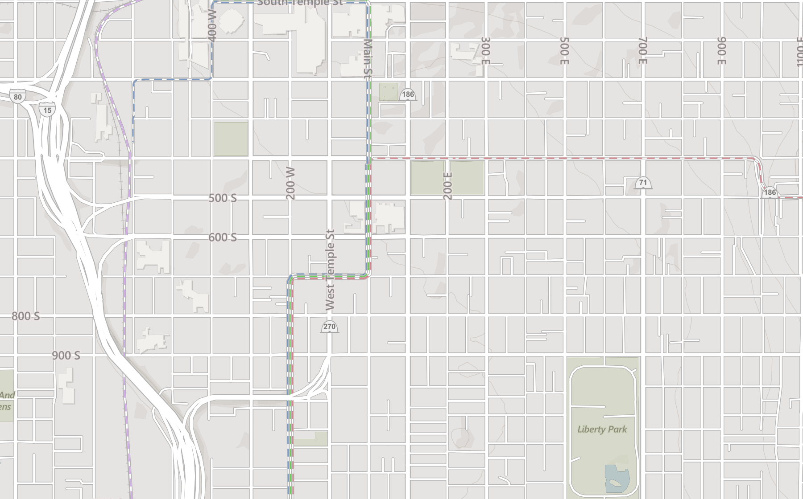](posts/basemapper/index.llms.md)

### [basemapper: Vector Basemaps for R and Python, Rendered Headlessly](posts/basemapper/index.llms.md)

Static maps in R and Python could only use raster tiles for basemaps. basemapper renders MapLibre vector styles at the figure’s own zoom and resolution, as PNG or true vector SVG, without a browser or GPU. Here is what it does and what it took to build.

Nov 2026

15 min

[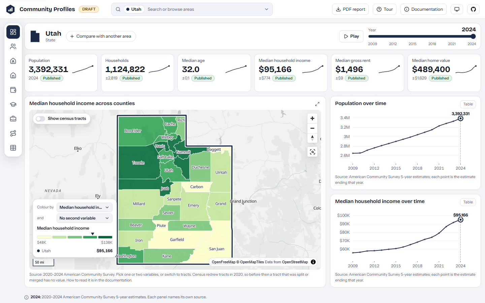](work/community-profiles/index.llms.md)

### [Demographic Profiles](work/community-profiles/index.llms.md)

A static, map-first dashboard of Census and economic indicators for Utah, its counties and its cities and towns, plus the data pipeline behind it. Forked from the Wasatch Front Regional Council’s Community Profiles.

Nov 2026

8 min

[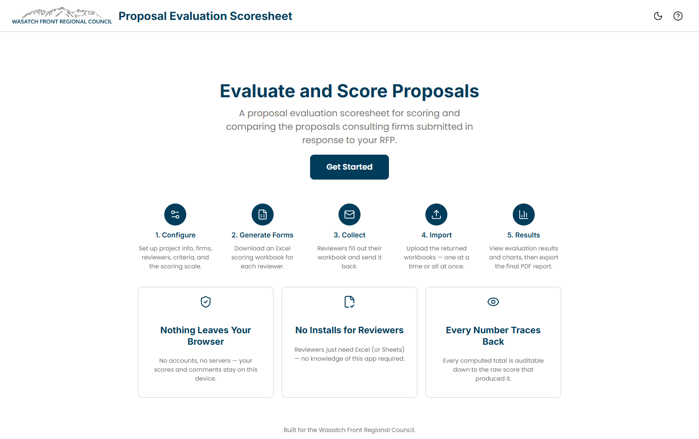](work/proposal-scoresheet/index.llms.md)

### [Proposal Evaluation Scoresheet](work/proposal-scoresheet/index.llms.md)

A browser-only tool for configuring weighted criteria, collecting reviewer scores through Excel workbooks, and ranking consulting firm proposals, with every number traceable to its raw score. Developed at the Wasatch Front Regional Council.

Nov 2026

6 min

[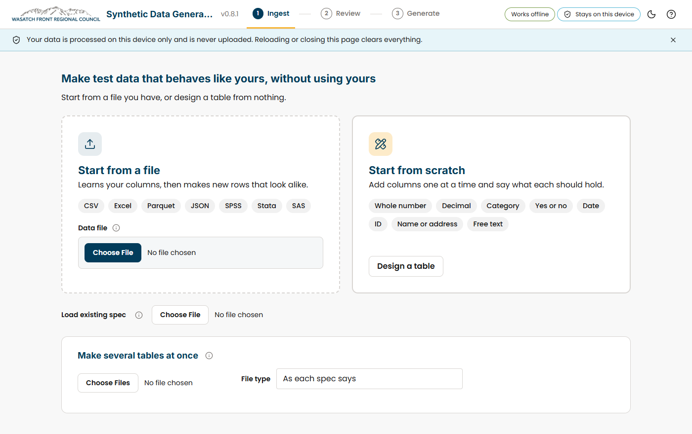](work/synthetic-data-generator/index.llms.md)

### [Synthetic Data Generator](work/synthetic-data-generator/index.llms.md)

A browser-only tool that turns a private survey table into a fake table with the same columns, types, formats and summary statistics, so analysis code can be written against it and run later on the real file. Developed at the Wasatch Front Regional Council.

Nov 2026

7 min

[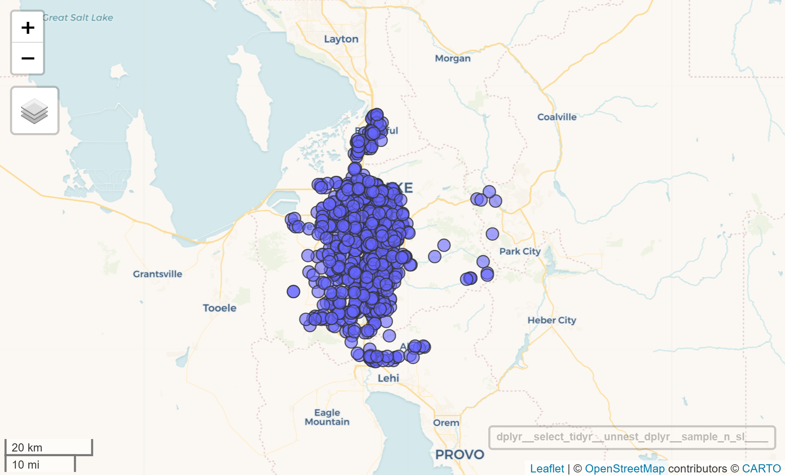](dashboards/slco-places.llms.md)

### [Salt Lake County Places Dashboard](dashboards/slco-places.llms.md)

Interactive dashboard of Overture Maps places in Salt Lake County: filter by category and confidence, see where they cluster and which cities have the most.

Oct 2026

4 min

[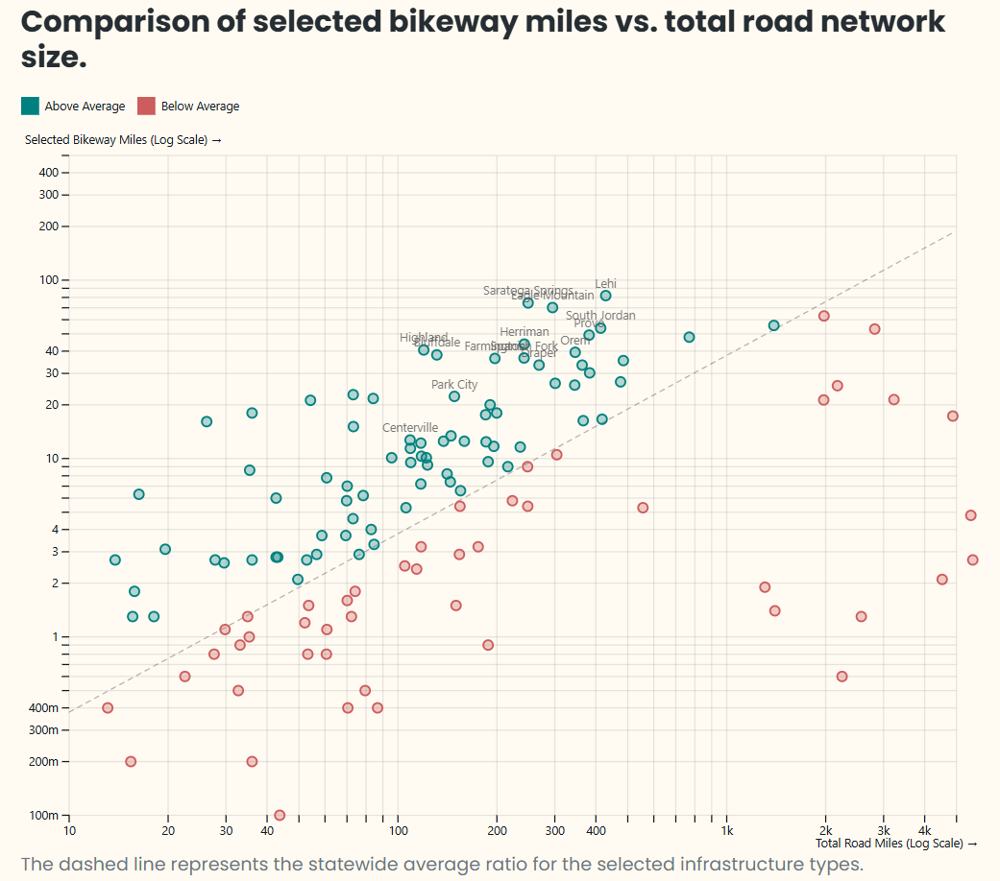](dashboards/utah-bikeways.llms.md)

### [Utah Bikeways Dashboard](dashboards/utah-bikeways.llms.md)

Interactive dashboard comparing bikeway miles with road miles for every Utah municipality, filterable by facility type.

Oct 2026

3 min

[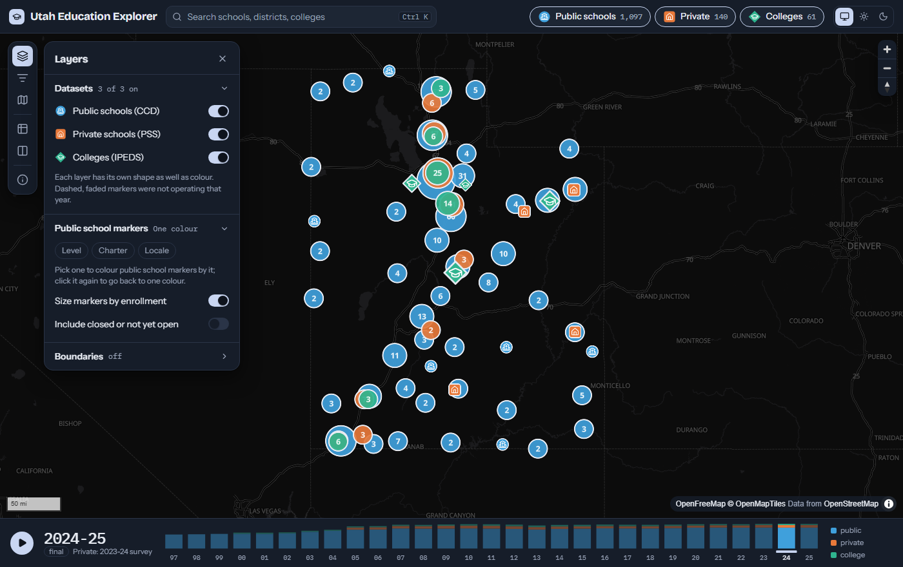](posts/education-explorer/index.llms.md)

### [An Education Explorer for Public NCES Data](posts/education-explorer/index.llms.md)

A static, map-first dashboard for publicly available NCES data (CCD, PSS, IPEDS) for one U.S. state at a time, powered by DuckDB-WASM. Here is why NCES data is hard to use, what the explorer does, and the pipeline problems behind it.

Oct 2026

11 min

[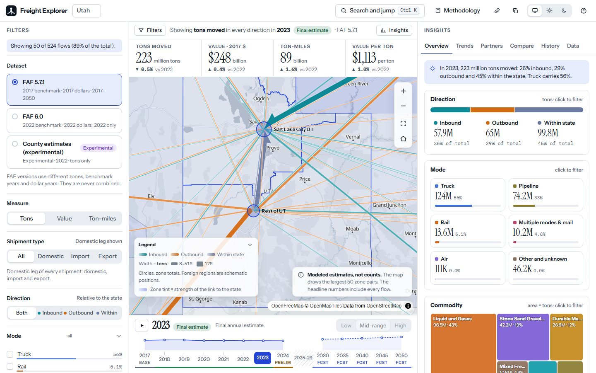](posts/freight-explorer/index.llms.md)

### [A Zero-Cost Freight Flow Explorer for Utah](posts/freight-explorer/index.llms.md)

A map-first explorer for the public Freight Analysis Framework (FAF) data, built as a static site that queries Parquet files directly in the browser. Here is why FAF is awkward to use, what the explorer shows, and what it took to build.

Oct 2026

11 min

[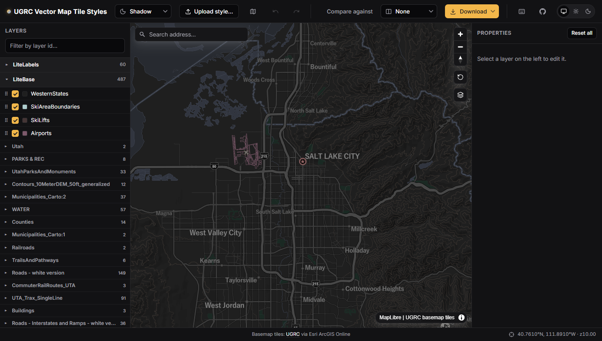](posts/ugrc-styles/index.llms.md)

### [Restyling Utah’s Vector Basemap for MapLibre](posts/ugrc-styles/index.llms.md)

Alternate MapLibre styles for UGRC’s Lite vector basemap, generated by rules from live upstream sources, and a visual editor to tweak, compare and download them. How it works, and the bugs that shaped it.

Sep 2026

11 min

[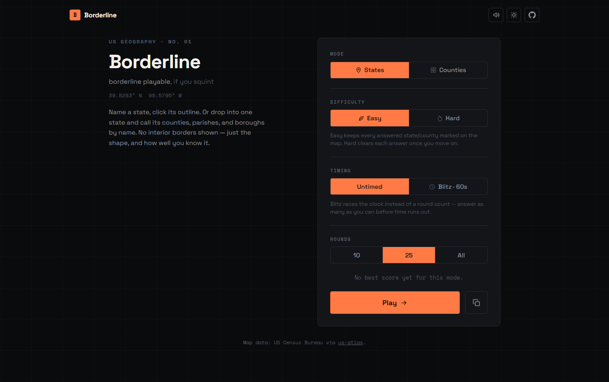](posts/borderline/index.llms.md)

### [Borderline: A U.S. Geography Guessing Game](posts/borderline/index.llms.md)

A browser geography game for U.S. states and counties, built as plain static HTML, CSS and JavaScript with no build step. Here is how it plays, and the projection, hit-testing and caching problems behind it.

Sep 2026

9 min

[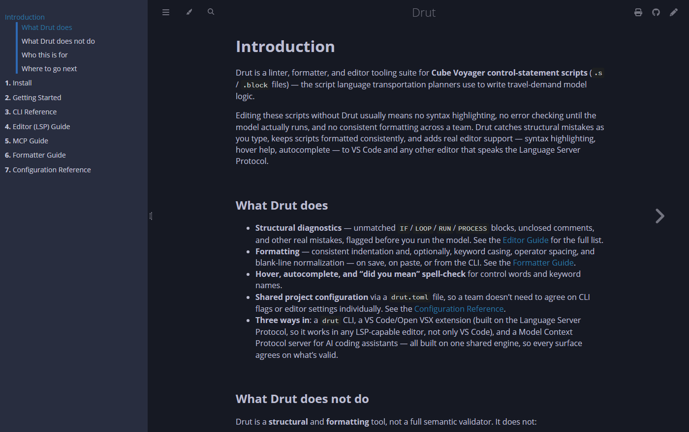](posts/drut/index.llms.md)

### [Drut: Linting and Formatting for Cube Voyager Scripts](posts/drut/index.llms.md)

Drut is a linter, formatter and editor tooling suite for Cube Voyager scripts (.s / .block), with a CLI, a VS Code extension built on a language server, and an MCP server. Here is why it exists, what it does, and what it took to parse a language with no public grammar.

Aug 2026

10 min

[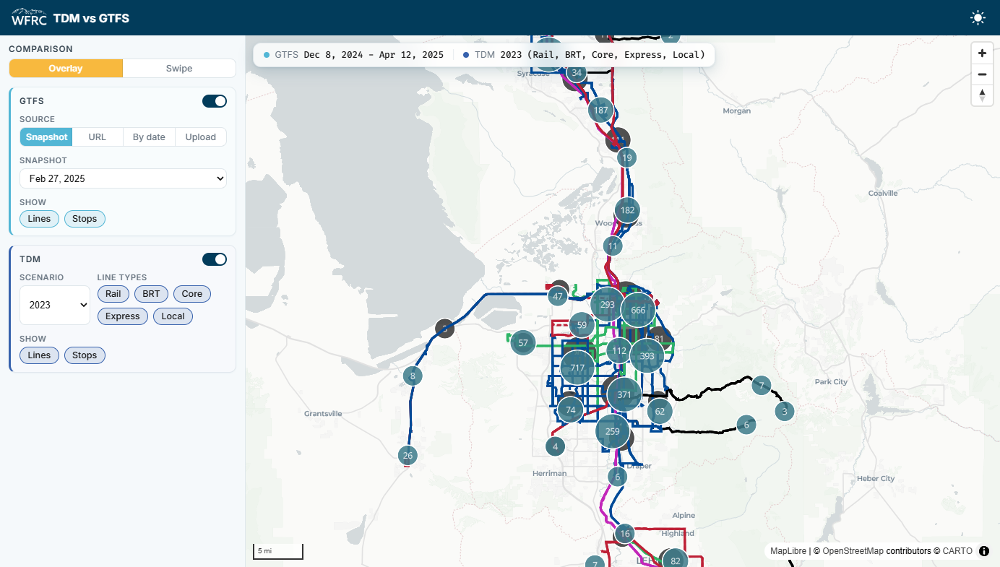](work/gtfs-vs-tdm/index.llms.md)

### [GTFS vs. TDM Transit Network Comparison](work/gtfs-vs-tdm/index.llms.md)

A web map for comparing the base-year transit network in the Wasatch Front travel demand model with GTFS transit data, built as an R Shiny app and a static browser app. Developed at the Wasatch Front Regional Council.

Jul 2026

6 min

[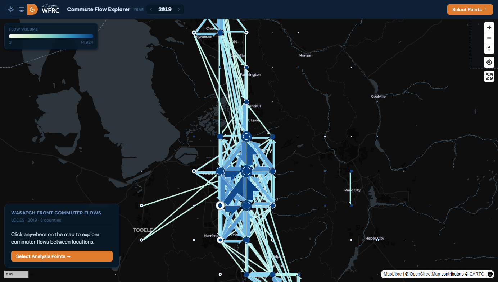](work/commute-explorer/index.llms.md)

### [Commute Flow Explorer](work/commute-explorer/index.llms.md)

A client-side web app for exploring origin-destination commuter flows across the Wasatch Front using H3 cells and DuckDB-WASM. Developed at the Wasatch Front Regional Council.

Jun 2026

6 min

[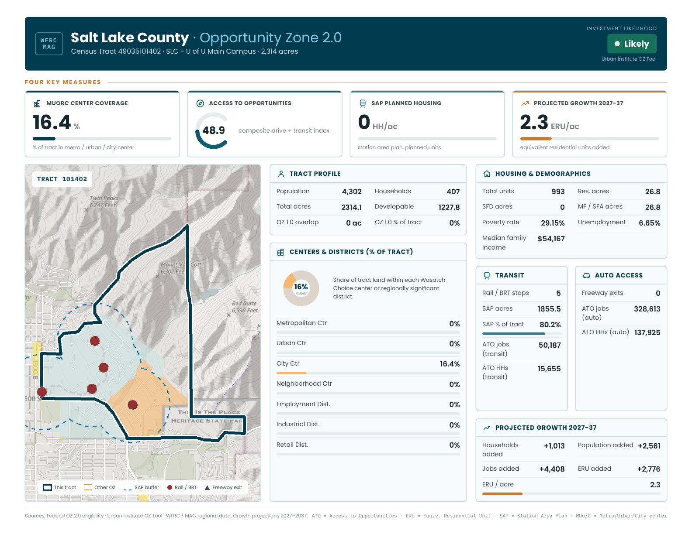](work/opportunity-zones-info-sheets/index.llms.md)

### [Opportunity Zones 2.0 Tract Info Sheets](work/opportunity-zones-info-sheets/index.llms.md)

A Quarto, R and Typst pipeline that turns a dozen regional GIS layers into a one-page profile for every census tract on Utah’s Opportunity Zones 2.0 eligible list. Developed at the Wasatch Front Regional Council.

May 2026

5 min

[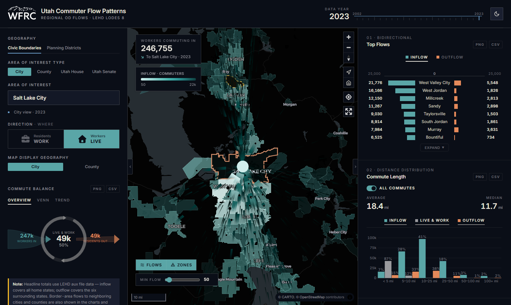](work/commute-patterns/index.llms.md)

### [Utah Commuter Flow Patterns](work/commute-patterns/index.llms.md)

An interactive, client-side map of commute flows across Utah, built on LEHD LODES data and open-source tools. Developed at the Wasatch Front Regional Council.

May 2026

7 min

[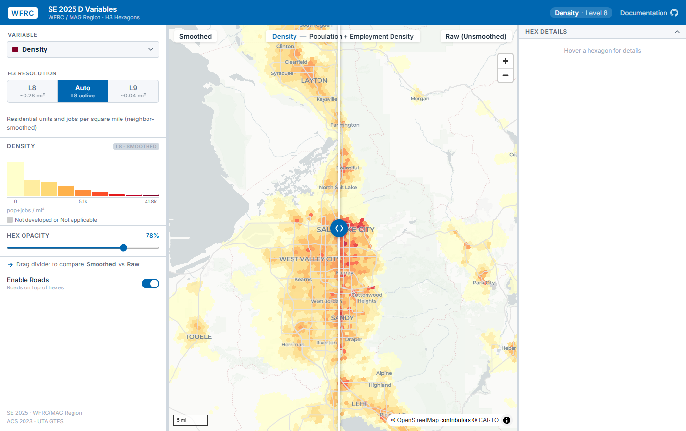](work/se2025-h3/index.llms.md)

### [SE 2025 Urban Form D Variables (H3)](work/se2025-h3/index.llms.md)

Calculates the D variables of urban form (density, diversity, design, destinations, demographics, distance to transit) for the Wasatch Front region at H3 resolution, with neighbor smoothing and a swipe map to compare smoothed and raw values. Developed at the Wasatch Front Regional Council.

May 2026

7 min

[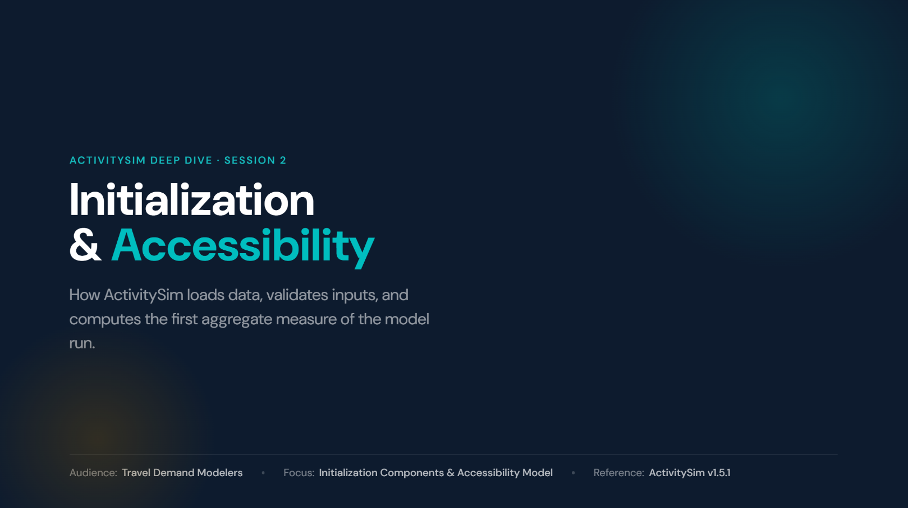](slides/activitysim-accessibility/index.llms.md)

### [ActivitySim Initialization & Accessibility](slides/activitysim-accessibility/index.llms.md)

A deep dive for travel demand modelers on how ActivitySim loads data, validates inputs, and computes its first aggregate measure, accessibility.

Apr 2026

1 min

[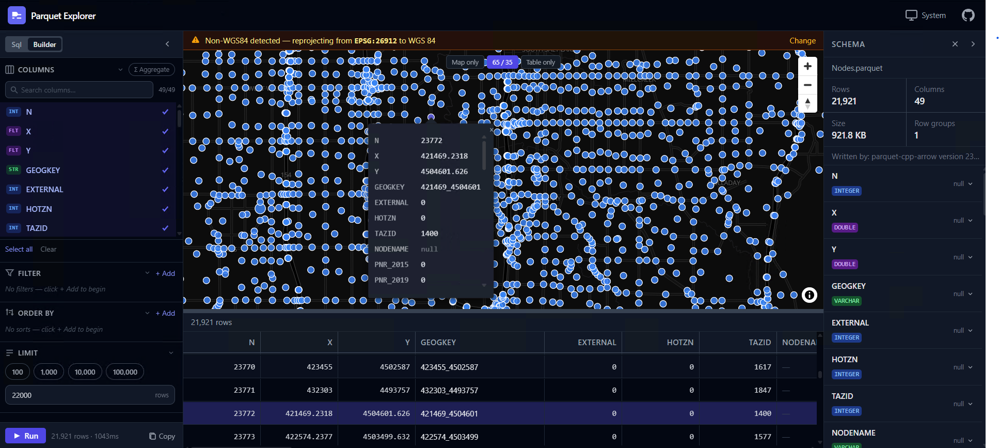](posts/parquet-explorer/index.llms.md)

### [Building a Client-Side Geo/Parquet File Viewer](posts/parquet-explorer/index.llms.md)

A browser-based viewer for GeoParquet and Parquet files with SQL and map views. It runs on DuckDB-WASM, so the data stays on your computer. Here is what it does, and what it took to get geometry from a Parquet file onto a map in the browser.

Apr 2026

9 min

[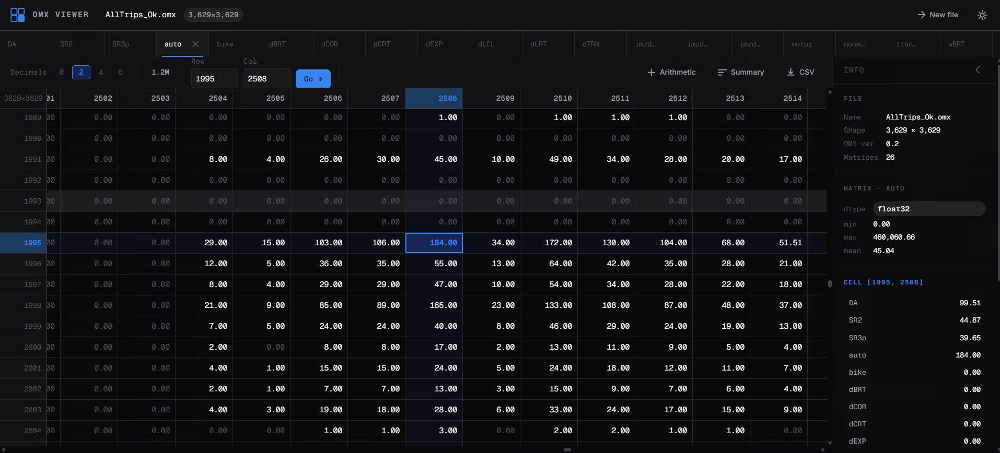](posts/omx-viewer/index.llms.md)

### [Building a Client-Side Open Matrix (OMX) File Viewer](posts/omx-viewer/index.llms.md)

A browser-based viewer for OMX matrix files from travel demand models. It runs on WebAssembly, so the data never leaves your computer. Here is what it does and what it took to scroll a multi-hundred-megabyte matrix in a browser tab.

Apr 2026

9 min

### [Prompt Engineering Best Practices](slides/prompt-engineering/index.llms.md)

Slides on prompt engineering best practices for analytics and modeling work, presented in WFRC’s Tech, Skills, and Beyond series.

Apr 2026

15 min

[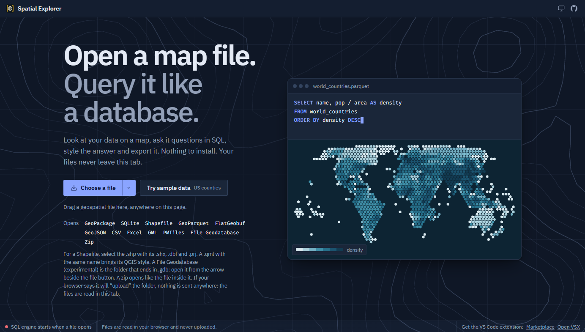](posts/spatial-sql-explorer/index.llms.md)

### [Spatial Explorer: Spatial SQL for Maps, in the Browser and in VS Code](posts/spatial-sql-explorer/index.llms.md)

Open a geospatial file, query it with spatial SQL, style it and export it without a desktop GIS. How the project grew from a single-page experiment into a web app and a VS Code extension.

Feb 2026

9 min

[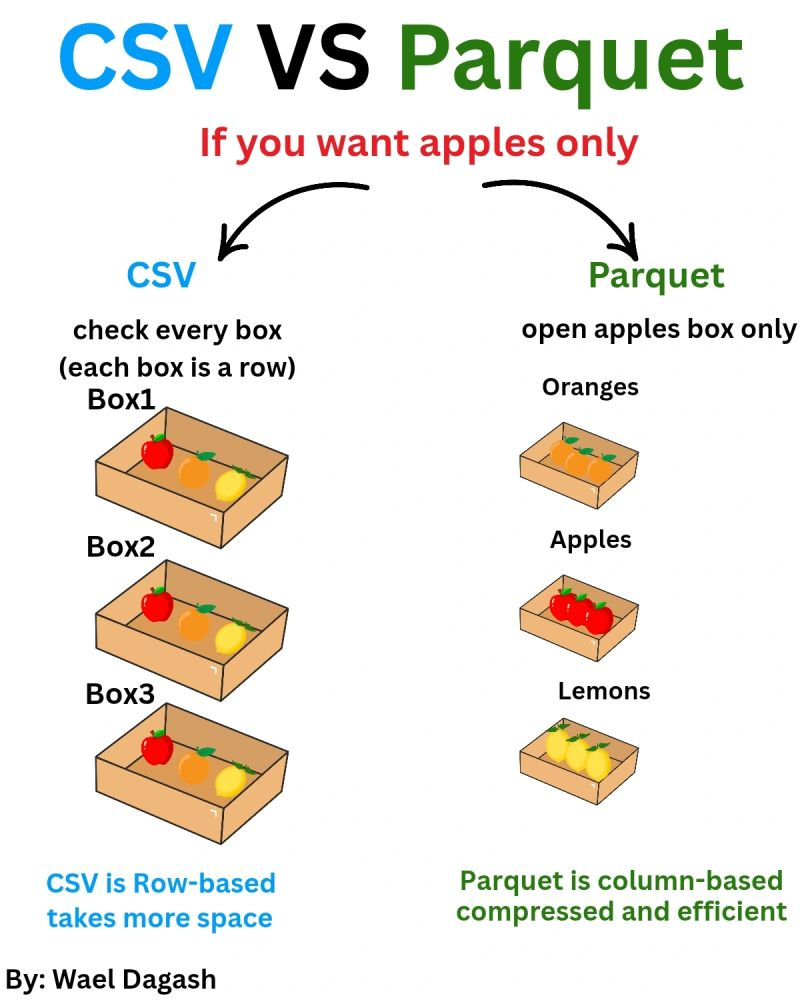](slides/spatial-benchmark/index.llms.md)

### [Modernizing Spatial Workflows](slides/spatial-benchmark/index.llms.md)

Benchmarks of DuckDB, SedonaDB and GeoParquet against sf and GeoPandas on Utah address and county data, in R and Python.

Feb 2026

11 min

[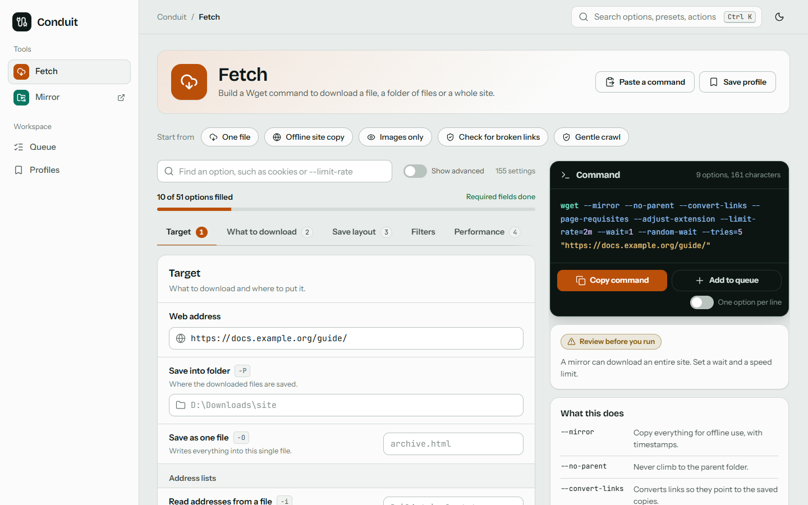](posts/wget-gui/index.llms.md)

### [Fetch: a Wget Command Builder](posts/wget-gui/index.llms.md)

A browser-based builder for GNU Wget commands, covering every option in wget 1.21 with plain-language explanations and warnings for risky choices

Jan 2026

7 min

[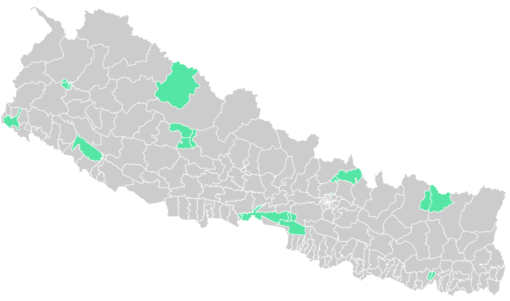](posts/nepal-election-geojson/index.llms.md)

### [Nepal Electoral Constituency GeoJSON](posts/nepal-election-geojson/index.llms.md)

Scraping a constituency map from an election results site, converting its SVG paths to GIS geometry, and georeferencing it against ward boundaries in R.

Jan 2026

8 min

[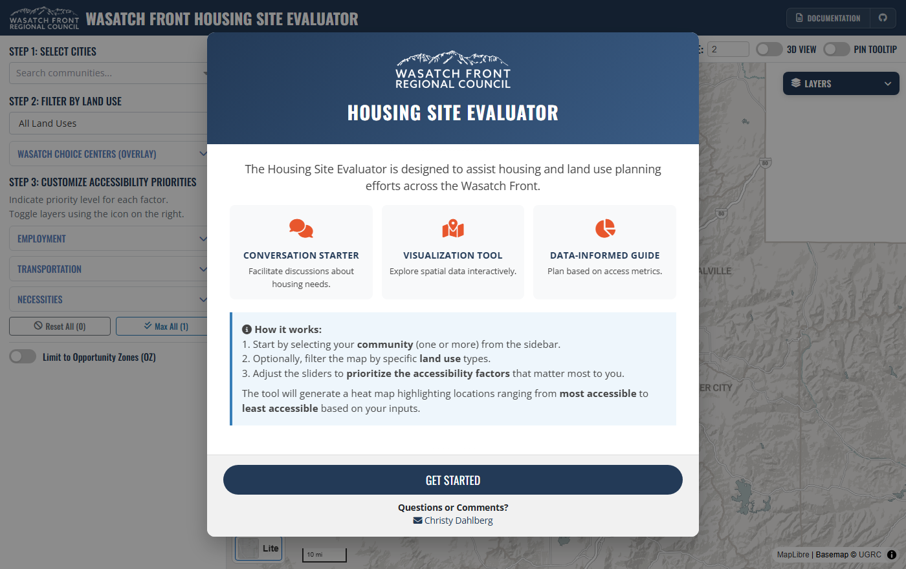](work/housing-site-evaluator/index.llms.md)

### [Housing Site Evaluator](work/housing-site-evaluator/index.llms.md)

Scores every parcel and H3 hexagon in the Wasatch Front region on access to jobs, transit and everyday necessities, and lets planners weight those factors on a live map. Developed at the Wasatch Front Regional Council.

Dec 2025

6 min

### [Analyzing the Utah Bikeways data](posts/utah-bikeways/index.llms.md)

This analysis calculates and compares roadway lane miles and bikeway facility miles across Utah municipalities using spatial data from the Utah Geospatial Resource Center (UGRC).

Nov 2025

19 min

### [Building an Interactive Storymap using {mapgl}](posts/storymap_my_journey/index.llms.md)

Creating an open-source, interactive storymap with the {mapgl} R package to visualize my journey across the world.

Sep 2025

6 min

### [Quantifying Economic Effects of Transportation Investments](slides/quantifying-economic-impacts/index.llms.md)

Slides on methods and applications for quantifying the economic effects of transportation investments in regional planning.

Aug 2025

10 min

### [Base Year SE Data Development](posts/socioeconomic-demo/index.llms.md)

Developing base-year socioeconomic data by traffic analysis zone for the Lower Savannah COG 2050 Long Range Transportation Plan, using R and Python.

Jul 2025

53 min

### [Building an Interactive Population Pyramid Explorer](posts/population-pyramid-explorer/index.llms.md)

A Shiny app that pairs a scrolling {mapgl} story map of tract-level median age with a population pyramid for any U.S. county, built on two Census Bureau products. Why I built it, how the story map and the pyramid work, and ideas for what comes next.

Jun 2025

7 min

### [Mirror: a Robocopy Command Builder](posts/robocopy-gui/index.llms.md)

A browser-based builder for Windows Robocopy commands, covering every option in robocopy /? with plain-language explanations and warnings before anything deletes files

Jun 2025

7 min

### [pukRhelpers: A Personal Toolbox of R Helpers](posts/pukrhelpers/index.llms.md)

An R package collecting the helper functions I kept copying between projects, from ArcGIS and Open SGID loaders to KML parsing and line splitting, with one function you can run in your browser. Maintained lightly.

May 2025

8 min

### [Overture Maps Data Download](posts/overture-data-download/index.llms.md)

Downloading Overture Maps data for an area of interest with DuckDB, in both R and Python.

May 2024

8 min

### [Building a U.S. Census Data Explorer](posts/uscensus-dashboard/index.llms.md)

A Shiny app that puts the American Community Survey, the Decennial Census and LEHD employment data behind one point-and-click interface, with a map, a searchable variable picker and CSV or shapefile downloads. Why I built it, how it works, and what I would change.

May 2024

11 min

### [3D Population Density Mapping of Nepal](posts/nepal-population-density/index.llms.md)

A 3D population density map of Nepal built in R with rayshader and Kontur population data.

Jan 2023

12 min
