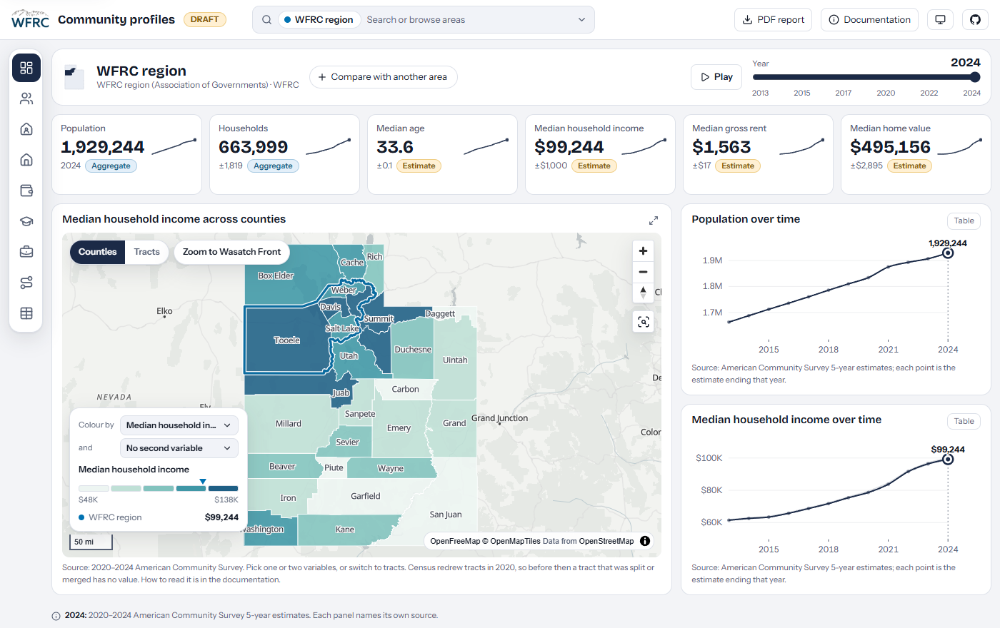

> **NOTE:**
>
> **Developed at the Wasatch Front Regional Council (WFRC).** The application and its repository belong to WFRC; this page only summarizes my work. The app is still marked as a draft.

The dashboard for the WFRC region: headline indicators, a county choropleth, and population and income trends.

## What it does

Community profiles (“facts and figures”) for the WFRC region, its counties, cities and planning areas (AOG, MPO, RPO and workshop areas), all in one dashboard with no backend.

- **ACS 5-year indicators** with trends from 2009 to 2024, annual population estimates, jobs, workers and commute flows from LODES, and employment and wages from QCEW.
- **Ten screens** from Overview to Commute, with a year slider that drives every panel, side-by-side comparison of two areas, and a shareable URL for any view.
- **Honest numbers:** every value carries a method label (direct, aggregated, allocated or derived), so it is clear whether a figure was published for exactly that area or built from block groups.
- A **PDF report** (a designed profile or a poster) generated in the browser for any area.

## What I worked on

Both halves of the project: the Python pipeline that downloads, validates and crosswalks the Census, LODES and QCEW data into committed Parquet files, and the Svelte and TypeScript front end that reads them in the browser with DuckDB-WASM, with MapLibre maps, Observable Plot charts and a Flowmap.gl commute layer.

My role: developer. I authored all the commits in the repository.

## See it

[ Open app](https://wfrcanalytics.github.io/APP-Community-Profiles/) [ GitHub](https://github.com/WFRCAnalytics/APP-Community-Profiles)
