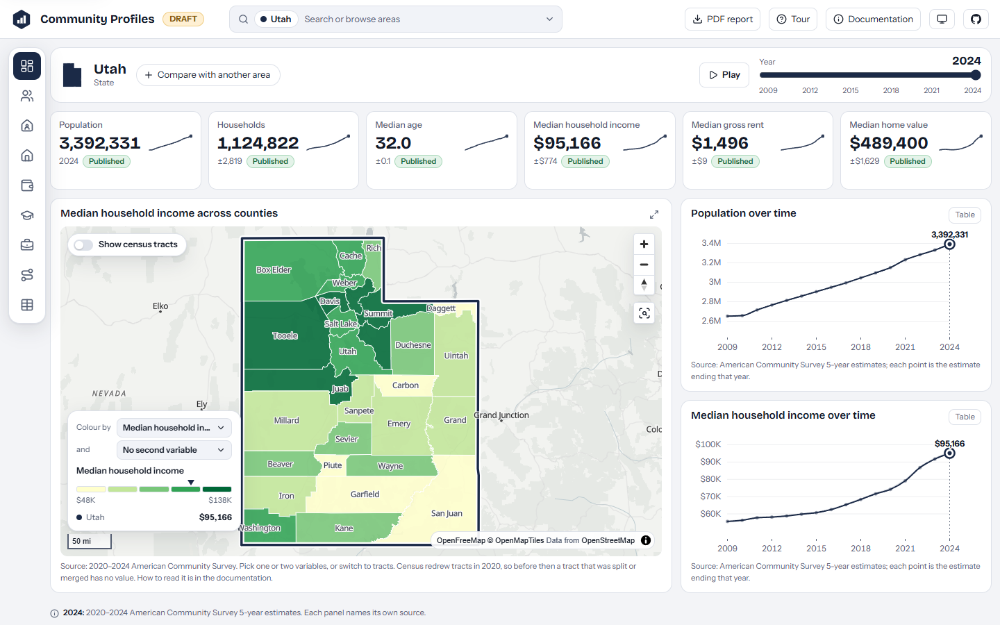

::: {.callout-note}
## Forked from WFRC's Community Profiles

A fork of Community Profiles, which I developed at the [Wasatch Front Regional Council (WFRC)](https://wfrc.utah.gov/), hosted in my own repository with WFRC's permission. The original belongs to WFRC ([details below](#the-original)). This app is still marked as a draft.
:::

## What it does

Facts and figures for Utah, its counties and its cities and towns, all in one dashboard with no backend. Census tracts can be drawn on the maps.

- **ACS 5-year indicators** with trends from 2009 to 2024, annual population estimates, jobs, workers and commute flows from LODES, and employment and wages from QCEW.
- **Ten screens** from Overview to Commute, with a year slider that drives every panel, side-by-side comparison of two areas, and a shareable URL for any view.
- **Honest numbers:** every value carries a method label (published for exactly that area, or aggregated from whole Census blocks), so it is clear how a figure was produced.
- A **PDF report** (a designed profile or a poster) generated in the browser for any area.

## What I worked on

Everything in it. I developed the original at WFRC, both halves of it: the Python pipeline that downloads, validates and crosswalks the Census, LODES and QCEW data into committed Parquet files, and the Svelte and TypeScript front end that reads them in the browser with DuckDB-WASM, with MapLibre maps, Observable Plot charts and a Flowmap.gl commute layer. I authored all the commits in that repository.

This fork is mine to maintain. I reworked the geography from the WFRC region and its planning areas to the state, counties and cities and towns of Utah, and gave the app its own name and mark.

## See it

::: {.app-links}
[ Open app](https://ar-puuk.github.io/Demographic-Profiles/){.btn .btn-primary target="_blank" rel="noopener"}
[ GitHub](https://github.com/ar-puuk/Demographic-Profiles){.btn .btn-outline-secondary target="_blank" rel="noopener"}
:::

## The original: WFRC's Community Profiles {#the-original}

Community Profiles is the WFRC app this one was derived from. It covers the WFRC region, its counties, cities and planning areas (AOG, MPO, RPO and workshop areas). It belongs to WFRC and is unchanged for now. WFRC allowed me to fork it and host this version in my own repository, with some adjustments, as a demographic profile. It will evolve to accommodate more diverse, strategic metrics for planning and regional development, such as population projections, land use characteristics, transit ridership and travel characteristics. Credit for the original, and for the Wasatch Front data work behind it, goes to the agency.

::: {.app-links}
[ Community Profiles](https://wfrcanalytics.github.io/APP-Community-Profiles/){.btn .btn-outline-secondary target="_blank" rel="noopener"}
[ Its repository](https://github.com/WFRCAnalytics/APP-Community-Profiles){.btn .btn-outline-secondary target="_blank" rel="noopener"}
[ WFRC on GitHub](https://github.com/WFRCAnalytics){.btn .btn-outline-secondary target="_blank" rel="noopener"}
[ WFRC website](https://wfrc.utah.gov/){.btn .btn-outline-secondary target="_blank" rel="noopener"}
:::
