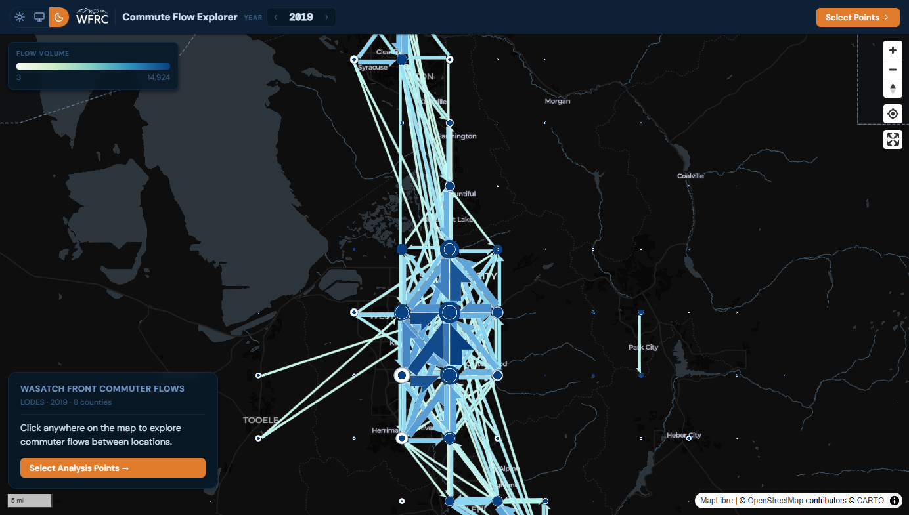

> **NOTE:**
>
> The application and its repository belong to WFRC; this page only summarizes my work.

The explorer’s region-wide flow map, with the year selector and Select Points button.

## Why a second commute tool

WFRC already had a commute flow map: [Commute Patterns](../../work/commute-patterns/index.llms.md), which answers questions about named places. Where do Salt Lake City’s residents work? Where do Davis County’s workers live? That works well when the question follows a city, county or district boundary.

Many planning questions don’t. A transit station, a new employment center or a corridor doesn’t have a boundary in the Census data, and the people asking about it want to know how many commuters move between that spot and a few others. The underlying data, the Census Bureau’s LEHD Origin-Destination Employment Statistics (LODES), is published for Census blocks, so the detail is there. What was missing was a way to draw your own areas and compare them.

The repository puts the difference plainly: use Commute Patterns when your question is about a named jurisdiction, and use Commute Flow Explorer when you want to draw your own catchment areas and compare them.

## What it does

The app opens on an **overview flow map** of every commute flow across the eight-county Wasatch Front region. Zoomed out, nearby flows are clustered into a readable picture of the region; zooming in breaks them back apart.

Pressing **Select Points** switches to analysis mode. Click anywhere on the map to place 2 to 10 analysis points. Each point captures a ring of H3 hexagons (about 0.1 km² cells) around the click, and the ring size can be set for all points at once or for one point on its own. Then:

- **Flow lines** connect every pair of points, in both directions, scaled and coloured by the number of commuters. Hovering a line shows the total with wage and industry breakdowns, and a click pins that tooltip in place.
- **An OD matrix** lists every origin-destination pair in a colour-coded table, with the same wage and industry detail.
- **Point cards** in the sidebar show each point’s name (editable), county, colour, and outbound and inbound totals. Points can be dragged to reorder them.
- **A year selector** covers LODES data from 2002 to 2023. Selecting 2020 or 2021 shows a badge warning that those years were disrupted by COVID.

Everything runs in the browser: LODES data is queried with DuckDB-WASM, with light and dark themes, and there is no server or API key behind it.

## How it’s built

### The data pipeline

A set of Python scripts, run with `uv`, prepares the data once. They download the LODES origin-destination files and the workplace area files for the configured counties, and use the Census geography crosswalk to assign every block to the H3 resolution 9 cell that contains it. Flows are then summed from block pairs to hexagon pairs and written as one Parquet file per year: total commuters, three wage bands, and three industry groups. The industry counts come from the workplace files, joined at the work block before aggregation so that they describe the jobs at the destination. A small metadata file lists every populated cell with its centre and county, and is loaded once when the app starts.

The list of counties lives in a single YAML file. Adding or removing a county, even one in another state for a cross-state metro, means editing that file and rerunning the scripts; the app code doesn’t change.

### The app

The front end is React with Vite. MapLibre draws the map, `h3-js` turns a click into a ring of cells, and Flowmap.gl on deck.gl draws the flows. When the points, the year or a ring size change, the app sends DuckDB-WASM a query for the flows between the selected cells and rebuilds the flow lines and the matrix from the result.

## Interesting problems

**Running DuckDB on GitHub Pages.** The multi-threaded builds of DuckDB-WASM need cross-origin isolation headers that GitHub Pages doesn’t set. The app uses the single-threaded bundle, which needs neither those headers nor a server, and reads each year’s Parquet file over HTTP.

**Keeping the overview fast.** Drawing every hexagon pair in the region at once made Flowmap.gl’s clustering slow. The overview query instead aggregates flows to a 0.1-degree grid inside DuckDB before they reach the map, which leaves a few hundred cells for the flow layer to cluster and keeps panning responsive.

**Overlapping catchments.** Two points placed close together can share cells. The app detects this, names the overlapping pair in a warning, and highlights the shared cells. A flow from a shared cell is counted for both points, which is stated in the warning rather than hidden. Shrinking the ring of one point, or of all of them, clears the overlap.

**Naming a county for an empty cell.** Each point card shows its county, looked up from the cell metadata. Cells in sparse areas, such as the Tooele salt flats or mountain wilderness, have no blocks with people or jobs and so no metadata. For those, the lookup falls back to the cell’s much larger resolution 5 parent cell (about 250 km²) and takes the county from there.

**A basemap that wouldn’t render.** UGRC’s vector basemap is an option alongside the default Carto basemap. Its tiles, served by ArcGIS, encode some data in an older Protocol Buffers form that MapLibre’s tile parser doesn’t accept, leaving holes in the map. A small service worker intercepts those tile requests and rewrites the affected fields into the standard encoding before MapLibre sees them.

**Clicks that meant two things.** Clicking a flow line to pin its tooltip also counted as a click on the map, which placed a stray analysis point underneath it. The flow layer now marks the click as handled, so the map’s click handler skips it.

## How the work was organized

I built it spec-first. Before any app code, the repository held a set of principles (no server, data fidelity, geography from config, accessibility among them), a specification with user stories and requirements, a research note on each library choice, the data model and an ordered task list. The first full implementation followed those documents, and the commits after it are refinement: the overview mode, the dockable tooltips, the WFRC theme, resizable panels and per-point ring control.

## What I worked on

The full application: the data pipeline that builds the hexagon flow files, a React and Vite front end, MapLibre with flowmap.gl and deck.gl for the flow layer, and the Parquet data that DuckDB-WASM queries.

My role: developer. I authored all the commits in the repository.

## See it

[ Open app](https://wfrcanalytics.github.io/APP-Commute-Explorer/) [ GitHub](https://github.com/WFRCAnalytics/APP-Commute-Explorer)
