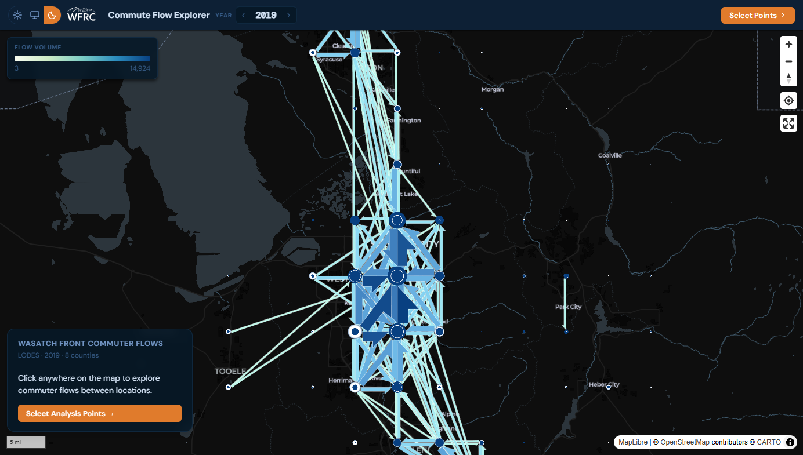

::: {.callout-note appearance="simple"}
**Developed at the Wasatch Front Regional Council (WFRC).** The application and its repository belong to WFRC; this page only summarizes my work.
:::

## What it does

Where [Commute Patterns](../commute-patterns/index.qmd) answers questions about named jurisdictions, this app answers site-specific ones: click anywhere on the map to place 2 to 10 analysis points, each capturing a ring of H3 hexagons (about 0.1 km² cells), and compare the commute flows between them.

- An **overview flow map** of the whole eight-county region that disaggregates as you zoom in.
- An **OD matrix** with wage and industry breakdowns for every origin-destination pair.
- LEHD LODES data for 2002 to 2023, queried entirely in the browser with DuckDB-WASM, with light and dark themes.

Rule of thumb from the repository: use Commute Patterns for a named city, county or district, and use Commute Flow Explorer to draw your own catchment areas, such as a transit station or an employment center, and compare them.

## What I worked on

The full application: a React and Vite front end, MapLibre with flowmap.gl and deck.gl for the flow layer, and the Parquet data that DuckDB-WASM queries.

My role: developer. I authored all the commits in the repository.

## See it

::: {.app-links}
[ Open app](https://wfrcanalytics.github.io/APP-Commute-Explorer/){.btn .btn-primary target="_blank" rel="noopener"}
[ GitHub](https://github.com/WFRCAnalytics/APP-Commute-Explorer){.btn .btn-outline-secondary target="_blank" rel="noopener"}
:::
