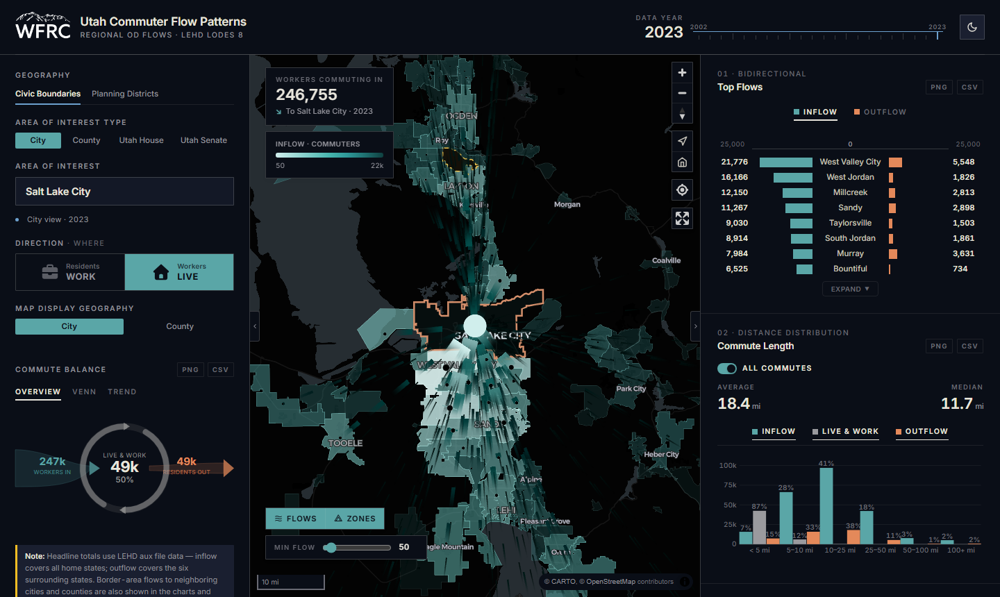

::: {.callout-note}
## Developed at the Wasatch Front Regional Council (WFRC)

The application and its repository belong to WFRC; this page only summarizes my work. It is a **modernized version of WFRC's earlier Regional Commuter Flows map**. I did not create the original; my contribution was rebuilding it on open-source tools.
:::

## Why it exists

Where people live and where they work shapes almost every transportation question a regional council deals with: which corridors carry the most commuters, which cities export workers and which import them, and how far people travel to get to a job. As the map's own introduction puts it, when roads and transit get more expensive to build, a better balance between housing and jobs is one way to reduce the need for long commutes, and that starts with seeing where commutes go today.

WFRC's earlier Regional Commuter Flows map showed this, and I didn't create it. My job was to rebuild it on open-source tools, as a map that runs entirely in the browser, with no server, no API key and no ArcGIS dependency, and that anyone can host as a set of static files.

The data is the Census Bureau's LEHD Origin-Destination Employment Statistics (LODES). It records, for every pair of Census blocks, how many people live in one and work in the other, built from employer wage records. A flow from Provo to Salt Lake City means workers live in Provo and their employer reports their workplace in Salt Lake City; it describes home and work locations, not daily routes, and the app says so.

## What it does

Pick a city, county, Utah House district or Utah Senate district and see where its residents work, or where its workers live, as flow lines scaled by commuter volume. Zones on the map can be shown as cities or counties, and clicking a zone selects it.

- **LODES data from 2002 to the latest release**, switchable from the header.
- **Six linked chart panels:** commute balance (top destinations and origins side by side, with a trend over time), a flow diagram, means of transportation and travel time to work (ACS 5-year), commute distance, and industry mix. Every chart exports to PNG or CSV.
- **Statewide coverage:** every county, city and legislative district in Utah, plus cities and counties within about 50 miles of the border in the six neighbouring states, which appear as points so cross-border commutes show up in the totals and charts.
- **Planning geographies:** a Planning Boundaries mode, built from traffic analysis zones, alongside the civic boundaries.
- **Shareable views:** the area, direction and zone level are kept in the URL.
- Light and dark themes that carry through the map, charts and controls.

## How it's built

A Python pipeline does the heavy work once. It downloads the block-level LODES files for Utah and the Census geography crosswalk, labels blocks outside any city as "*County* Unincorporated", assigns blocks to legislative districts by overlaying block centroids on the Census boundaries, and sums block pairs into city-to-city, county-to-county and district flows. Each year becomes a small set of Parquet files with commuter counts and their age, earnings and industry breakdowns. The processed files are committed to the repository.

The front end is plain JavaScript built with Vite. MapLibre draws the map on Carto vector tiles, Flowmap.gl draws the flows, and DuckDB-WASM queries the Parquet files in the browser whenever the area, year or direction changes. The charts are custom SVG and HTML rather than a charting library, which made it straightforward to match the map's colours exactly. Every push builds the app twice, once for WFRC's own web server and once for a GitHub Pages mirror.

## Interesting problems

**Matching the published totals.** Early inflow and outflow totals didn't agree with the Census Bureau's own OnTheMap tool. Two things were missing: workers who live outside Utah but work in the state, which LODES publishes in a separate file, and flows between Wasatch Front counties and the rest of Utah, which a too-strict filter dropped. With both added, and with people who live and work in the same place counted separately from the cross-boundary flows, the totals reconcile.

**Commute distance that holds at every level.** Measuring distance between city centroids gives one number for every commute between two cities, however large they are. Instead, the pipeline computes the straight-line distance for every block pair before aggregating, and stores the sum of workers times miles alongside the worker count. Summing those two columns gives an exact weighted mean distance for any area, and the same pass fills the distance bands for the commute length chart.

**Putting the point in the right place.** Flow lines start and end at a point inside each area. Geometric centroids can fall outside an oddly shaped city, so the pipeline uses the Census Bureau's internal points, which are guaranteed to be inside. One city still needed a hand override: Hooper's Census boundary includes a large arm of the Great Salt Lake, which pulled its point about 15 miles west.

**Places the Census doesn't have yet.** Ogden Valley City incorporated after the Census place geography that LODES uses, while the three census-designated places it replaced (Eden, Liberty and Wolf Creek) are still in the data. A small config file now adds and removes places on top of the Census geography. The change is applied to the crosswalk without dropping a single block, and the pipeline stops if an added boundary would take blocks from another real place, or if the names in the flows, metadata and boundaries disagree. Hill Air Force Base is drawn the same way as an information-only area, with a note that federal and military jobs are largely missing from LODES.

**Travel mode and time for areas the Census doesn't publish.** The ACS publishes commute mode and travel time for places and counties only. For everything else (unincorporated areas, districts, planning areas, new places) the pipeline builds an estimate from block groups or tracts, weighted by how many of each unit's resident workers live inside the area, and carries a margin of error with it. Estimates are shown, flagged as low reliability, or suppressed depending on how large the margin is relative to the estimate. The cutoffs come from a back-test that re-derives every place the Census does publish and compares the two. The same work fixed an older undercount in the district figures before 2020, where 2020 tract IDs had been matched against 2010 tracts.

**Clicks that landed twice.** A flow line drawn by deck.gl sits on top of city polygons drawn by MapLibre, and a click could reach both. Which handler won depended on timing, so the sidebar could show one city's numbers under another city's name. The fix replaced the timing check with a direct deck.gl pick at the click point, so the flow line always wins.

**A year switch that silently did nothing.** Switching years re-registered a file under the same name in DuckDB-WASM, which failed without an error, and the map stayed on the previous year. Each year's files are now registered under their own names.

## What I worked on

- Rebuilding the application as a **fully client-side** web app: DuckDB-WASM queries pre-processed Parquet files directly in the browser, so there is no server, no API key and no ArcGIS dependency.
- The data processing that prepares the LODES and ACS tables for the app, including the statewide and cross-border expansion, the planning boundaries, the custom places and the derived ACS estimates.
- The map, chart panels, theming and export features.

My role: developer. I authored all the commits in the repository.

## See it

::: {.app-links}
[ Open app](https://wfrc.utah.gov/maps/regional-commuter-flows/){.btn .btn-primary target="_blank" rel="noopener"}
[ GitHub](https://github.com/WFRCAnalytics/APP-WFRC-Commute-Patterns){.btn .btn-outline-secondary target="_blank" rel="noopener"}
:::

The map's About panel links to WFRC's companion article, [what commuting patterns reveal about Wasatch Front communities](https://wfrc.utah.gov/what-commuting-patterns-reveal-about-wasatch-front-communities/).

A companion tool, [Commute Flow Explorer](../commute-explorer/index.qmd), covers free-placement analysis instead of fixed jurisdictions.
