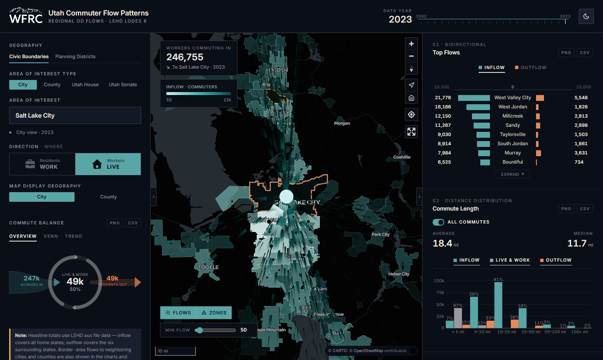

::: {.callout-note appearance="simple"}
**Developed at the Wasatch Front Regional Council (WFRC).** The application and its repository belong to WFRC; this page only summarizes my work. It is a **modernized version of WFRC's earlier Regional Commuter Flows map**. I did not create the original; my contribution was rebuilding it on open-source tools.
:::

{.lightbox}

## What it does

Pick a city, county, Utah House district or Utah Senate district and see where its residents work, or where its workers live, as arcs scaled by commuter volume.

- 22 years of LEHD LODES data (2002 to 2023), switchable from the header.
- Six linked chart panels: commute balance, a flow diagram, means of transportation and travel time to work (ACS 5-year), commute distance, and industry mix. Every chart exports to PNG or CSV.
- Light and dark themes that carry through the map, charts and controls.

## What I worked on

- Rebuilding the application as a **fully client-side** web app: DuckDB-WASM queries pre-processed Parquet files directly in the browser, so there is no server, no API key and no ArcGIS dependency.
- The data processing that prepares the LODES and ACS tables for the app.
- The map, chart panels, theming and export features.

My role: developer. I authored all the commits in the repository.

## See it

::: {.app-links}
[ Open app](https://wfrc.utah.gov/maps/regional-commuter-flows/){.btn .btn-primary target="_blank" rel="noopener"}
[ GitHub](https://github.com/WFRCAnalytics/APP-WFRC-Commute-Patterns){.btn .btn-outline-secondary target="_blank" rel="noopener"}
:::

A companion tool, [Commute Flow Explorer](../commute-explorer/index.qmd), covers free-placement analysis instead of fixed jurisdictions.
