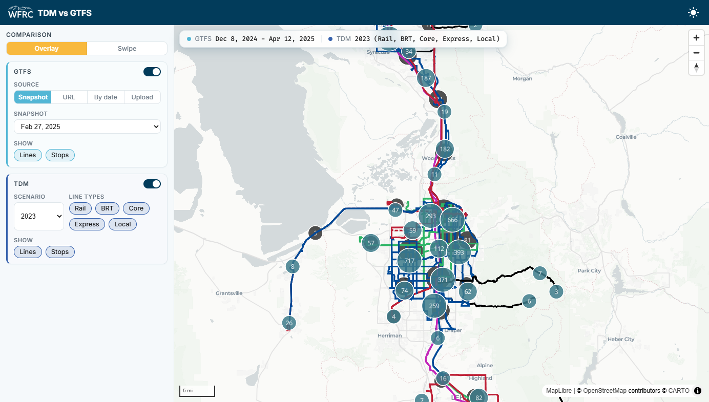

::: {.callout-note}
## Developed at the Wasatch Front Regional Council (WFRC)

The tool and its repository belong to WFRC; this page only summarizes my work.
:::

## Why compare the two

The regional travel demand model (TDM) represents transit service, meaning routes, stops and the line-haul network, for a defined base year. The model's transit results depend on that network, so the base year should match the service that was actually running. GTFS feeds, which transit agencies publish for trip planners and apps, describe the same service as it was actually operated. Putting the two side by side is the most direct way to check the model's network.

Before this tool, that check was a manual QGIS project: convert a GTFS feed to GIS layers, load the model's transit lines, and compare. The conversion lost information along the way, including each route's own colour, its route type and the separate shapes of its variants. This tool puts both on one map so the two can be checked against each other, with any feed.

It is deliberately a **visual validation** tool: there is no automated route matching or coverage-gap scoring. A person looks at the alignment and decides.

## What it does

- **Overlay or swipe**: draw both networks on one map, or compare them side by side with a swipe control.
- **Flexible GTFS sources**: a saved snapshot, a feed URL, a calendar date resolved to the historical UTA snapshot closest to it, or an uploaded GTFS zip.
- **TDM options**: the base year or forecast scenarios, and line types (rail, BRT, core, express, local), each shown as lines, stops or both.
- **Details on demand**: hovering a line names it, and clicking a route or stop opens a panel. For GTFS that includes the agency, the number of trips and stops served, the route's website, and for stops the stop code and wheelchair boarding information.
- **Validity dates**: the map shows the date range the loaded feed covers, read from the feed itself.
- Basemaps that follow light and dark mode.

The base year is the default, since comparing a forecast scenario with present-day GTFS isn't meaningful, but the forecast networks stay available for anyone who wants to see them.

## How it's built

The tool exists in two forms, sharing the same data and the same logic.

**An R Shiny app** came first. It uses `tidytransit` to read GTFS, `sf` to read the model network, and `mapgl` for the MapLibre map and the swipe view. Both datasets are processed live from their original files: the GTFS zips as downloaded, and the model's network as exported, a zipped file geodatabase read in place through GDAL's virtual file system. There is no processed copy of either to keep in sync, and the pipeline discovers the model's transit groups from the geodatabase itself, so it keeps working as new groups are added. The app's colours, fonts and logos come from WFRC's brand repository, included as a git submodule.

**A static web app**, the one linked below, is a port to Svelte and TypeScript built with Vite, so it can run on GitHub Pages with no R server behind it. The model network is converted to GeoJSON ahead of time with GDAL and committed. GTFS is parsed in the browser.

## Interesting problems

**Making the model's lines the right colour.** The comparison reads best when a model route is drawn in the same colour as the real route it represents, so a mismatch stands out. The model doesn't store route colours, so they have to be inferred. Rail is matched by named line (the TRAX lines, the S-Line and FrontRunner). For buses, the model's route name almost always contains the real route number once the agency prefix and leading zeros are stripped (S513 becomes 513), and flex routes map to their F-prefixed names. That name crosswalk gives 71 of the 75 base-year bus routes their exact colour from the GTFS feed. The rest fall back to a rule based on mode and headway: the base-year network doesn't tag frequent "core" routes, so a local route with a best headway of 15 minutes or less is coloured as core. A spatial check against the live network found that this rule, with the per-line rail colours, raised the colour match from 77% to 89%, and the crosswalk caught a route the rule had wrong. The crosswalk is limited to the base year, because some forecast-only project codes happened to end in digits that matched unrelated present-day routes.

**Parsing GTFS in a browser.** There was no maintained JavaScript library that turns a GTFS zip into route shapes and stops in the browser; the purpose-built packages I found were Node-only. So the static app has its own port of the R pipeline, using `unzipit` and `papaparse`, and was checked against the R app on the same feed: the known route colours and the feed's validity range match exactly. The parsing runs in a Web Worker so the page stays responsive. Before parsing, the app reads the uncompressed size of the largest files straight from the zip's index and warns about feeds large enough to strain the browser. Setting that limit took measurement rather than a guess: UTA's feed is about 4 MB as a zip but over 25 MB uncompressed, because the stop times compress so well, so a first guess of 10 MB would have rejected the very feed the tool is for.

**Historical feeds without a backend.** The "by date" source asks the Mobility Database, which archives past GTFS feeds, for the UTA snapshot that was in service closest to a chosen date. Its API requires a personal token. A server could hold a shared one, but the static app deliberately has no server, and anything shipped in a public JavaScript bundle can be read by anyone. So each visitor supplies their own free token, which is stored only in their own browser. The same constraint shows up with the feed URL source: most transit agencies' servers don't allow cross-origin requests from a browser, so when that fails the app says why and suggests downloading the zip and uploading it instead. A set of dated UTA snapshots committed to the repository covers the common case with no setup at all.

**Swipe mode and clustering.** In the R app's overlay view, GTFS stops cluster at low zoom. In its swipe view they don't, because `mapgl`'s compare widget drops the clustering options when it builds each side's map; that is a limit of the package rather than of this app.

## What I worked on

The comparison app and the pipeline that turns GTFS feeds into route shapes and stops, including colors derived from each route's own color. That covers both versions: the R Shiny app and the static Svelte port, along with the colour matching for the model network and the Mobility Database lookup.

My role: developer. I authored all the commits in the repository.

## See it

::: {.app-links}
[ Open app](https://wfrcanalytics.github.io/GIS-GTFS-vs-LIN/){.btn .btn-primary target="_blank" rel="noopener"}
[ GitHub](https://github.com/WFRCAnalytics/GIS-GTFS-vs-LIN){.btn .btn-outline-secondary target="_blank" rel="noopener"}
:::
