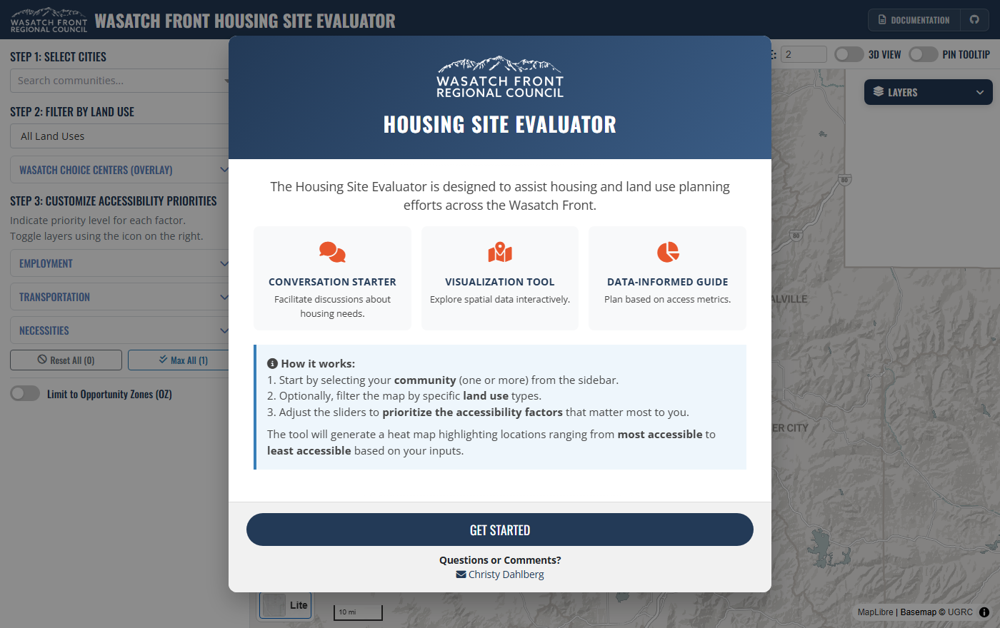

> **NOTE:**
>
> The tool and its repository belong to WFRC; this page only summarizes my work. It is a **complete rebuild of WFRC’s original [Housing ATO Calculator](https://github.com/WFRCAnalytics/MAP-Housing-ATO-Calculator/)**. I did not create the original tool or its concept; my contribution was modernizing the scoring pipeline and the web apps.

The Wasatch Front Housing Site Evaluator on its welcome screen.

## Why it exists

Where new housing goes shapes how its residents live. A home near frequent transit, a grocery store and a school gives a household options that a home at the edge of the road network does not. The Housing ATO Calculator was made to put that idea on a map: a conversation starter and a data-informed guide for housing and land-use planning, where each community decides which kinds of access matter most to it.

The original tool was built by Bill Hereth at WFRC. Its data was prepared in a Jupyter notebook and served through an ArcGIS web app. The rebuild keeps the concept and the factors but replaces the machinery underneath: a reproducible R pipeline that scores the whole region, and two new interactive apps that read its output.

## What it does

Users choose one or more communities, optionally filter by land use, and set a priority for each of eleven accessibility factors. The tool combines those priorities into a heat map from most to least accessible, which can be tilted into 3D, inspected cell by cell, saved as an image or downloaded as data.

| Group | Factors |
|----|----|
| Employment | Auto access to jobs, transit access to jobs |
| Transportation | Transit stops, freeway exits, active transportation |
| Necessities | Childcare, healthcare, education, grocery stores, community centers, parks |

Each factor is scored 0 to 1 per parcel and per H3 hexagon (resolution 10). Wasatch Choice center and Opportunity Zone layers are shown as context only; they are not part of the score.

## How the scores are made

The pipeline runs as four Quarto steps, each writing GeoParquet that the next one reads.

1.  **Prepare.** Download the ArcGIS layers (boundaries, transit stops and routes, bikeways, schools, healthcare, childcare, grocery stores, parks, job access by traffic analysis zone) and local parcel and building data from WFRC’s Real Estate Market Model (REMM), driven by a single source manifest.
2.  **Process.** Generate travel-time isochrones with OpenRouteService at 5, 10, 15, 30 and about 60 minutes, using the travel mode that fits each amenity: walking for most daily needs, cycling for commuter rail and higher education, driving for healthcare and freeway exits. Bike facilities get straight-line distance bands instead. The H3 grid is built here too.
3.  **Join.** Assign every parcel and hexagon the smallest time or distance band that reaches it, attach job access counts, and tag each with a land-use code.
4.  **Score.** Normalize each measure to 0 to 1 and export the result for the apps and as a File Geodatabase.

Two rules do most of the scoring work. Travel time and distance are “cost” measures, so the regional minimum scores 1 and longer trips decay toward 0; job counts are “benefit” measures, scored against the regional maximum. And three factors combine several layers with a **weighted maximum** rather than an average: a hexagon next to a FrontRunner station is well served by transit even if it has no local bus stop, so the best-served sub-layer wins (commuter rail counts fully, rapid bus at 0.8, local bus at 0.5).

Land use needed its own logic, because neither building points nor parcel polygons cover every case. A hexagon takes the most common code among its buildings; gaps are filled by sampling the parcel underneath, then by a vote of the six neighboring hexagons when at least four agree, and anything still empty is marked “Other” rather than left blank. Ties are broken by building square footage and then alphabetically, so the same inputs always give the same answer.

## Interesting problems

**Moving off in-memory geometry.** Instead of loading millions of geometries into R memory, the rebuild runs the spatial work in DuckDB over GeoParquet. That made the pipeline faster and easier to maintain, but it brought its own problems. Bulk updates across ten million rows built up DuckDB’s undo buffers until the R session crashed, and neither checkpointing nor vacuuming released them. The fix was to give binary columns a default value instead of filling nulls afterward, keep the working database in a file, and reconnect every couple of layers.

**A join that could not use its index.** Joining points to a dissolved isochrone band means testing them against a single polygon with tens of thousands of vertices, and a spatial index cannot help with one giant shape. Cutting each band into small pieces first made the matches identical and took the join step from about 13.6 minutes to 0.6. I first did this with hand-written tiling, then switched to DuckDB’s `ST_Subdivide` once a release added it.

**Esri geometry and browser quirks.** Some features in the parcel geodatabase are stored as curved geometry types that crashed DuckDB’s reader, so that loader falls back to `sf` to linearize them. On the web side, some browser extensions strip the MIME type from the DuckDB WebAssembly download; the app catches that and loads it another way.

**Repeatable results.** Several fixes were about making two runs agree: sorting outputs by key so row order is stable, deterministic tie-breaking for land use, and isochrone requests that retry, checkpoint each batch and only publish a complete layer, so a failed API call can never leave a partial layer cached as finished.

## The apps

Both apps read the same scored data and let users weight the eleven factors.

- A **Shiny app** in R with `bslib` and `mapgl`, with hover tooltips that show each factor’s contribution, pinnable tooltips, a screenshot control and data download.
- A **static Vue app** with MapLibre GL and DuckDB-WASM that needs no server. Data is split into one file per community, so selecting a city loads only that city. Re-weighting is instant because the score and color are computed on the GPU from a map style expression, not by redrawing features. Hexagon outlines are built in a web worker from the H3 index. It uses UGRC’s Lite, Dark and Hybrid vector basemaps and UGRC’s address search. GitHub Actions builds and deploys it to GitHub Pages and WFRC’s web server.

## What I worked on

- The rebuilt scoring backend on R, DuckDB and GeoParquet, run as four sequential Quarto steps, with isochrone- and buffer-based proximity measures.
- The land-use assignment, normalization and composite scoring.
- Both interactive apps and their deployment.

My role: developer. I authored all the commits in the rebuilt repository. The app’s wording and icons were worked out with Bill Hereth, who is also listed with me as a contact for the project.

## See it

[ Open app](https://wfrc.utah.gov/housing-ato-calculator-map/) [ GitHub](https://github.com/WFRCAnalytics/MAP-Housing-ATO-Calculator-Updated)
