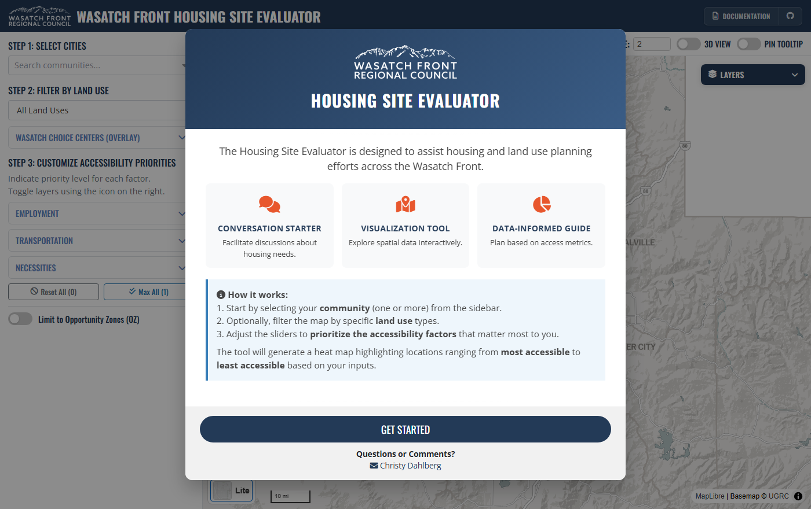

::: {.callout-note appearance="simple"}
**Developed at the Wasatch Front Regional Council (WFRC).** The tool and its repository belong to WFRC; this page only summarizes my work. It is a **complete rebuild of WFRC's original [Housing ATO Calculator](https://github.com/WFRCAnalytics/MAP-Housing-ATO-Calculator/)**. I did not create the original tool or its concept; my contribution was modernizing the scoring pipeline and the web apps.
:::

## What it does

The Housing Site Evaluator helps housing and land-use planners see which places have good access to opportunity. Users choose their community, optionally filter by land use, and set priorities for eleven accessibility factors; the tool turns that into a heat map from most to least accessible.

| Group | Factors |
|---|---|
| Employment | Auto access to jobs, transit access to jobs |
| Transportation | Transit stops, freeway exits, active transportation |
| Necessities | Childcare, healthcare, education, grocery stores, community centers, parks |

Each factor is scored 0 to 1 per parcel and hexagon. Wasatch Choice center and Opportunity Zone layers are shown as context only; they are not part of the score.

## What I worked on

- The **scoring backend**, rebuilt on R, DuckDB and GeoParquet instead of loading millions of geometries into R memory, which made the pipeline faster, cleaner and easier to maintain.
- A pipeline run as four sequential Quarto steps, from data preparation through ATO scoring, with isochrone- and buffer-based proximity measures.
- The interactive web apps built on top of the scores.

My role: developer. I authored all the commits in the rebuilt repository.

## See it

::: {.app-links}
[ Open app](https://wfrc.utah.gov/housing-ato-calculator-map/){.btn .btn-primary target="_blank" rel="noopener"}
[ GitHub](https://github.com/WFRCAnalytics/MAP-Housing-ATO-Calculator-Updated){.btn .btn-outline-secondary target="_blank" rel="noopener"}
:::
