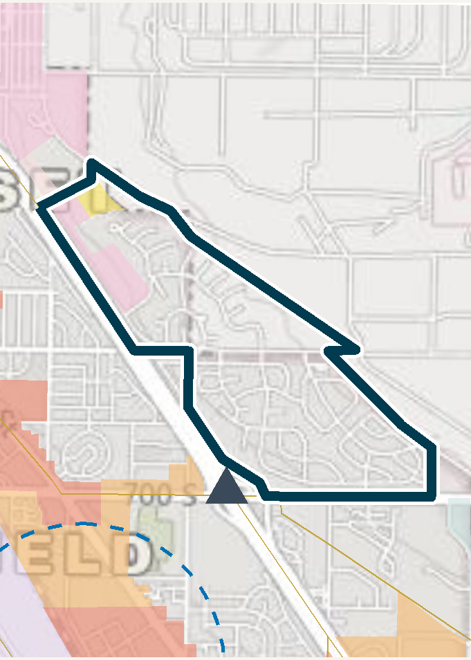

::: {.callout-note appearance="simple"}
**Developed at the Wasatch Front Regional Council (WFRC), with Mountainland Association of Governments (MAG).** The reports and repository belong to WFRC; this page only summarizes my work.
:::

{.lightbox fig-alt="Map of a census tract outlined in dark blue with transit and land-use context." width="50%"}

## What it does

Utah's Opportunity Zones 2.0 eligible-tract list is a long list of census tracts, and investors and local governments need to weigh land use and transportation access tract by tract. This pipeline produces landscape PDF info sheets for every tract on the list, to support OZ 2.0 investment siting decisions.

Each county gets two documents:

| PDF | Content |
|---|---|
| **Summary** | A one-page table with all tracts in the county side by side |
| **Detail** | One page per tract, with a large map, key metrics and five data panels |

The maps show Wasatch Choice centers, small-area-plan buffers, rail and BRT stops and freeway exits. Counties run in WFRC order (Box Elder, Weber, Davis, Salt Lake, Tooele, Morgan) and then MAG (Utah, Summit, Wasatch).

## What I worked on

The whole pipeline: caching and joining the GIS sources, computing per-tract metrics, generating the maps, and rendering the PDFs with Quarto and Typst. R packages are managed with `renv` so the reports can be regenerated when the eligible list or underlying data changes.

My role: developer. I authored all the commits in the repository.

## See it

This project produces PDFs rather than a web app, so the source is the best place to look.

::: {.app-links}
[ GitHub](https://github.com/WFRCAnalytics/GIS_OpportunityZones_InfoSheets){.btn .btn-primary target="_blank" rel="noopener"}
:::
