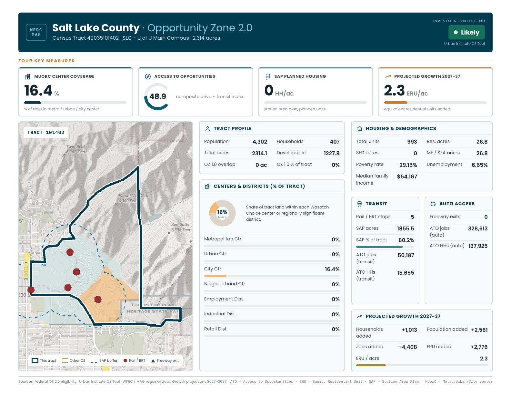
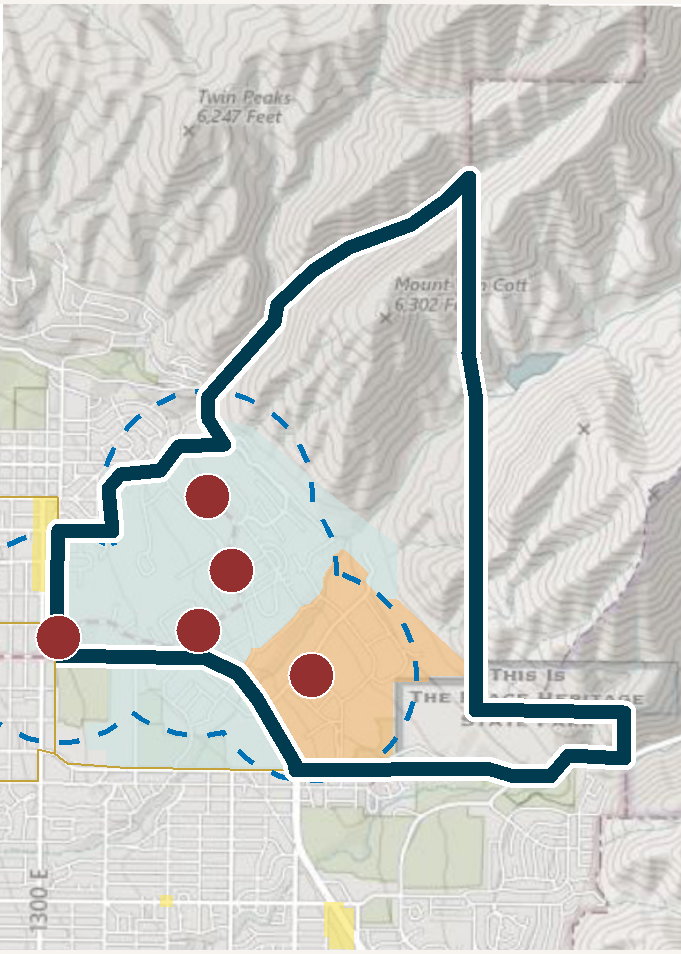
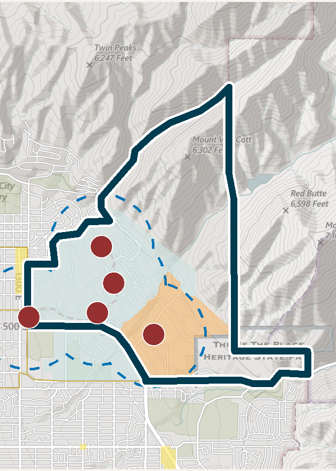

::: {.callout-note}
## Developed at the Wasatch Front Regional Council (WFRC), with Mountainland Association of Governments (MAG)

The reports and repository belong to WFRC; this page only summarizes my work.
:::

{fig-alt="A landscape tract detail page for census tract 49035101402 in Salt Lake County (University of Utah main campus). A dark header shows the tract name and an 'Investment likelihood: Likely' badge. Four cards show center coverage of 16.4%, an access-to-opportunities index of 48.9, 0 planned households per acre and 2.3 ERU per acre of projected growth. Below are the tract map and tables of population, housing, transit, auto access and growth figures."}

## Why tract-level info sheets

Opportunity Zones offer federal tax incentives for investment in designated census tracts. With the second round of the program (OZ 2.0), Utah has a long list of eligible tracts, and the people weighing them, from local governments to investors, need to compare tracts on the things that make investment work: land that can be developed, access to jobs, transit, planned housing and expected growth.

That information exists, but it is spread across a dozen regional datasets maintained by different teams: Wasatch Choice centers, station area plans, the Access to Opportunities index, small-area growth forecasts, census demographics and the housing unit inventory. The info sheets bring it together into one consistent page per tract, and a one-page table per county to compare tracts side by side.

## What's on a page

Each detail page is built to be read in under a minute:

- **The header** names the tract (with a descriptive name, such as "SLC - U of U Main Campus"), its acreage, and the Urban Institute's investment likelihood rating.
- **Four key measures** across the top: how much of the tract lies in a metropolitan, urban or city center; a 0 to 100 Access to Opportunities index combining driving and transit access to jobs and households; planned housing density from station area plans; and projected growth from 2027 to 2037 in equivalent residential units (ERU) per developable acre.
- **The map** shows the tract with Wasatch Choice centers, station area plan buffers, rail and BRT stops and freeway exits.
- **Six panels** give the detail behind the headline numbers: the tract profile, center and district coverage, housing and demographics, transit, auto access and projected growth.

The county summary puts every tract in a county on one page with the same measures, and an Excel workbook carries all of it with live formulas, plus a PDF version that prints the workbook as Excel would.

## How it's built

The pipeline is a Quarto project in R, in four stages:

1. **Load.** GIS layers are pulled from ArcGIS services and local sources and cached as GeoPackages, then read with `sf` using SQL and spatial filters so only the needed features come in.
2. **Calculate.** Per-tract metrics: center and station-area overlaps, housing joins, Access to Opportunities scores weighted by developable acres, and growth forecasts area-proportioned from traffic analysis zones.
3. **Map.** A ggplot per tract, saved at 200 dpi and cached so the summary and detail documents share them.
4. **Render.** Parameterized Quarto documents render each county's summary and detail PDFs with Typst, which gives precise control over a dense, fixed landscape layout.

The page design came from a visual mock-up, and the Typst templates reproduce it to the point (literally: the mock's pixel sizes convert directly to points). Fonts ship with the repository, and R packages are pinned with `renv`, so anyone can regenerate the full set when the eligible list or the underlying data changes.

### Sharper maps with basemapper

The first version of the maps used raster basemap tiles, and in print they looked soft: blurry contours, and labels that were hard to read. UGRC publishes the same basemap as a vector style, but no R tool could draw one under a ggplot. So I wrote [basemapper](../../posts/basemapper/index.qmd), an R and Python package that renders vector basemaps at the figure's own zoom and resolution, and switched the maps to it.

::: {layout-ncol="2"}
:::: {}
{.img-fluid alt="Census tract map on Salt Lake City's east bench over a raster basemap with soft, partly hidden labels and blurry contours."}

**Before:** raster basemap tiles
::::

:::: {}
{.img-fluid alt="The same census tract map over a UGRC Lite vector basemap with crisp hillshade, contours and roads."}

**After:** UGRC Lite vector, rendered by basemapper
::::
:::

## What I worked on

The whole pipeline: caching and joining the GIS sources, computing the per-tract metrics, generating the maps, designing and building the Typst layouts, and producing the Excel workbook. I authored all the commits in the repository, and wrote basemapper along the way.

The current release covers 108 eligible tracts across Box Elder, Weber, Davis, Salt Lake, Tooele and Utah counties.

## See it

The reports and their source are public on GitHub.

::: {.app-links}
[ GitHub](https://github.com/WFRCAnalytics/GIS_OpportunityZones_InfoSheets){.btn .btn-primary target="_blank" rel="noopener"}
[ Salt Lake County detail sheets](https://github.com/WFRCAnalytics/GIS_OpportunityZones_InfoSheets/blob/main/output/detail/Salt_Lake_OZ_Detail.pdf){.btn .btn-outline-secondary target="_blank" rel="noopener"}
[ Workbook](https://github.com/WFRCAnalytics/GIS_OpportunityZones_InfoSheets/tree/main/output){.btn .btn-outline-secondary target="_blank" rel="noopener"}
:::
