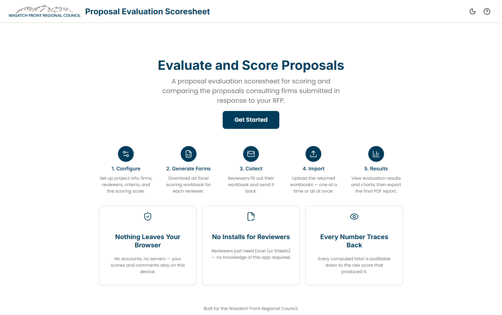

> **NOTE:**
>
> The application and its repository belong to WFRC; this page only summarizes my work.

The landing page, showing the five-step workflow and the privacy and traceability guarantees.

## Why it exists

When WFRC selects a consultant through a request for proposals, a panel of reviewers scores each firm’s proposal against weighted criteria, and the scores are combined into a ranking. Before this tool, that happened in a spreadsheet: a setup sheet for the project, firms, reviewers, criteria and scale; one tab per reviewer; and a composite sheet that averaged the scores, applied the weights and ranked the firms.

The spreadsheet worked, but it had a weak spot. There are two kinds of reviewers: applicant reviewers (called “City” reviewers in the spreadsheet, “TLC Applicant” in the app), whose scores count toward both an overall total and a separate applicant-only total, and WFRC reviewers, whose scores count only toward the overall total. The sheet knew which was which only by column position, so adding or reordering a reviewer could quietly put scores in the wrong total. The number of firms, reviewers and criteria, and the 1/3/5 scale, were also built into its layout.

The goal was a tool that keeps everything that made the spreadsheet trustworthy (visible formulas, files people can open, nothing hidden), makes every one of those things configurable, and gives each reviewer an explicit type instead of a column position.

## What it does

The workflow has five steps.

- **Configure** the project, the firms (invited and submitted, from a searchable list), the reviewers (TLC Applicant or WFRC, and whether each has signed the confidentiality form), the weighted criteria (as a decimal or a percent) and the scoring scale, either a set of discrete points or a continuous range such as 1.0 to 5.0.
- **Generate a real Excel workbook per reviewer**, one at a time or all together as a zip. Reviewers fill it in Excel, Google Sheets or LibreOffice and never need to know the app exists.
- **Import** the completed workbooks one at a time or in bulk, or enter scores by hand for anyone who reported back by phone or email.
- **Rank** the firms on a dashboard with overall, applicant-only and WFRC-only weighted totals, each with its own rank, plus criterion breakdowns, radar charts, reviewer score-spread charts and reviewer comments tabbed by criterion.
- **Export** a formatted PDF report for the official procurement record, a Calculations workbook, and a `project.json` that reopens the project later.

**No backend, no database, no accounts.** Everything stays in the browser. The only durable save is the project file the user chooses to download.

## How it’s built

The app is React and TypeScript, built with Vite and published as static files on GitHub Pages. State lives in a React context with a reducer, and the screens are a small state machine rather than a router. Charts use Recharts, workbooks use ExcelJS, and the PDF report uses `@react-pdf/renderer`. Colors, fonts and logos come from WFRC’s brand repository, adjusted where needed to meet WCAG 2.1 AA contrast in both light and dark mode.

I started from a written specification before writing any code: the business rules of the original spreadsheet, a set of non-negotiable principles (no server, one project at a time, nothing hard-coded, every number traceable), and file contracts for the project JSON and the reviewer workbook. The specification and contracts are in the repository alongside the code.

## The interesting parts

**The Excel round trip.** The reviewer workbook is the app’s only interface to reviewers, and the app both writes and reads it, so the two sides must agree on every detail. Each workbook has one “Scoring” sheet with a branded banner that states the scale, one row per firm and criterion, and only the Score and Comments cells unlocked. In discrete mode the Score cell is a dropdown of the allowed values; in continuous mode it is a decimal range. Hidden, locked columns carry the reviewer, firm and criterion IDs, so a returned file is matched by ID rather than by row order or firm name. The importer finds the header row by its content, skips blank trailing rows, and flags only scores or comments that actually changed when a file is imported twice. Sheet protection has no password on purpose: it is there to prevent accidental edits, and a lost password would lock staff out of their own files. Automated tests generate and parse workbooks, but opening a generated file in real Excel stayed a manual sign-off step, because a library reading its own output only proves it agrees with itself.

**Formulas, not snapshots.** The first version of the Calculations workbook wrote every average, weighted score and total as a number computed in JavaScript, so the exported file was a frozen picture with nothing to audit. Now every derived cell is a real Excel formula (averages, weighted values, firm totals, completion counts), cross-checked against the app’s own calculation functions, so changing a score or a weight in Excel updates everything downstream, the same way the original spreadsheet did.

**A PDF fit for the record.** The report started as the browser’s print dialog. Getting the charts to print in light colors while the screen stayed in dark mode took a separate off-screen chart copy, because Recharts writes colors directly into the SVG and flipping the whole page’s theme for an instant caused a visible flash. It was later replaced with a designed vector report: a cover, a results overview, the evaluation framework, a two-page profile per firm with its radar chart, criterion table, reviewer heatmap and comments, and data notes. The text is real and selectable, the charts are the app’s own Recharts charts converted to vector shapes, and the wording is neutral: the report supports a decision, it does not make one.

**Privacy by having nothing to protect.** Scores and comments are procurement-sensitive. Because the app has no server and calls no external service with project data, there is nothing to breach. The README records ideas raised internally for a version with sign-in, online scoring and notifications, and a draft design for a Google Workspace backend, and it is explicit that each one would mean giving up that property, with open questions about hosting, identity and data retention to answer first.

## Testing

The repository has three layers of tests: unit tests for the calculation engine, schema validation and color contrast; integration tests for the ExcelJS generate-and-parse round trip; and component tests that drive the full app with React Testing Library using real generated workbooks rather than mocks.

## What I worked on

The full application: the specification, the React and TypeScript front end, the calculation engine, the Excel workbook round trip and Calculations export, the PDF report, and the unit, integration and component tests around them.

My role: developer. I authored all the commits in the repository.

## See it

[ Open app](https://wfrcanalytics.github.io/APP-Project-Scoresheet/) [ GitHub](https://github.com/WFRCAnalytics/APP-Project-Scoresheet)
