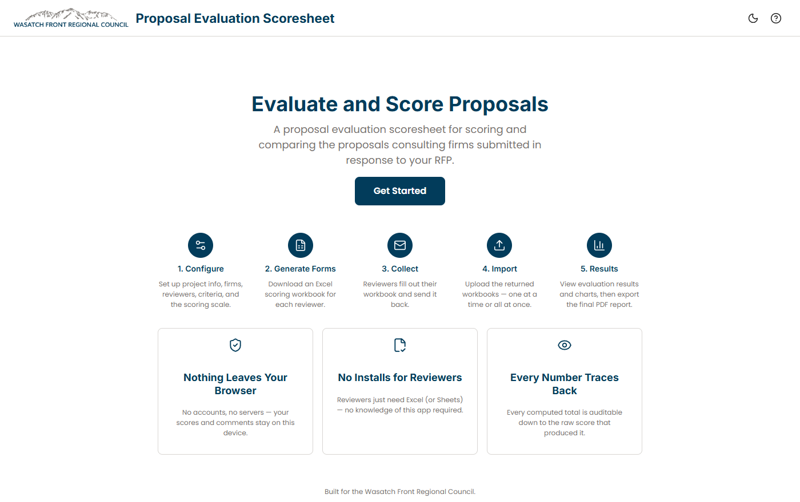

::: {.callout-note appearance="simple"}
**Developed at the Wasatch Front Regional Council (WFRC).** The application and its repository belong to WFRC; this page only summarizes my work.
:::

## What it does

A scoring tool for comparing the proposals consulting firms submit in response to an RFP.

- **Configure** the project, firms, reviewers, weighted criteria and scoring scale (discrete points or a continuous range).
- **Generate a real Excel workbook per reviewer**, so reviewers fill in Excel or Sheets and never need to know the app exists, then import the completed workbooks one at a time or in bulk.
- **Rank on a dashboard** with overall and per-reviewer-group weighted totals, criterion breakdowns, score-spread charts and a "show calculations" trail that traces every number back to the raw score.
- **Export** a print-quality PDF report for the official procurement record, and a `project.json` to resume later.
- **No backend, no database, no accounts:** everything stays in the browser.

## What I worked on

The full application: a React and TypeScript front end, the calculation engine, the ExcelJS workbook generate-and-parse round trip, the PDF report, and the unit, integration and component tests around them.

My role: developer. I authored all the commits in the repository.

## See it

::: {.app-links}
[ Open app](https://wfrcanalytics.github.io/APP-Project-Scoresheet/){.btn .btn-primary target="_blank" rel="noopener"}
[ GitHub](https://github.com/WFRCAnalytics/APP-Project-Scoresheet){.btn .btn-outline-secondary target="_blank" rel="noopener"}
:::
