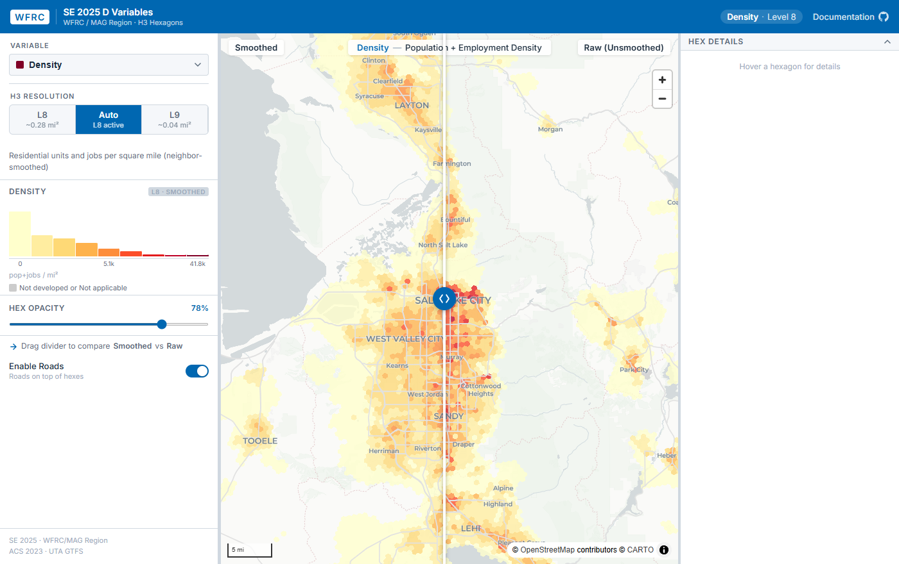

::: {.callout-note appearance="simple"}
**Developed at the Wasatch Front Regional Council (WFRC).** The data, tool and repository belong to WFRC; this page only summarizes my work.
:::

{.lightbox}

## What it does

The "D variables" are a standard framework for measuring how urban form relates to travel behavior (Cervero and Kockelman, 1997; Ewing and Cervero, 2010). This project calculates them for the WFRC and MAG region from WFRC's SE 2025 socioeconomic data, at H3 resolution 9 and 8.

| Variable | What it measures |
|---|---|
| Density | Residents and workers per square mile |
| Diversity | Balance of homes and jobs (land-use mix) |
| Design | Street-network connectivity |
| Destinations | Proximity to activity centers and everyday amenities, with seven sub-components |
| Demographics | Median household income and an Income Diversity Index |
| Distance to transit | Distance to the nearest frequent-service stop |

A supplementary **Rental Housing Attainability Index**, developed by Cascadia Partners with WFRC and UTA, is included alongside them.

Because urban form describes the environment a person *experiences*, not the contents of an arbitrary polygon, each variable is **spatially smoothed** across neighboring hexagons. The explorer's swipe control compares the smoothed value with the raw one.

## What I worked on

The R pipeline that computes and smooths the variables, and the interactive explorer for browsing them.

My role: developer. I authored all the commits in the repository.

## See it

::: {.app-links}
[ Open app](https://wfrcanalytics.github.io/GIS_SE2025_H3/){.btn .btn-primary target="_blank" rel="noopener"}
[ GitHub](https://github.com/WFRCAnalytics/GIS_SE2025_H3){.btn .btn-outline-secondary target="_blank" rel="noopener"}
:::
