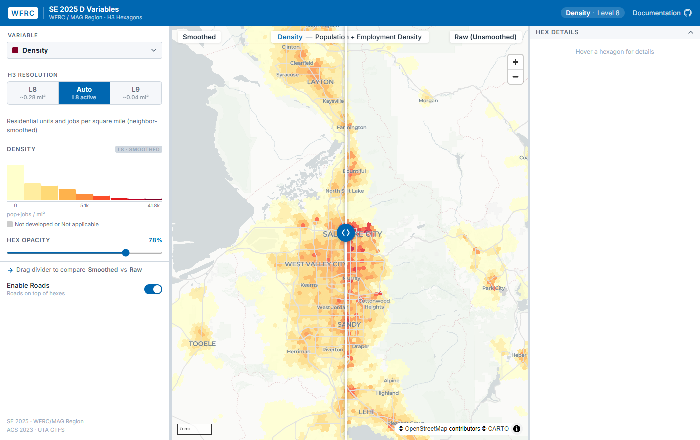

::: {.callout-note}
## Developed at the Wasatch Front Regional Council (WFRC)

The data, tool and repository belong to WFRC; this page only summarizes my work.
:::

## Why the D variables

The "D variables" are a standard framework for describing the parts of the built environment most strongly tied to how people travel: whether they drive, take transit or walk, and how far (Cervero and Kockelman, 1997; Ewing and Cervero, 2010). Measuring them consistently across a region gives planners and modelers a common way to compare places.

WFRC's SE 2025 socioeconomic data (households, population, residential units and jobs by sector, from the parcel-level Real Estate Market Model) is the natural starting point. This project turns it, together with census, transit and amenity data, into a set of D variables on a uniform grid of H3 hexagons at resolutions 9 and 8, and an explorer for browsing them.

The project began as a smaller job, smoothing the SE data across neighboring hexagons, and grew into a full D-variable pipeline with the smoothing built into each variable.

## What it calculates

| Variable | What it measures |
|---|---|
| Density | Residential units plus jobs (converted to household equivalents) per square mile |
| Diversity | Balance of households and jobs: 1 when they are in balance, near 0 for a purely residential or purely employment area |
| Design | Street-network connectivity, with 4-way intersections scored 1 and T-intersections 0.5 |
| Destinations | Overlap with Wasatch Choice centers (60%) plus the presence of six everyday amenities (40%): healthcare, high school, grocery, city hall, park and EMS, each also kept as its own column |
| Demographics | Median household income and an Income Diversity Index |
| Distance to transit | Distance to the nearest frequent stop: a weekday median headway of 15 minutes or less, or commuter or heavy rail |

A supplementary **Rental Housing Attainability Index**, developed by Cascadia Partners with WFRC and UTA, is included alongside them. It averages the multifamily share of housing units with the share of renters paying less than 30% of income on rent, on a 0 to 100 scale. The raw SE counts are carried through too, so population, households and jobs by sector can be explored in the same map.

## Smoothing: what a place is like, not what is inside a hexagon

A level-9 hexagon covers only about 0.04 square miles. A park one block away matters just as much to a resident whether or not it falls inside the same hexagon, and raw per-hexagon values produce sharp edges at cell boundaries that nobody actually experiences.

So each variable is **smoothed** across up to three rings of neighbors, roughly a half-mile radius. The cell itself keeps 40% of the weight and the rings get 30%, 20% and 10%, so a hexagon's own character still dominates. The detail that matters is that smoothing is applied to the **inputs** of each formula, not its output. Smoothed density is still people and jobs per square mile, computed from smoothed counts, rather than an average of neighboring density scores. For ratios like diversity or the attainability index, the counts are smoothed first and then divided.

At the edge of the study area, missing neighbors contribute nothing and their weight is not handed to the neighbors that are present, so a boundary cell is not dominated by the few cells around it. Every variable is also stored unsmoothed, and the explorer's swipe control puts the two side by side.

Level 8 follows two rules. Raw counts are a plain sum of each cell's seven level-9 children, so regional totals match exactly at both resolutions. The D variables are recomputed on the level-8 grid with their own smoothing, so each score means the same thing at its own scale.

## Choices worth explaining

**Income diversity took three tries.** The first version used one minus the Gini coefficient of household income. The second switched to Shannon entropy, so that a mixed-income area scored well regardless of how wealthy it was, but entropy values clustered near the top and were hard to read. The current index splits the region's households into three income tiers, with the breakpoints drawn from the regional distribution so each tier holds about a third of households, and scores each hexagon as the smallest tier share divided by the largest. A score of 1 means all three tiers are equally present; 0 means at least one is missing entirely. A wealthy area where everyone earns about the same scores low, not because incomes are high but because there is no mix. The same rework fixed a bug that had cut the income brackets off at $75,000.

**Filling in counties outside the model.** The SE 2025 data covers only the core travel-model area. For Box Elder, Tooele, Morgan, Cache, Summit and Wasatch counties, the grid is extended using the Utah Statewide Travel Model's own SE 2025 data, spread from traffic analysis zones onto hexagons by area. New hexagons are created only inside cities, towns and census-designated places, since covering whole counties would add a large number of hexagons over empty land.

**A buffer or the grid?** Cascadia Partners computed the multifamily share with a quarter-mile buffer. I recomputed it in the pipeline as a point-in-hexagon count with the standard ring smoothing. A check script reproduced Cascadia's buffer values almost exactly, so the reason for the switch is consistency with the rest of the pipeline, not a correction, and the documentation says so.

**Small data bugs with large effects.** Point layers from the state's ArcGIS services were at first cached with every coordinate at (0, 0) until the request named a coordinate system explicitly. GDAL's File Geodatabase writer can produce a corrupt spatial index that makes features vanish when zoomed in, so the pipeline deletes that index before zipping and also writes a GeoPackage copy.

## The explorer

The explorer is a Vite, React and TypeScript app on MapLibre GL, deployed to GitHub Pages. Choosing a variable shows a swipe map, smoothed on the left and raw on the right; for plain counts that have no smoothed version, it becomes a single full-width map. A hover panel lists every variable for the focused hexagon, and a histogram legend shows the distribution.

The map switches from level 8 to level 9 at zoom 11. The hexagons were first served as GeoJSON and are now PMTiles written straight from R, so the browser loads only the tiles in view. Both levels load together and their opacities crossfade over a zoom range, computed on the GPU, which removed a flash of bare basemap during the switch. Thinning features at low zoom and rounding stored values cut the level-9 tiles by more than half. Color classes are Fisher natural breaks computed in R, pooled across smoothed and raw values so both sides of the swipe share a scale.

## Outputs

The pipeline is a single R script with documented, editable parameters at the top: smoothing weights, the jobs-to-household ratio, Wasatch Choice center weights and the income-tier mode. Remote layers are cached locally in full, and filters are applied when they are read, so a filter can change without downloading again. It writes a File Geodatabase and a GeoPackage with level-9 and level-8 layers, the PMTiles and break metadata for the app, and a methodology document that describes each formula.

## What I worked on

The R pipeline that computes and smooths the variables, the extension to counties outside the model area, the integration of the Rental Housing Attainability Index, and the interactive explorer.

My role: developer. I authored all the commits in the repository. The Rental Housing Attainability Index method is Cascadia Partners' work with WFRC and UTA.

## See it

::: {.app-links}
[ Open app](https://wfrcanalytics.github.io/GIS_SE2025_H3/){.btn .btn-primary target="_blank" rel="noopener"}
[ GitHub](https://github.com/WFRCAnalytics/GIS_SE2025_H3){.btn .btn-outline-secondary target="_blank" rel="noopener"}
:::
