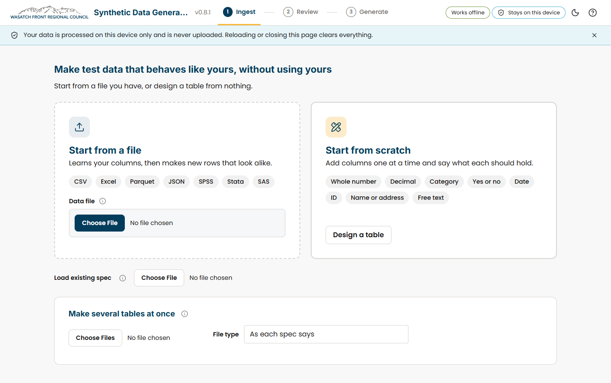

::: {.callout-note appearance="simple"}
**Developed at the Wasatch Front Regional Council (WFRC).** The application and its repository belong to WFRC; this page only summarizes my work.
:::

## What it does

Analysts want AI coding agents to help write analysis code, but the real survey data is private. This tool learns the shape of one table and produces a fake one with the same columns, row count, types, formats and summary statistics, so an agent can build and test code without ever seeing a real row. Swap in the real file afterwards and run the code locally.

- **No backend, no uploads, no accounts.** Everything runs in the browser tab, a strict Content-Security-Policy blocks other requests, and a live counter shows what the page sends.
- **Many formats:** CSV, Excel, Parquet, JSON, SPSS, Stata and SAS in; the fake file comes out in the same format.
- **Ingest, Review, Generate:** override each column's type and rules, set a seed, preview rows and check that every summary was met.
- The only thing derived from real data is a **spec file** of summaries and settings, never rows or identifiers, plus a README written for the agent.

## What I worked on

The full application: a TypeScript front end with DuckDB-WASM for reading files, the generation and checking logic, and the tests that show no real value reaches the page, the spec, the preview, the output file or an error message, run across Chrome, Edge, Firefox and WebKit.

My role: developer. I authored all the commits in the repository.

## See it

::: {.app-links}
[ Open app](https://wfrcanalytics.github.io/APP-synthetic-data-generator/){.btn .btn-primary target="_blank" rel="noopener"}
[ GitHub](https://github.com/WFRCAnalytics/APP-synthetic-data-generator){.btn .btn-outline-secondary target="_blank" rel="noopener"}
:::
