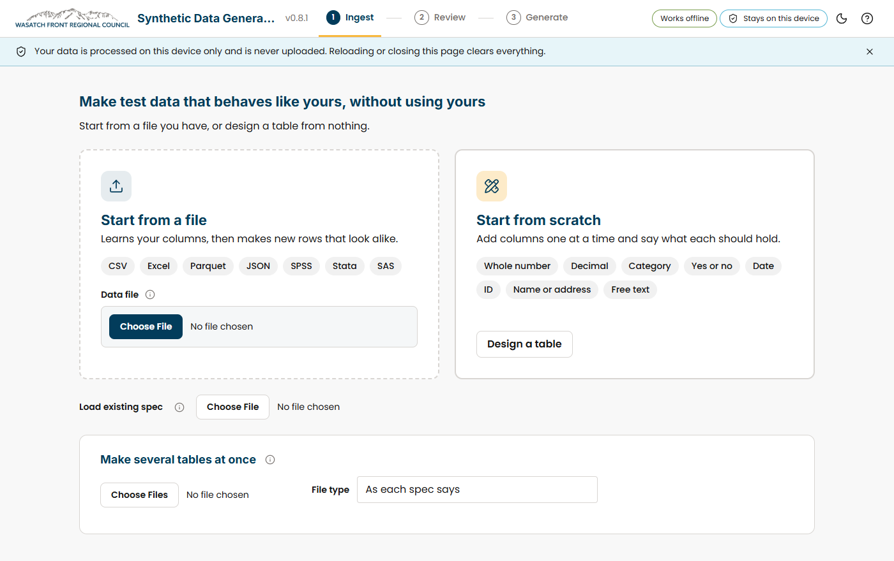

::: {.callout-note}
## Developed at the Wasatch Front Regional Council (WFRC)

The application and its repository belong to WFRC; this page only summarizes my work.
:::

## Why it exists

AI coding agents are good at writing analysis code, but they work best when they can run that code and see what happens. The data WFRC analysts work with, such as household travel surveys and transit onboard surveys, holds respondent locations, demographics and identifiers that must not be shown to an agent.

The way around it is a mirror project. Make a fake copy of each table, let the agent write, run and debug code against the fakes, then swap in the real files (same names, same formats) and run the code locally. Final results always come from the real data, so the fake data does not need to reproduce real findings. It needs to be good enough that code written against it runs unchanged on the real file and produces output that looks plausible.

That sets an unusual bar. Statistics matter, but parsing details matter more: agents mostly break on a delimiter, a date format, a leading zero or a missing-value code, not on a mean.

## What it does

The app works in three steps.

1. **Ingest.** Open a CSV, Excel, Parquet, JSON, SPSS, Stata or SAS file, or design a table from scratch. For a CSV the app detects the delimiter, encoding, quoting and header; for a workbook you pick the sheet, header position and range. It shows the row count and column names, never row values.
2. **Review.** One entry per column with its detected type and summary. You can override the type, confirm missing-value and "don't know" codes, choose how numbers are generated, edit an ID pattern, add a codebook, set rules between columns, or exclude a column.
3. **Generate.** Set a seed, preview 50 fake rows, check that every summary was met, and download the fake file in the same format as the original (SAS files are read only and written as CSV or SAS transport files).

Next to the fake file you can download the **spec**, a JSON file of the summaries and settings used, and a **README for the agent** that says the data is not real and describes each column. The spec is the only thing derived from real data. It holds category labels, exact minimums and maximums, special codes, quantiles and ID patterns, and for names, emails, addresses and free text only counts, lengths and patterns. It never holds rows, ID lists, free text or personal values, so you can read it end to end and know exactly what was taken. A saved spec can generate the fake table again without the real file.

## How fake values are made

Privacy comes from breaking the link between rows: columns are generated independently unless you add a rule, so no fake row describes a real person, even where individual values come from the real data.

- **Categories** keep their exact label set and count per label, shuffled into new rows. Coded integers, such as a travel mode stored as 1, 2, 3, 5, 8 or 97, are treated as categories by default, because generating numbers between the minimum and maximum would create codes that do not exist in the codebook.
- **Numbers, dates and times** always place the real minimum and maximum, then fill the rest in one of three ways: evenly between them, a beta distribution fitted to the real mean and standard deviation (the one common distribution that respects fixed bounds and hits both targets), or interpolation between stored percentiles to keep the shape, such as the morning and evening peaks in departure times.
- **Missing values and special codes** like -9 or 998 are placed with their exact counts and left out of the statistics.
- **Survey IDs** are never stored as lists. Each is described by a per-position pattern (digit, letter or fixed character) and how often each ID repeats, so a household ID that appears 2.4 times on average still does.
- **Names, emails, phone numbers and addresses** are invented from word lists, with a choice of regions, and never copied. **Free text** keeps only its length distribution, and **coordinates** only their bounding box and decimal places.

Each column gets its own random sub-seed derived from the global seed and the column name, so changing one column's settings does not change any other column's output.

## Keeping the file identical to a parser

Much of the work went into making the fake file look the same as the real one to whatever code reads it. For CSV that means delimiter, quoting, encoding, line endings, header and byte-order mark; UTF-16 and Windows-1252 files needed their own transcoding path. For Excel it means the sheet name, header position, number formats, leading zeros kept as text, blank cells kept apart from empty text, and dates in either of Excel's date systems. For Parquet it means the same logical types, down to integer width, decimal precision and timestamp time zone, with 64-bit values kept exact; the app writes Parquet with its own writer. For JSON it means the same keys in the same order, the same number of nulls and of absent keys, and the same indentation. SPSS and Stata files keep their variable and value labels.

All of this is read in the browser with DuckDB-WASM and its extensions, served from the site itself.

## Proving the privacy promises

**No backend, no uploads, no accounts.** Everything runs in the browser tab. A strict Content-Security-Policy makes the browser refuse requests to any other origin, and a live counter in the header shows how many requests the page and its workers have made, counted as same-origin, cross-origin or blocked. Closing or reloading the page clears all real data.

The promises are tested, not just stated. Browser tests in Chrome, Edge, Firefox and WebKit check that no outside request is made, that nothing is stored, and that no real value of any column reaches the page, the spec, the preview, the output file or an error message. A robustness test runs the app on a collection of other people's awkward CSV files; its first run found four bugs.

For machines that cannot reach the web page, each release includes an offline zip with a small launcher that serves the app from a local folder. The release workflow runs the real launcher on Linux, macOS and Windows with outside requests refused before attaching the zip, and the build is reproducible: the same commit gives the same file checksums. The hosted app also keeps working if the network drops after the page has loaded.

## How it grew

The first design document set out a deliberately narrow version 1: one table at a time, every column independent, and CSV, Excel and Parquet only. Relationships across tables, rules within a row, and SPSS, Stata and JSON were listed as non-goals, along with their known costs: arrival times before departure times, and IDs that would not join across separately generated tables.

The app was then built in small, specified slices, each with its own spec, plan, tasks and tests. Later slices closed most of those gaps. Rules between columns now hold in every row and are checked on Generate. An ID column can take its values from another table, a count can follow how many rows another table has per ID, and values can be carried through a chain of tables. A test now generates four linked tables, households, persons, vehicles and trips, and checks that every ID, count and carried value joins.

## What I worked on

The full application: the design document and slice specifications, a TypeScript front end with DuckDB-WASM for reading files, the profiling, generation and checking logic, the file writers, the offline release, and the privacy and browser tests.

My role: developer. I authored all the commits in the repository.

## See it

::: {.app-links}
[ Open app](https://wfrcanalytics.github.io/APP-synthetic-data-generator/){.btn .btn-primary target="_blank" rel="noopener"}
[ GitHub](https://github.com/WFRCAnalytics/APP-synthetic-data-generator){.btn .btn-outline-secondary target="_blank" rel="noopener"}
:::
